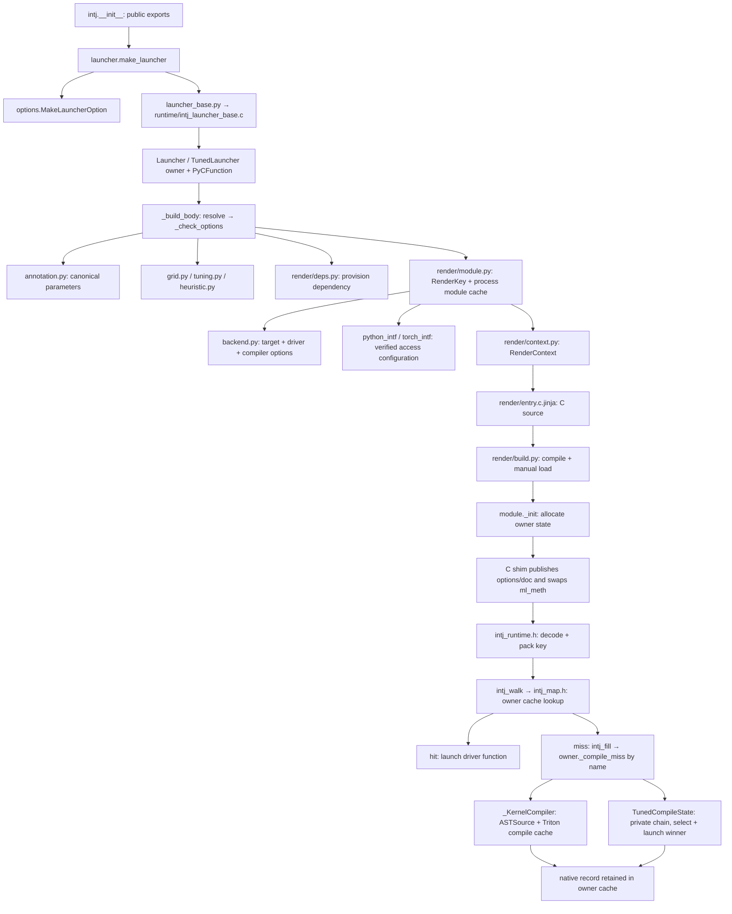

# intj/ structure for code review

Start with the five-file reading path below, then use the file sections to inspect a symbol’s inputs, dependencies and users.

**Reviewed baseline:** `0fa6f75f145555569ca0bec6b1defb16ccdd8111`, on 2026-10-23. This source-level map includes the move of ABI maintenance scripts into `intj/tools/` based on that revision; affected source anchors have been refreshed. Future code edits can invalidate signatures, line anchors and dependency relationships.

## Start here

1. Read [intj/__init__.py](../intj/__init__.py): the public package surface and its re-exports.
2. Read [intj/launcher.py](../intj/launcher.py), beginning at `make_launcher`, `Launcher._build_body` and `_KernelCompiler`: requested options, first build, and Python miss-time compilation.
3. Read [intj/render/module.py](../intj/render/module.py), then `RenderKey` and `RenderContext`: module identity, argument/key layout, ABI selection and rendering inputs.
4. Read [intj/render/entry.c.jinja](../intj/render/entry.c.jinja), beginning at `intj_bound_entry`, `intj_call`, `intj_walk` and `intj_fill`: the rendered launch, cache lookup and miss callback.
5. Read [intj/runtime/intj_runtime.h](../intj/runtime/intj_runtime.h): argument readers, specialization codes, object interning and launcher-state layout. Follow its ABI/map includes when reviewing those operations.

For tuning, follow `TunedLauncher` → `TunedCompileState` → `analyze`/`plan_tuning` in [intj/tuning.py](../intj/tuning.py), then [intj/heuristic.py](../intj/heuristic.py). For allocation and entry swapping, follow [intj/launcher_base.py](../intj/launcher_base.py) → [intj/runtime/intj_launcher_base.c](../intj/runtime/intj_launcher_base.c).

## Architecture and call paths

The factory records configuration and obtains the generic C stub; it does not build a kernel-specific module. A first call or explicit `build()` resolves delayed options, checks them, assembles a module key, reuses or builds a rendered module, initializes the owner’s C state and Python compile state, then swaps the existing function’s C entry. References captured before the build observe that swap.

A normal warmed launch enters C, parses device/stream/grid and dynamic values, validates/decodes kernel arguments, constructs the specialization key and looks up the owner’s cache. A hit calls the selected driver without entering `_compile_miss`. Object constexprs, interpreter tensor access, and Python grids can still call Python operations. Zero-grid and error cases have early-return paths described in the corresponding C definitions.

A miss leaves the cache lock before calling `Launcher._compile_miss(...)` by name. Ordinary owners compile/reuse through `_KernelCompiler`, return the driver record, and C launches it. Tuned owners execute an owner-private Triton wrapper chain, compile through the same compiler core and launch the winning kernel within that chain; C records the result and avoids launching it a second time. The insertion path rechecks the cache because another thread may have filled the same key during the callback.

### State ownership and lifetime

| State | Owner and lifetime | Main definitions |
| --- | --- | --- |
| Requested/resolved options, function method definition and build lock | One `intj_launcher` C owner. The PyCFunction keeps its owner alive; the embedded method definition changes entry after successful build. | `options.MakeLauncherOption`, `runtime/intj_launcher_base.h::intj_launcher`, `runtime/intj_launcher_base.c` |
| Native records, key/object memos, interned objects, bound values and cache lock | One dynamically allocated `intj_launcher_state` behind the owner’s state pointer. Its ops table reaches traversal/release; map pointers remain valid under the read lock. | `runtime/intj_runtime.h`, `runtime/intj_map.h`, template `intj_init` / `intj_traverse_state` / `intj_release` |
| Compiled Triton kernels, specialization check map and override | One Python `_compile_state` slot on each concrete launcher: `_KernelCompiler`, or `TunedCompileState` containing one. Python GC manages the slot. | `launcher._over_stub`, `Launcher._new_compile_state`, `_KernelCompiler`, `tuning.TunedCompileState` |
| Rendered module, driver pointers, type objects and ABI data | Module configuration initialized at load and retained by `render/module.py::_LOADED`. Sibling owners may reuse this module while keeping separate mutable launch/compiler state. | `RenderKey`, template `intj_state`, `intj_exec`, `_set_torch_abi`, `_set_launcher_type` |
| Cached module binaries and provisioned third-party libraries | On-disk Triton/INTJ cache directories. Identity includes source/template/header/compiler/ABI inputs; third-party dependencies are version/checksum pinned. | `launcher_base._digest`, `RenderKey.digest`, `render/build.py`, `render/deps.py` |

Rendered modules and the launcher base are loaded manually with `spec_from_file_location`/`module_from_spec`/`exec_module`, keeping them out of `sys.modules`. The rendered extension uses multi-phase initialization; interpreter-level single-phase module reuse would violate owner-state isolation.

### Boundaries to inspect during review

| Boundary | Information crossing it | Why it matters |
| --- | --- | --- |
| User → factory/options | Kernel and keyword values; delayed callback returns checked keyword mappings. | Validation is deferred to `check()`/build/first call. Copies make input container mutation independent of later checks. |
| Python → generated module build | Immutable `RenderKey`; derived `RenderContext`; ABI and backend configuration. | Equal keys must mean equivalent binaries and specialization behavior. Context computes values; template spells C. |
| C → Python miss callback | `keyblob, nparams, device, stream, controls, *dynamic, *args`. | Python runs outside native cache lock and owns compilation/tuning state. |
| Python miss → C record | Function handle, block dimension, shared bytes and packed parameter count; optional compiled-kernel/dependent/computed/meta values. | C retains owned references and validates packing. Tuned miss already performs the final launch. |
| Python/Torch objects → C readers → driver | Scalar bits, dtype/type codes, addresses, storage-size facts and parameter buffers. | A coarser-than-Triton key can launch the wrong binary; ABI layout errors can produce invalid pointers. |

## Coverage and interpretation

The following sections cover every tracked file under `intj/`: package Python code, render/build code, native runtime, CPython/Torch interfaces, and their local documentation/data. Files outside `intj/` appear only when they call, test, build, or explain the package; they have no separate review sections here.

Every named Python `class`, `def` and `async def` is represented, including methods, nested definitions, overload declarations and type-checking-only declarations. Dataclass rows include constructor fields; automatically generated equality/hash methods are described by the class rather than treated as separate source definitions. `self`/`cls` are implicit receivers; signatures retain them for accuracy. Enums take a member value or use named members; TypedDict classes describe dictionary schemas.

Native sections include C/C++ functions, record/struct types, compatibility shims and macro-generated families. Repeated definitions selected by preprocessor branches are documented together when they implement the same operation. Jinja macros are render-time helpers, not runtime callable symbols. Embedded generated C in the package ABI checkers is identified as such; code fences in local Markdown are examples, not live definitions. Anonymous lambdas are listed as source-located callbacks/expressions with their owner and inputs.

**“Depends on”** names direct substantive helpers, imports, fields, emitted C helpers and external APIs; file imports also provide shared context for that file’s definitions. **“Used by”** includes callers and non-call uses such as inheritance, type annotations, re-exports, registration tables, C slots, fixture injection and callback passing. Test references can be grouped by concrete file. The relationships are source-derived and conservative: Python dynamic receiver types, arbitrary user callbacks, `getattr`, copied Triton objects and runtime driver symbols cannot be exhaustively resolved by static inspection. “No resolved named reference” does not mean an API is unused.

**Validation:** verified file sections for all 52 `intj/` files (including four ABI-tool files and 13 versioned ABI files), a census of 337 named Python definitions and 14 lambdas, and 911 valid source links. For the tools move, `PYTHON=/tmp/gb2/bin/python ninja -C ci` passed formatting and Pyright (0 errors), with 179 CPU tests passed and 14 skipped. Four focused launcher tests passed for import isolation, both ABI detectors, and tensor-reader behavior, with one Torch warning. All three new CLI commands passed, including the CPython checker's explicit-header option; Torch 2.14 runtime and C++ results match the recorded version file. Parsed offsets and dtype maps for all 13 versions are unchanged. The wheel built successfully; isolated imports and all three CLI commands passed from its extracted contents, with both Torch detectors matching the packaged ABI data. The full GPU suite was not rerun for this tools move; other Torch/Python CI environments remain **untested** here. No launch benchmark was run, so no performance change is established.

## Navigation

| Area | Detailed sections | Review focus |
| --- | --- | --- |
| Public API and configuration | [Package and analysis files](#package-and-analysis-files) | Options, annotations, backend selection, compatibility calls and grid/heuristic lowering |
| Launcher and tuning | [Launcher and tuning](#launcher-and-tuning) | Factory, owner methods, compiler inputs/cache and tuning chain |
| Rendering, runtime and ABI | [Rendering, runtime and ABI interfaces](#rendering-runtime-and-abi-interfaces) | Module identity/build, templates, native cache/GC/locks and binary readers |

### Inventory counts

| Area | Tracked files | Named Python definitions |
| --- | ---: | ---: |
| Package root | 14 | 230 |
| Rendering and build | 7 | 74 |
| Native runtime | 5 | 0 |
| CPython interface | 5 | 4 |
| Torch interface | 17 | 14 |
| ABI tools | 4 | 15 |
| **Total** | **52** | **337** |

The Python census contains 271 functions/methods and 66 classes, plus 14 anonymous lambdas. Native functions/types, macro-generated families, Jinja helpers and embedded ABI-checker C add further rows.

# Package and analysis files

## `intj/__init__.py`

Public package exports: launcher factory, option and annotation values, backend selections, warning, version, and lazily exposed scalar type tuples. Importing this facade keeps Torch and Triton unloaded.

**File dependencies:** `intj._version`, `intj.annotation`, `intj.kernel_cache`, `intj.launcher`, `intj.options`, `intj.torch_intf.torch_abi`, `typing`. Public API names come from annotation.py, launcher.py, options.py, kernel_cache.py, torch_intf/torch_abi.py, and _version.py; scalar tuples load through annotation.__getattr__.

**Used by:** `benchmarks/bench_ffi_compare.py`, `benchmarks/bench_hip_module_launch.py`, `benchmarks/bench_intj_ffi_paths.py`, `benchmarks/bench_launch.py`, `benchmarks/bench_mix.py`, `intj/annotation.py`, `intj/backend.py`, `intj/compat.py`, `intj/grid.py`, `intj/heuristic.py`, `intj/render/deps.py`, `intj/launcher.py`, `intj/render/build.py`, `intj/render/module.py`, `intj/tools/abi_detect.py`, `intj/tools/cpp_detect.py`, `intj/torch_intf/torch_abi.py`, `intj/tuning.py`, `tests/test_annotation.py`, `tests/test_compat.py`, `tests/test_delayed.py`, `tests/test_grid.py`, `tests/test_kernel_cache.py`, `tests/test_launcher.py`, `tests/test_launcher_object.py`, `tests/test_python_compat.py`, `tests/test_return_compiled.py`, `tests/test_runtime.py`, `tests/test_tuned.py`.

| Symbol and parameters | Responsibility | Depends on | Used by |
| --- | --- | --- | --- |
| [__getattr__](../intj/__init__.py#L45) `__getattr__(name: str) -> Any` | Expose scalar type tuples computed on demand for package attribute lookup; reject any other missing attribute. | `getattr`, `AttributeError` | Python attribute lookup for `intj.INT_TYPES` / `FLOAT_TYPES`; users importing these exports |

## `intj/_imports.py`

The process-wide deferred-import gate. Caches Triton/Torch modules and the exact private compiler/runtime names needed elsewhere; caches missing/old Triton discovery as a value.

**File dependencies:** `functools`, `intj.errors`, `sys`, `torch`, `triton`, `triton._C.libtriton`, `triton._compile_warmup_state`, `triton._utils`, `triton.compiler`, `triton.language`, `triton.runtime`, `triton.runtime.autotuner`, `triton.runtime.driver`, `triton.runtime.jit`, `types`, `typing`. Triton and Torch imports are deferred inside functions; optional triton._compile_warmup_state is accepted when available. The interpreter class is inspected through sys.modules rather than imported.

**Used by:** `intj/annotation.py`, `intj/backend.py`, `intj/compat.py`, `intj/grid.py`, `intj/heuristic.py`, `intj/render/deps.py`, `intj/launcher.py`, `intj/render/build.py`, `intj/render/module.py`, `intj/tools/abi_detect.py`, `intj/tools/cpp_detect.py`, `intj/torch_intf/torch_abi.py`, `intj/tuning.py`, `tests/test_compat.py`.

| Symbol and parameters | Responsibility | Depends on | Used by |
| --- | --- | --- | --- |
| [ensure_triton_imported](../intj/_imports.py#L43) `ensure_triton_imported() -> None` | Discover supported Triton once, cache compiler/runtime/language names, and publish triton last so a successful gate means every cached name is ready. | `_find_triton`, `isinstance`, `_triton_required` | Every production Triton consumer through _imports; callers listed at file level and in corresponding definition rows; `intj/annotation.py` (6 named references; see its definitions); `intj/backend.py`: `canonical_options`, `current_device`, `current_target`; `intj/compat.py`: `_knob_key`, `_pointer_type`, `_target_key`, `launch`, `launch_or_interpret`; `intj/grid.py`: `compile_grid`; `intj/heuristic.py`: `_Emitter.__init__`; `intj/render/deps.py`: `_deps_root`; `intj/launcher.py` (13 named references; see its definitions); `intj/render/build.py`: `_compile_so_bytes`, `compiler_path`, `load`; `intj/render/module.py`: `_pointer_types`, `_triton_identity`; `intj/torch_intf/torch_abi.py`: `dtype_index_table`; `intj/tuning.py`: `_config_options`, `_private_chain`, `analyze`, `tuning_render`; tests/bench/CI: `tests/test_compat.py` |
| [_find_triton](../intj/_imports.py#L81) `_find_triton() -> types.ModuleType &#124; ModuleNotFoundError &#124; str` | Return the imported module, a missing-module error, or an unsupported version string; lru_cache remembers refusals without caching raised exceptions. | `tuple`, `map`, `version.split`, `functools.lru_cache` | `intj/_imports.py`: `ensure_triton_imported`; tests/bench/CI: `tests/test_launcher.py` |
| [interpreted_function](../intj/_imports.py#L105) `interpreted_function() -> Any` | Look up InterpretedFunction only if triton.runtime.interpreter is already in sys.modules. | `sys.modules.get`, `getattr` | `intj/launcher.py`: `_check_options` |
| [_triton_required](../intj/_imports.py#L116) `_triton_required(found: str) -> Exception` | Construct the install/version refusal exception with the discovered version suffix. | `UnsupportedKernel` | `intj/_imports.py`: `ensure_triton_imported` |
| [ensure_torch_imported](../intj/_imports.py#L122) `ensure_torch_imported() -> None` | Import Torch on first demand and retain it in the process-wide torch name. | deferred torch import; module-global torch cache | Torch ABI detection/builds, launch compilation/validation, compatibility calls and tensor type checks; `intj/compat.py`: `launch`; `intj/launcher.py`: `_check_options`; `intj/render/build.py`: `_lib_dirs_without_cpp_extension`; `intj/render/module.py`: `_cxx_abi`, `_torch_version_string`; `intj/tools/abi_detect.py`: `_main`, `_probes`, `_selfcheck`; `intj/tools/cpp_detect.py`: `measure`; `intj/torch_intf/torch_abi.py`: `dtype_index_table`, `live_dtypes`, `torch_version`; `intj/tuning.py`: `TunedCompileState._tune` |

## `intj/_version.py`

Single source of the package version (`0.1.0` at this revision); the build metadata and rendered-module identity consume it.

**File dependencies:** None. No imports. pyproject.toml points setuptools dynamic version metadata at this file; render/module.py adds the version to RenderKey module identity.

**Used by:** `intj/__init__.py`, `intj/launcher_base.py`, `intj/render/module.py`.

**Definitions:** none. Data: `__version__` is the package/cache-schema version.

## `intj/errors.py`

Defines the shared refusal exception; unsupported kernels and configurations raise it rather than silently changing launch paths.

**File dependencies:** None. Only built-in NotImplementedError.

**Used by:** `intj/_imports.py`, `intj/backend.py`, `intj/compat.py`, `intj/render/deps.py`, `intj/launcher.py`, `intj/launcher_base.py`, `intj/render/build.py`, `intj/render/module.py`, `intj/tuning.py`.

| Symbol and parameters | Responsibility | Depends on | Used by |
| --- | --- | --- | --- |
| [UnsupportedKernel](../intj/errors.py#L4) `UnsupportedKernel(*args)` | Shared NotImplementedError subtype for unsupported kernel/configuration refusals; inherits exception construction (message or *args). | built-in NotImplementedError | launcher/backend/render/compat refusal paths; tests assert this same class (launcher re-exports it); `intj/_imports.py`: `_triton_required`; `intj/backend.py`: `current_target`, `refuse_unknown_options`, `select`; `intj/compat.py`: `_pointer_type`, `_target_key`, `launch`; `intj/render/deps.py`: `_provision`; `intj/launcher.py` (7 named references; see its definitions); `intj/launcher_base.py`: `load_stub`; `intj/render/build.py`: `build_flags`; `intj/render/module.py`: `_build_module`, `_resolve_torch_access_mode`, `_verified_cpython_header`; `intj/tuning.py` (7 named references; see its definitions) |

## `intj/options.py`

Stores the complete requested factory configuration as a frozen dataclass, copies mutable input containers, and defines the keyword schema. Validation and delayed resolution belong to launcher.py.

**File dependencies:** `collections.abc`, `dataclasses`, `intj.kernel_cache`, `intj.torch_intf.torch_abi`, `typing`. OPTION_FIELDS is derived from dataclass fields, excluding jit_func and delayed; no independent duplicated keyword list is used for validation.

**Used by:** `intj/__init__.py`, `intj/launcher.py`, `tests/test_launcher_object.py`.

| Symbol and parameters | Responsibility | Depends on | Used by |
| --- | --- | --- | --- |
| [MakeLauncherOption](../intj/options.py#L14) `MakeLauncherOption(jit_func: Any, dynamic_options: Sequence[str] = (), extra_annotation: Mapping[str, object] &#124; None = None, options: Mapping[str, Any] &#124; None = None, torch_access_mode: TorchAccessMode &#124; None = None, kernel_cache: KernelCache = KernelCache.INTJ, no_gpu: bool = False, verify_annotation: bool = False, bind_device: int &#124; None = None, bind_values: Mapping[str, object] &#124; None = None, grid_arg: int &#124; None = None, grid_cpp: object &#124; None = None, grid_py: Callable[[dict[str, object]], object] &#124; None = None, return_compiled: bool = False, assume_constant_globals: bool = False, ndebug: bool = True, delayed: Callable[[], Mapping[str, Any]] &#124; None = None)` | Snapshot requested launcher configuration without validating it; generated dataclass constructor takes every field shown. Frozen outer value; input mappings and dynamic option sequence are copied. | KernelCache, TorchAccessMode, dataclasses; __post_init__ | `intj/launcher.py` (10 named references; see its definitions); `intj/options.py`: `module initialization/reference` |
| [MakeLauncherOption.__post_init__](../intj/options.py#L45) `MakeLauncherOption.__post_init__(self) -> None` | Copy extra_annotation/options/bind_values mappings and tuple-ize dynamic_options when possible; leave invalid values for check() to diagnose. | `getattr`, `isinstance`, `object.__setattr__`, `dict`, `tuple` | Dataclass construction and dataclasses.replace from launcher option edits (implicit) |
| [MakeLauncherKwargs](../intj/options.py#L59) `MakeLauncherKwargs(**optional_fields); fields: dynamic_options: Sequence[str], extra_annotation: Mapping[str, object] &#124; None, options: Mapping[str, Any] &#124; None, torch_access_mode: TorchAccessMode &#124; None, kernel_cache: KernelCache, no_gpu: bool, verify_annotation: bool, bind_device: int &#124; None, bind_values: Mapping[str, object] &#124; None, grid_arg: int &#124; None, grid_cpp: object &#124; None, grid_py: Callable[[dict[str, object]], object] &#124; None, return_compiled: bool, assume_constant_globals: bool, ndebug: bool` | TypedDict schema for optional factory keywords; constructs a dict, with the field set shown rather than a generated dataclass constructor. | TypedDict, KernelCache, TorchAccessMode | launcher.make_launcher typing schema; keyword callers; `intj/launcher.py`: `make_launcher`; tests/bench/CI: `tests/test_launcher_object.py` |

## `intj/annotation.py`

Defines public argument annotations and specialization promises, merges inline/extra/Triton annotations into canonical immutable values, and computes the key fields each parameter needs.

**File dependencies:** `collections.abc`, `dataclasses`, `enum`, `inspect`, `intj._imports`, `struct`, `sys`, `triton.language`, `types`, `typing`. Triton dtype/JITFunction objects are reached through _imports; torch.Tensor classification inspects already-loaded torch through sys.modules. TYPE_CHECKING imports do not load Triton at runtime.

**Used by:** `intj/__init__.py`, `intj/compat.py`, `intj/launcher.py`, `intj/render/context.py`, `intj/render/key.py`, `intj/render/module.py`, `intj/tuning.py`, `tests/test_annotation.py`, `tests/test_delayed.py`, `tests/test_launcher.py`, `tests/test_launcher_object.py`, `tests/test_runtime.py`, `tests/test_tuned.py`.

| Symbol and parameters | Responsibility | Depends on | Used by |
| --- | --- | --- | --- |
| [Fact](../intj/annotation.py#L22) `Fact()` | Immutable base marker for caller-promised specialization facts; no constructor fields. | frozen dataclasses | EqualTo/Aligned/PointerRange subclasses; Assume/Exactly validation; public annotation users; `intj/annotation.py` (9 named references; see its definitions) |
| [EqualTo](../intj/annotation.py#L27) `EqualTo(value: int)` | Promise integer equality to one; fact.value is validated when consumed by Assume/Exactly. | Fact | Public Assume/Exactly promises; _checked_facts/_FACT_CLASSES; annotation/launcher tests; `intj/annotation.py`: `_checked_facts`, `module initialization/reference` |
| [Aligned](../intj/annotation.py#L34) `Aligned(value: int)` | Promise divisibility by 16 for scalar/pointer specialization; fact.value is validated when consumed. | Fact | Public Assume/Exactly promises; _checked_facts/_FACT_CLASSES; annotation/launcher tests; `intj/annotation.py`: `_checked_facts`, `module initialization/reference` |
| [PointerRange](../intj/annotation.py#L41) `PointerRange(value: int)` | Promise entire underlying storage fits the AMD pointer-range specialization; accepts value=32 through fact validation (threshold 2**31-1 bytes). | Fact | Public Assume/Exactly promises; _checked_facts/_FACT_CLASSES; HIP annotation tests; `intj/annotation.py`: `_checked_facts`, `module initialization/reference` |
| [_checked_facts](../intj/annotation.py#L51) `_checked_facts(facts: tuple[Fact, ...], owner: str) -> tuple[Fact, ...]` | Require exact built-in Fact subclasses and exact supported integer values; return the immutable fact tuple or raise a clear type/value error. | `allowed.get`, `type`, `TypeError`, `getattr`, `ValueError` | `intj/annotation.py`: `Assume.__init__`, `Exactly.__init__` |
| [SpecializationPolicy](../intj/annotation.py#L68) `SpecializationPolicy()` | Immutable public policy base used by Argument; no fields. | frozen dataclasses | `intj/annotation.py` (6 named references; see its definitions) |
| [_Auto](../intj/annotation.py#L73) `_Auto()` | Singleton AUTO policy type: retain each applicable Triton specialization fact. | SpecializationPolicy | `intj/annotation.py`: `_specialization_modes`, `module initialization/reference` |
| [_Never](../intj/annotation.py#L78) `_Never()` | Singleton NEVER policy type: suppress each specialization fact. | SpecializationPolicy | `intj/annotation.py`: `_specialization_modes`, `module initialization/reference` |
| [Assume](../intj/annotation.py#L83) `Assume(*facts: Fact)` | Store explicit fact promises; unspecified applicable facts retain AUTO specialization. | SpecializationPolicy, _checked_facts, frozen dataclass storage | `intj/annotation.py`: `_specialization_modes` |
| [Assume.__init__](../intj/annotation.py#L94) `Assume.__init__(self, *facts: Fact) -> None` | Validate supplied fact promises and initialize the frozen facts tuple. | `object.__setattr__`, `_checked_facts` | Construction of Assume by users/tests (implicit constructor dispatch) |
| [Exactly](../intj/annotation.py#L107) `Exactly(*facts: Fact)` | Store exactly the supplied assumed facts; unspecified facts become NEVER. | SpecializationPolicy, _checked_facts, frozen dataclass storage | `intj/annotation.py`: `_specialization_modes` |
| [Exactly.__init__](../intj/annotation.py#L120) `Exactly.__init__(self, *facts: Fact) -> None` | Validate supplied fact promises and initialize the frozen facts tuple. | `object.__setattr__`, `_checked_facts` | Construction of Exactly by users/tests |
| [_Unset](../intj/annotation.py#L137) `_Unset()` | Singleton UNSET marker type for an unspecified annotation field, distinct from a field explicitly set to None. | frozen dataclasses | `intj/annotation.py`: `Argument`, `Argument.__post_init__`, `module initialization/reference` |
| [BindValue](../intj/annotation.py#L144) `BindValue(value) / named enum members` | Enum selecting tensor binding (read current pointer/storage each call) or pointer binding (capture address once); members TENSOR="tensor", POINTER="pointer". | enum.Enum | `intj/annotation.py`: `Argument`, `Argument.__post_init__`, `_merge_annotations`; tests/bench/CI: `tests/test_delayed.py`, `tests/test_launcher_object.py` |
| [_normalize_type_field](../intj/annotation.py#L156) `_normalize_type_field(value: object) -> object` | Snapshot a non-string type sequence as a tuple and reject empty choices; leave a single dtype/sentinel unchanged. | `isinstance`, `tuple`, `ValueError` | `intj/annotation.py`: `Argument.__post_init__`, `Constexpr.__post_init__` |
| [Annotation](../intj/annotation.py#L165) `Annotation()` | Immutable public base marker shared by ordinary Argument and Constexpr annotations. | frozen dataclasses | `intj/annotation.py`: `Argument`, `Constexpr` |
| [Argument](../intj/annotation.py#L170) `Argument(type: Any = UNSET, specialize: SpecializationPolicy &#124; _Unset = UNSET, value: object = UNSET, bind_value: BindValue &#124; None = None)` | Describe optional ordinary-parameter type allowlist, specialization policy, baked value or binding mode; generated constructor fields shown. | Annotation, SpecializationPolicy/UNSET, BindValue, __post_init__ | `intj/annotation.py`: `_annotation_source`, `_merge_annotations`; `intj/compat.py`: `_annotations`; tests/bench/CI: `tests/test_delayed.py`, `tests/test_launcher_object.py` |
| [Argument.__post_init__](../intj/annotation.py#L197) `Argument.__post_init__(self) -> None` | Normalize types, verify policy and binding-mode objects, reject simultaneous value/bind_value, and require baked values to hash. | `object.__setattr__`, `_normalize_type_field`, `isinstance`, `TypeError`, `ValueError`, `hash` | Dataclass constructor for Argument (implicit) |
| [Constexpr](../intj/annotation.py#L216) `Constexpr(type: Any = UNSET, power_of_two_or_zero: bool = False, value: object = UNSET)` | Describe a constexpr type allowlist, baked value, or power-of-two/zero compact-key promise; generated constructor fields shown. | Annotation, UNSET, __post_init__ | `intj/annotation.py`: `_annotation_source`, `_merge_annotations`; `intj/compat.py`: `_annotations`; tests/bench/CI: `tests/test_launcher_object.py` |
| [Constexpr.__post_init__](../intj/annotation.py#L237) `Constexpr.__post_init__(self) -> None` | Normalize type choices, require a boolean power promise, and require baked values to hash. | `object.__setattr__`, `_normalize_type_field`, `isinstance`, `TypeError`, `hash` | Dataclass constructor for Constexpr (implicit) |
| [__getattr__](../intj/annotation.py#L245) `__getattr__(name: str) -> Any` | Materialize/cache INT_TYPES or FLOAT_TYPES from deferred Triton dtype names; reject other missing attributes. | `AttributeError`, `_imports.ensure_triton_imported`, `globals` | Python attribute lookup for `intj.INT_TYPES` / `FLOAT_TYPES`; users importing these exports |
| [CacheKeyField](../intj/annotation.py#L257) `CacheKeyField(kind: str, width: int, offset: int = -1)` | Immutable key-field description with kind, byte width and byte offset (-1 until layout assigns it). | frozen dataclasses | `intj/annotation.py`: `CanonicalAnnotation`, `KeyLayout`, `_cache_key_fields`; `intj/render/context.py`: `_param_view`, `_write`; `intj/render/module.py`: `_dynamic_key_fields`, `_layout_fields`, `_spec_key_layout`; tests/bench/CI: `tests/test_annotation.py` |
| [DeviceBinding](../intj/annotation.py#L272) `DeviceBinding(value) / named enum members` | String enum marking fixed-device versus device-in-key layouts: FIXED="fixed", NOT_FIXED="not_fixed". | str and enum.Enum | `intj/launcher.py`: `_BuildOptions`, `_check_options`; `intj/render/context.py`: `RenderContext.from_key`; `intj/render/key.py`: `RenderKey`; `intj/render/module.py`: `_layout_fields`, `_spec_key_layout`; `intj/tuning.py`: `tuning_render`; tests/bench/CI: `tests/test_annotation.py`, `tests/test_launcher.py`, `tests/test_runtime.py` |
| [KeyLayout](../intj/annotation.py#L280) `KeyLayout(fields: tuple[tuple[int, CacheKeyField], ...], device_offset: int &#124; None, nwords: int)` | Immutable placed key fields, optional device byte offset and total uint64 word count. | CacheKeyField | `intj/render/module.py`: `_layout_fields` |
| [CanonicalAnnotation](../intj/annotation.py#L296) `CanonicalAnnotation(kind: str, types: tuple[str &#124; None, ...] &#124; None, equal_to_one: str, aligned_16: str, pointer_range_32: str, facts: tuple[tuple[str, int], ...], power_of_two_or_zero: bool, bind_value: str &#124; None, baked_value: tuple[object, ...], key_fields: tuple[CacheKeyField, ...] = (), tuned: bool = False, exact_key: bool = False, triton_typed: bool = False, tensor_only: bool = False, none_ok: bool = False)` | Canonical parameter meaning for the renderer and compiler: effective types, per-fact modes, baked tag/binding, key fields, tuned/exact roles and annotation conversion constraints. | CacheKeyField tuple and canonical immutable values | `intj/annotation.py`: `ResolvedParam`, `_cache_key_fields`, `_merge_annotations`; `intj/launcher.py`: `_lists_attrs`; `intj/render/context.py`: `ParamView`, `_bound_checks`, `_checks`, `_needs_generic_decode`; `intj/render/key.py`: `Param`; `intj/render/module.py`: `_object_capable`; tests/bench/CI: `tests/test_launcher.py`, `tests/test_runtime.py` |
| [ResolvedParam](../intj/annotation.py#L329) `ResolvedParam(name: str, index: int, annotation: CanonicalAnnotation, baked: object = UNSET)` | Associate kernel parameter name/index with its canonical annotation and optional baked Python value; baked is excluded from equality/hash. | CanonicalAnnotation, UNSET | `intj/annotation.py`: `_merge_annotations`; `intj/launcher.py`: `_BuildOptions`, `_check_options`, `_parameter_options`; `intj/render/module.py`: `_spec_key_layout`; `intj/tuning.py`: `_config_options`, `check_tuned_configs`, `plan_tuning`, `tuning_render`; tests/bench/CI: `tests/test_launcher.py`, `tests/test_runtime.py` |
| [_canonical_value](../intj/annotation.py#L345) `_canonical_value(value: object) -> tuple[object, ...]` | Encode baked/interner values as deterministic hashable JSON-compatible tags (including float bits and JIT source identity); reject unsupported values. | _imports dtype/JITFunction names, struct.pack, JITFunction.cache_key | `intj/annotation.py`: `_merge_annotations`; `intj/launcher.py`: `_Interner.__call__`, `_canonical_global`, `_compiler_input`; tests/bench/CI: `tests/test_annotation.py` |
| [_tensor_annotation](../intj/annotation.py#L384) `_tensor_annotation(value: object) -> str &#124; None` | Recognize torch.Tensor/tl.tensor and their optional forms from objects or postponed strings; inspect already-loaded Torch without importing it. | `_imports.ensure_triton_imported`, `type`, `''.join(value.split()).replace`, `''.join`, `value.split`, `sys.modules.get`, `any`, `getattr`, `typing.get_origin`, `typing.get_args`, `len` | `intj/annotation.py`: `_merge_annotations` |
| [_annotation_source](../intj/annotation.py#L416) `_annotation_source(value: object, name: str) -> Argument &#124; Constexpr &#124; None` | Interpret a raw annotation/shorthand as Argument, Constexpr or no annotation; reject unsupported spelling. | `_imports.ensure_triton_imported`, `type`, `Constexpr`, `Argument`, `isinstance`, `ValueError` | `intj/annotation.py`: `_merge_annotations` |
| [_merge_field](../intj/annotation.py#L436) `_merge_field(name: str, field: str, left: object, right: object, *, kind: str='argument') -> object` | Merge inline and extra fields, letting UNSET defer; compare type allowlists canonically and float values by bits; reject conflicting values. | `_canonical_types`, `type`, `struct.pack`, `ValueError` | `intj/annotation.py`: `_merge_annotations` |
| [_specialization_modes](../intj/annotation.py#L471) `_specialization_modes(value: object) -> tuple[object, object, object]` | Translate UNSET/AUTO/NEVER/Assume/Exactly into equality/alignment/pointer-range modes; detect duplicate/conflicting fact promises. | `type`, `ValueError`, `_FACT_CLASSES.get`, `TypeError`, `getattr`, `_FACT_NAMES.index`, `tuple` | `intj/annotation.py`: `_merge_annotations` |
| [_type_name](../intj/annotation.py#L501) `_type_name(value: object, kind: str, *, element: bool=False) -> str &#124; None` | Convert supported Triton scalar/global-pointer types to canonical names such as i32 or *fp16; reject invalid address-space/const/unsupported type combinations. | `_imports.ensure_triton_imported`, `type`, `ValueError`, `_type_name`, `name.startswith` | `intj/annotation.py`: `_canonical_types`; tests/bench/CI: `tests/test_annotation.py` |
| [_canonical_types](../intj/annotation.py#L534) `_canonical_types(value: object, kind: str) -> tuple[str &#124; None, ...] &#124; None` | Normalize a single type/tuple allowlist into sorted unique canonical names; AUTO/UNSET means inference, while AUTO inside a tuple is rejected. | `isinstance`, `any`, `ValueError`, `_type_name`, `tuple`, `sorted` | `intj/annotation.py`: `_merge_annotations`, `_merge_field` |
| [_inferred_scalar_type](../intj/annotation.py#L544) `_inferred_scalar_type(value: object) -> str &#124; None` | Classify baked None/bool/float/int into Triton scalar types and enforce signed/unsigned integer bounds. | `type`, `ValueError` | `intj/annotation.py`: `_merge_annotations` |
| [_fits_scalar](../intj/annotation.py#L566) `_fits_scalar(value: object, name: str &#124; None, kind: str) -> bool` | Test whether a baked value fits a canonical type; constexpr fp32 requires exact round-trip, ordinary fp32 allows conversion; pointer baking does not fit. | `name.startswith`, `type`, `int`, `struct.unpack`, `struct.pack` | `intj/annotation.py`: `_merge_annotations` |
| [_applicable](../intj/annotation.py#L590) `_applicable(name: str &#124; None, field: str) -> bool` | Decide whether a specialization fact is meaningful for a canonical scalar/pointer branch. | `name.startswith` | `intj/annotation.py`: `_cache_key_fields`, `_merge_annotations`; `intj/launcher.py`: `_compiler_input`, `_lists_attrs` |
| [_cache_key_fields](../intj/annotation.py#L600) `_cache_key_fields(annotation: CanonicalAnnotation) -> tuple[CacheKeyField, ...]` | Calculate unplaced descriptor/payload/exact fields from a canonical annotation; omit fields for baked/bound/tuned values and fixed-None constexprs; compact power-of-two/zero constexprs contribute one payload byte. | CanonicalAnnotation, CacheKeyField, _applicable, _FACT_NAMES | `intj/render/module.py`: `_spec_key_layout`; tests/bench/CI: `tests/test_annotation.py`, `tests/test_tuned.py` |
| [_merge_annotations](../intj/annotation.py#L651) `_merge_annotations(jit_func: Any, extra_annotation: Mapping[str, object] &#124; None) -> tuple[ResolvedParam, ...]` | Merge all kernel parameters against extra annotations and Triton flags, validate types/promises/baked/bound/tensor roles, and return ordered ResolvedParam values. | _annotation_source, _tensor_annotation, _merge_field, _specialization_modes, _canonical_types/_value, _fits_scalar/_applicable, CanonicalAnnotation/ResolvedParam, Triton parameter metadata | `intj/launcher.py`: `_check_options`; tests/bench/CI: `tests/test_annotation.py`, `tests/test_launcher.py` |

**Data consumers:** `AUTO`, `NEVER`, `UNSET` are singleton policy/absence markers. `_FACT_NAMES` and `_FACT_CLASSES` drive fact validation/merging; canonical annotations carry only immutable value information to render/key.py. Dataclass-generated equality/hash/constructors are implicit, rather than separately source-defined methods.

**Anonymous functions (inputs and consumers)**

| Symbol and parameters | Responsibility | Depends on | Used by |
| --- | --- | --- | --- |
| [lambda@541](../intj/annotation.py#L541) `lambda(name) -> tuple[bool, str]` | Order canonical type names with None first and remaining names lexically. | Builtin comparisons; canonical name values | _canonical_types passes it as sorted(key=...) |
| [lambda@821](../intj/annotation.py#L821) `lambda(ty) -> tuple[int, str]` | Rank fitting constexpr types by scalar width and name to choose the smallest supported representation. | Canonical type spellings; int(ty[1:]) | _merge_annotations passes it as min(key=...) |

## `intj/backend.py`

Represents driver differences as backend data, registers HIP/CUDA, selects the host stub or active target, and normalizes compiler options and knobs.

**File dependencies:** `abc`, `collections.abc`, `dataclasses`, `intj._imports`, `intj.errors`, `intj.launcher`, `triton.backends.amd`, `typing`. HIP library resolution defers triton.backends.amd.driver; HostBackend.library_path defers launcher._stub to avoid the startup cycle. Driver symbol names and error style feed render/module.py and entry.c.jinja.

**Used by:** `intj/launcher.py`, `intj/render/module.py`, `intj/tuning.py`, `tests/knob_helpers.py`, `tests/test_grid.py`, `tests/test_launcher.py`.

| Symbol and parameters | Responsibility | Depends on | Used by |
| --- | --- | --- | --- |
| [Backend](../intj/backend.py#L14) `Backend() abstract; descriptor fields: name: str, launch_symbol: str, device_symbol: str, error_symbol: str, error_style: str, pointer_range: bool` | Abstract driver description (name, launch/device/error symbols, error style, pointer-range support); subclasses provide library_path(), with no constructor parameters. | abc.ABC; descriptor fields and library_path contract | `intj/backend.py` (6 named references; see its definitions) |
| [Backend.library_path](../intj/backend.py#L38) `Backend.library_path(self) -> str` | Abstract operation for locating the driver shared library to dlopen. | abc.abstractmethod | Polymorphic call in render/module._build_module; abstract base contract |
| [HipBackend](../intj/backend.py#L42) `HipBackend()` | HIP driver descriptor using hipModuleLaunchKernel/hipDeviceGet/hipGetErrorString, return-style errors and pointer-range specialization. | Backend | `intj/backend.py`: `module initialization/reference` |
| [HipBackend.library_path](../intj/backend.py#L52) `HipBackend.library_path(self) -> str` | Resolve HIP runtime with Triton AMD driver’s own private library search. | `driver._get_path_to_hip_runtime_dylib` | render/module._build_module through selected backend descriptor |
| [CudaBackend](../intj/backend.py#L60) `CudaBackend()` | CUDA descriptor using cuLaunchKernel/cuDeviceGet/cuGetErrorString, out-parameter error text and no pointer-range bit. | Backend | `intj/backend.py`: `module initialization/reference` |
| [CudaBackend.library_path](../intj/backend.py#L73) `CudaBackend.library_path(self) -> str` | Return libcuda.so.1 for the loader’s normal search path. | enclosing state / builtin operations | render/module._build_module through selected backend descriptor |
| [HostBackend](../intj/backend.py#L77) `HostBackend()` | CPU no-op backend whose driver functions are exported by _intj_launcher_base; has no Triton compilation target and is selected only by no_gpu. | Backend | `intj/backend.py`: `module initialization/reference` |
| [HostBackend.library_path](../intj/backend.py#L92) `HostBackend.library_path(self) -> str` | Ensure/load the process launcher base and return its extension-library path. | `_stub` | render/module._build_module through HOST descriptor |
| [register](../intj/backend.py#L106) `register(backend: Backend) -> Backend` | Insert/replace a backend instance by its Triton target name in BACKENDS and return that instance. | enclosing state / builtin operations | `intj/backend.py`: `module initialization/reference` |
| [select](../intj/backend.py#L120) `select(no_gpu: bool) -> tuple[Backend, Any]` | Select HOST with no target for no_gpu, otherwise choose a registered descriptor for the current Triton target; refuse unavailable/unknown targets. | `current_target`, `BACKENDS.get`, `UnsupportedKernel`, `', '.join`, `sorted` | `intj/launcher.py`: `Launcher._new_compile_state`; `intj/render/module.py`: `_build_module` |
| [current_target](../intj/backend.py#L141) `current_target() -> Any` | Obtain the active Triton target after deferred import; refuse no visible GPU target. | `_imports.ensure_triton_imported`, `_imports.driver.active.get_current_target`, `UnsupportedKernel` | `intj/backend.py`: `select`; `intj/launcher.py`: `_KernelCompiler.__init__`; `intj/tuning.py`: `check_tuned_configs`; tests/bench/CI: `tests/test_launcher.py` |
| [current_device](../intj/backend.py#L154) `current_device() -> int` | Return the current device ordinal from the active Triton driver. | `_imports.ensure_triton_imported`, `_imports.driver.active.get_current_device` | `intj/launcher.py`: `_KernelCompiler.compile`, `_check_device`, `triton_specialization` |
| [canonical_options](../intj/backend.py#L160) `canonical_options(target: Any, options: Mapping[str, Any]) -> Any` | Parse compiler options through the target backend, filling defaults/normalizing values and refusing names that parsing would silently discard. | `_imports.ensure_triton_imported`, `_imports.make_backend(target).parse_options`, `_imports.make_backend`, `dict`, `refuse_unknown_options` | `intj/launcher.py`: `_KernelCompiler.canonical`; `intj/render/module.py`: `_build_module`; `intj/tuning.py`: `check_tuned_configs`; tests/bench/CI: `tests/test_launcher.py` |
| [refuse_unknown_options](../intj/backend.py#L177) `refuse_unknown_options(parsed: Any, names: Iterable[str]) -> None` | Compare option names with parsed dataclass fields and raise UnsupportedKernel for unknown names. | `set`, `dataclasses.fields`, `UnsupportedKernel`, `sorted` | `intj/backend.py`: `canonical_options`; `intj/render/module.py`: `_build_module` |
| [_knob_options](../intj/backend.py#L184) `_knob_options(jit_func: Any, options: Mapping[str, Any], knob_values: Mapping[str, object]) -> dict[str, Any]` | Merge explicit options with kernel debug default and runtime/compilation knob values, using defaults for dynamically supplied knobs outside their miss. | `dict`, `options.get`, `knob_values.get` | `intj/launcher.py`: `_KernelCompiler.canonical`, `triton_specialization`; `intj/render/module.py`: `_build_module`; `intj/tuning.py`: `check_tuned_configs`; tests/bench/CI: `tests/test_launcher.py` |

## `intj/compat.py`

Migration adapter for Triton-style indexed calls: binds Python arguments, unwraps TensorWrapper values, bakes object constexprs, caches native launchers, obtains device/stream, and preserves callable-grid context in thread-local storage.

**File dependencies:** `functools`, `intj._imports`, `intj.annotation`, `intj.errors`, `intj.launcher`, `threading`, `typing`. Triton/Torch runtime names are loaded through _imports. Generated launcher calls are opaque native PyCFunctions; compatibility caching uses two bounded lru_cache instances.

**Used by:** `tests/test_compat.py`, `tests/test_tensor_wrapper_compat.py`.

| Symbol and parameters | Responsibility | Depends on | Used by |
| --- | --- | --- | --- |
| [_pointer_type](../intj/compat.py#L19) `_pointer_type(dtype: Any) -> Any` | Normalize a TensorWrapper dtype to a Triton pointer type; wrap unsupported dtype conversions as UnsupportedKernel. | `_imports.ensure_triton_imported`, `isinstance`, `tl.str_to_ty`, `_imports.canonicalize_dtype`, `tl.pointer_type`, `UnsupportedKernel` | `intj/compat.py`: `_annotations`; tests/bench/CI: `tests/test_compat.py` |
| [_annotations](../intj/compat.py#L32) `_annotations(baked: tuple[tuple[str, Any], ...], wrapped_types: tuple[tuple[str, Any], ...]) -> dict[str, Argument &#124; Constexpr]` | Build Constexpr(value=...) annotations for baked object constexprs and Argument(type=pointer dtype) annotations for TensorWrappers. | `Constexpr`, `Argument`, `_pointer_type` | `intj/compat.py`: `_make`, `_make_grid_py` |
| [_make](../intj/compat.py#L41) `_make(kernel: Any, device: int, dimensions: int, options: tuple[tuple[str, Any], ...], baked: tuple[tuple[str, Any], ...], wrapped_types: tuple[tuple[str, Any], ...], return_compiled: bool) -> Any` | Construct a dimension-argument native launcher fixed to a device with normalized compile options/annotations and return mode. | `make_launcher`, `dict`, `_annotations` | `intj/compat.py`: `_cached`, `launch` |
| [_cached](../intj/compat.py#L61) `_cached(kernel: Any, source_key: str, device: int, dimensions: int, options: tuple[tuple[str, Any], ...], baked: tuple[tuple[str, Any], ...], wrapped_types: tuple[tuple[str, Any], ...], return_compiled: bool, target: tuple[str, str, int], debug: object, instrumentation: object, fpsan_casts: object) -> Any` | Cache up to 256 fixed-grid native launchers; extra source/target/knob parameters contribute to identity even though creation discards them. | lru_cache(maxsize=256), _make; identity arguments | `intj/compat.py`: `launch`; tests/bench/CI: `tests/test_compat.py` |
| [_calling_grid](../intj/compat.py#L85) `_calling_grid(meta: dict[str, object]) -> object` | Evaluate the current thread’s grid using meta plus original TensorWrappers; preserves caller-specific wrappers without pinning one grid in a cached launcher. | `_CALL.grid` | Native grid_py callback retained by _make_grid_py; calls current thread’s grid during each launch; `intj/compat.py`: `_make_grid_py` |
| [_cached_grid_py](../intj/compat.py#L96) `_cached_grid_py(kernel: Any, source_key: str, options: tuple[tuple[str, Any], ...], baked: tuple[tuple[str, Any], ...], wrapped_types: tuple[tuple[str, Any], ...], return_compiled: bool, target: tuple[str, str, int], debug: object, instrumentation: object, fpsan_casts: object) -> Any` | Cache up to 256 native callable-grid launchers by source/options/annotations/target/knobs, with current grid fetched at call time. | lru_cache(maxsize=256), _make_grid_py; identity arguments | `intj/compat.py`: `launch`; tests/bench/CI: `tests/test_compat.py` |
| [_make_grid_py](../intj/compat.py#L117) `_make_grid_py(kernel: Any, options: tuple[tuple[str, Any], ...], baked: tuple[tuple[str, Any], ...], wrapped_types: tuple[tuple[str, Any], ...], return_compiled: bool) -> Any` | Construct a native grid_py launcher using the shared _calling_grid callback. | `make_launcher`, `dict`, `_annotations` | `intj/compat.py`: `_cached_grid_py`, `launch` |
| [launch](../intj/compat.py#L133) `launch(kernel: Any, grid: Any, /, *args: Any, return_compiled: bool=False, **kwargs: Any) -> Any` | Adapt indexed Triton calls into native launcher calls: bind arguments/defaults, normalize wrappers, reject hooks/unpinned CPU pointers, resolve cache identity and current device/stream, and dispatch numeric or callable grids. Optional compile-warmup runtime intentionally routes to intercepted Triton calls. | _imports, signature.bind/apply_defaults, TensorWrapper/Torch pointer checks, _target_key/_knob_key, _cached/_make and callable-grid variants, _CALL | launch_or_interpret; tests/test_compat.py and tests/test_tensor_wrapper_compat.py; external Triton-style callers; `intj/compat.py`: `launch_or_interpret`; tests/bench/CI: `tests/test_compat.py`, `tests/test_tensor_wrapper_compat.py` |
| [_target_key](../intj/compat.py#L293) `_target_key() -> tuple[str, str, int]` | Build compatibility-cache identity from current target backend, architecture repr and warp size; refuse a missing target. | `_imports.ensure_triton_imported`, `_imports.driver.active.get_current_target`, `UnsupportedKernel`, `repr` | `intj/compat.py`: `launch` |
| [_knob_key](../intj/compat.py#L301) `_knob_key() -> tuple[object, object, object]` | Return debug, instrumentation and optional fpsan knobs that affect a launcher’s initial build. | `_imports.ensure_triton_imported`, `getattr` | `intj/compat.py`: `launch` |
| [launch_or_interpret](../intj/compat.py#L312) `launch_or_interpret(kernel: Any, grid: Any, /, *args: Any, return_compiled: bool=False, **kwargs: Any) -> Any` | Use Triton’s indexed interpreter call while runtime.interpret is enabled; otherwise route through compat.launch. | `_imports.ensure_triton_imported`, `kernel[grid]`, `launch` | Public migration bridge; compatibility tests and external migrated call sites; tests/bench/CI: `tests/test_compat.py` |

**Lifetime:** `_cached` and `_cached_grid_py` retain up to 256 launcher identities each; every retained launcher owns its compiler/cache. `_CALL.grid` and `_CALL.wrapped` hold only the current thread’s callable-grid context and are restored in `finally`, including recursive calls.

## `intj/grid.py`

Validates the supported annotated Python grid subset without executing the function and lowers it to checked C arithmetic. The generated `intj_eval_grid` reads call arguments or tuned dependencies and writes launch dimensions.

**File dependencies:** `ast`, `builtins`, `collections.abc`, `dataclasses`, `inspect`, `intj._imports`, `intj.launcher`, `json`, `textwrap`, `types`, `typing`. launcher.Param is a TYPE_CHECKING-only import (the actual value type is defined in render/key.py and re-exported by launcher). Emitted code calls runtime/intj_runtime.h intj_grid_* readers/arithmetic/output helpers and is inserted by render/entry.c.jinja.

**Used by:** `intj/launcher.py`, `intj/tuning.py`.

| Symbol and parameters | Responsibility | Depends on | Used by |
| --- | --- | --- | --- |
| [GridError](../intj/grid.py#L23) `GridError(*args)` | ValueError subtype for unsupported native-grid source; inherited exception constructor takes message/*args. | built-in ValueError | `intj/grid.py`: `compile_grid`, `compile_grid.fail`; `intj/launcher.py`: `_check_options` |
| [GridCode](../intj/grid.py#L28) `GridCode(extras: tuple[str, ...], source: str)` | Immutable generated evaluator source and ordered extra-argument names. | frozen dataclasses | `intj/grid.py`: `compile_grid`; `intj/launcher.py`: `_BuildOptions`, `_check_options`, `_launch_doc`; `intj/tuning.py`: `tuned_grid` |
| [compile_grid](../intj/grid.py#L41) `compile_grid(fn: object, params: Sequence[Param], baked: Mapping[int, object], deps: Mapping[str, int] &#124; None=None, offset: int=0) -> GridCode` | Validate an undecorated def with typed int/bool parameters and supported statements, map inputs to public/baked/tuned values, and return checked intj_eval_grid C source without executing fn. | AST/inspect/types, _imports, Param annotations, nested fail/temp/emit; emitted intj_grid_* | `intj/launcher.py`: `_check_options` |
| [compile_grid.fail](../intj/grid.py#L78) `compile_grid.fail(node: ast.AST, message: str) -> GridError` | Build a GridError pointing to the original function source line for an unsupported AST node. | `getattr`, `GridError` | `intj/grid.py`: `compile_grid`, `compile_grid.emit` |
| [compile_grid.temp](../intj/grid.py#L158) `compile_grid.temp() -> str` | Allocate the next deterministic gv_<n> C temporary name using the enclosing serial counter. | enclosing state / builtin operations | `intj/grid.py`: `compile_grid`, `compile_grid.emit` |
| [compile_grid.emit](../intj/grid.py#L211) `compile_grid.emit(node: ast.AST, indent: str='  ') -> tuple[str, str]` | Recursively lower supported expression AST nodes into typed C temporaries with checked arithmetic, short-circuited conditional branches and validated builtin min/triton.cdiv identity. | `isinstance`, `type`, `int`, `fail`, `temp`, `lines.append`, `emit`, `operations.get`, `len` | compile_grid statement/dimension lowering; recursive emit calls; `intj/grid.py`: `compile_grid` |

## `intj/heuristic.py`

Locates heuristic source, identifies metadata dependencies, and lowers supported computed heuristics into C evaluators with Python-like short-circuit behavior and checked scalar/tensor operations.

**File dependencies:** `ast`, `builtins`, `collections.abc`, `dataclasses`, `inspect`, `intj._imports`, `json`, `linecache`, `types`, `typing`. The generated C uses runtime/intj_runtime.h intj_heur_arg/intj_heur_tensor/intj_heur_dtype helpers and intj_grid_* arithmetic, plus tensor readers; tuning.py supplies Source slots and inserts evaluator source into the RenderKey.

**Used by:** `intj/tuning.py`, `tests/test_tuning.py`.

| Symbol and parameters | Responsibility | Depends on | Used by |
| --- | --- | --- | --- |
| [HeuristicError](../intj/heuristic.py#L25) `HeuristicError(*args)` | ValueError subtype for invalid heuristic source/unsupported lowering; inherited exception constructor. | built-in ValueError | `intj/heuristic.py`: `_Emitter.fail`, `_locate`, `_subscript_key`, `parse_heuristic`; `intj/tuning.py`: `analyze`, `tuning_render`; tests/bench/CI: `tests/test_tuning.py` |
| [Heuristic](../intj/heuristic.py#L30) `Heuristic(name: str, inputs: tuple[str, ...], arg: str, expr: ast.expr, fn: Any, where: str = '')` | Frozen parsed heuristic output name, ordered input names, parameter identifier, expression AST, callable and source location; expr and fn are excluded from equality/hash/repr. | dataclasses, AST expr and original callable | `intj/heuristic.py`: `_Emitter.__init__`, `lower`, `parse_heuristic`; `intj/tuning.py`: `Computed` |
| [parse_heuristic](../intj/heuristic.py#L41) `parse_heuristic(name: str, fn: object) -> Heuristic` | Locate a single-argument lambda/def expression, forbid captures/unsupported signature/body, require metadata reads as arg["literal"], and return ordered input dependencies. | `type`, `HeuristicError`, `_locate`, `isinstance`, `len`, `ast.walk`, `_subscript_key`, `sum`, `Heuristic`, `tuple` | `intj/tuning.py`: `analyze`; tests/bench/CI: `tests/test_tuning.py` |
| [_subscript_key](../intj/heuristic.py#L101) `_subscript_key(node: ast.AST, arg: str, where: str) -> str &#124; None` | Extract the literal metadata key from arg["name"]; return None for unrelated nodes or reject dynamic indexing of the metadata argument. | `isinstance`, `type`, `HeuristicError` | `intj/heuristic.py`: `_Emitter.input`, `parse_heuristic` |
| [_locate](../intj/heuristic.py#L121) `_locate(fn: types.FunctionType) -> ast.Lambda &#124; ast.FunctionDef` | Parse the callable’s source file and match candidate lambda/def nodes to its code object; use stricter bytecode comparison to disambiguate shared-line lambdas. | `linecache.getlines`, `HeuristicError`, `ast.parse`, `''.join`, `ast.walk`, `isinstance`, `min`, `_same_code`, `matches.append`, `len` | `intj/heuristic.py`: `parse_heuristic` |
| [_same_code](../intj/heuristic.py#L155) `_same_code(node: ast.Lambda &#124; ast.FunctionDef, code: types.CodeType, strict: bool) -> bool` | Compile a candidate AST and compare nested code names/variables/constants (plus bytecode in strict mode) to the callable code object. | `isinstance`, `compile`, `ast.Expression`, `ast.Module`, `any` | `intj/heuristic.py`: `_locate` |
| [Source](../intj/heuristic.py#L210) `Source(kind: str, index: int = 0, value: object = None)` | Immutable C-input location: caller argument, fixed value, dependent slot or computed slot, with index/value as applicable. | dataclasses | `intj/heuristic.py`: `_Emitter.__init__`, `_Emitter.input`, `lower`; `intj/tuning.py`: `tuning_render`; tests/bench/CI: `tests/test_tuning.py` |
| [lower](../intj/heuristic.py#L218) `lower(computed: Sequence[tuple[Heuristic, int]], sources: Mapping[str, Source], levels: int) -> str` | Emit one intj_tuned_level_<n> C evaluator per level, storing each computed value and boolean-kind pair at its global computed slot. | Heuristic/Source, _Emitter.emit; generated intj_tuned_level_<n> | `intj/tuning.py`: `tuning_render`; tests/bench/CI: `tests/test_tuning.py` |
| [_Emitter](../intj/heuristic.py#L253) `_Emitter(h: Heuristic, sources: Mapping[str, Source], lines: list[str], serial: list[int])` | Mutable per-heuristic emitter sharing output lines and deterministic serial numbering. Fields: h, sources, lines, serial, builtins_ok and triton_ok; records approved namespace identities and checks them when emitting relevant operations. | Heuristic, Source, _BUILTIN/_TRITON/_TENSOR_METHODS/_ARITH/_COMPARE; emitter methods | `intj/heuristic.py`: `lower` |
| [_Emitter.__init__](../intj/heuristic.py#L256) `_Emitter.__init__(self, h: Heuristic, sources: Mapping[str, Source], lines: list[str], serial: list[int])` | Store heuristic/source maps/output buffers and record whether builtin min/max and the Triton module resolve to approved implementations. | `namespace.get`, `getattr`, `_BUILTIN.items`, `_imports.ensure_triton_imported` | lower constructs one _Emitter per computed heuristic |
| [_Emitter.fail](../intj/heuristic.py#L272) `_Emitter.fail(self, node: ast.AST, message: str) -> HeuristicError` | Construct a source-located HeuristicError naming the affected heuristic. | `HeuristicError` | `intj/heuristic.py`: `_Emitter.emit`, `_Emitter.tensor_arg`, `_Emitter.tensor_call` |
| [_Emitter.temp](../intj/heuristic.py#L275) `_Emitter.temp(self) -> str` | Increment shared serial counter and return an hv_<n> temporary name. | enclosing state / builtin operations | `intj/heuristic.py`: `_Emitter.dtype`, `_Emitter.fixed_kind`, `_Emitter.pair` |
| [_Emitter.pair](../intj/heuristic.py#L279) `_Emitter.pair(self, indent: str) -> tuple[str, str]` | Declare a pair of int64 C temporaries for value and boolean-kind, initialized to zero. | `self.temp`, `self.lines.append` | `intj/heuristic.py`: `_Emitter.emit` |
| [_Emitter.fixed_kind](../intj/heuristic.py#L284) `_Emitter.fixed_kind(self, indent: str, is_bool: bool) -> tuple[str, str]` | Declare one int64 value temporary and return a literal kind expression derived from syntax. | `self.temp`, `self.lines.append` | `intj/heuristic.py`: `_Emitter.emit`, `_Emitter.tensor_call` |
| [_Emitter.input](../intj/heuristic.py#L290) `_Emitter.input(self, node: ast.expr) -> tuple[str, Source] &#124; None` | Recognize a metadata subscript and return its name plus configured Source location. | `_subscript_key` | `intj/heuristic.py`: `_Emitter.emit`, `_Emitter.tensor_arg` |
| [_Emitter.tensor_arg](../intj/heuristic.py#L294) `_Emitter.tensor_arg(self, node: ast.expr, what: str) -> tuple[str, int]` | Require a metadata input to refer to a caller argument tensor; return its name/index or raise. | `self.input`, `self.fail` | `intj/heuristic.py`: `_Emitter.dtype`, `_Emitter.tensor_call` |
| [_Emitter.emit](../intj/heuristic.py#L300) `_Emitter.emit(self, node: ast.expr, indent: str) -> tuple[str, str]` | Lower constants, scalar metadata, arithmetic/comparisons, boolean/conditional expressions, builtin/Triton operations and supported tensor attributes/methods; reject other syntax. | input/tensor_arg, pair/fixed_kind, dtype/tensor_call, fail, _is_attr/_is_dtype, arithmetic/operator tables; emitted runtime C helpers | lower calls emitter.emit; recursive self calls |
| [_Emitter.tensor_call](../intj/heuristic.py#L479) `_Emitter.tensor_call(self, target: ast.expr, method: str, args: Sequence[ast.expr], node: ast.AST, indent: str) -> tuple[str, str]` | Validate a supported tensor method’s arity/literal index and emit a checked intj_heur_tensor call carrying the method name and optional literal index. | `self.tensor_arg`, `len`, `int`, `self.fail`, `isinstance`, `type`, `self.fixed_kind`, `self.lines.append`, `json.dumps` | `intj/heuristic.py`: `_Emitter.emit` |
| [_Emitter.dtype](../intj/heuristic.py#L505) `_Emitter.dtype(self, node: ast.expr, indent: str) -> str` | Emit checked tensor dtype-code lookup into a uint8 temporary for comparisons. | `self.tensor_arg`, `self.temp`, `self.lines.append`, `json.dumps` | `intj/heuristic.py`: `_Emitter.emit` |
| [_is_attr](../intj/heuristic.py#L515) `_is_attr(node: ast.expr, attr: str) -> bool` | Recognize a syntactic attribute with the requested name. | `isinstance` | `intj/heuristic.py`: `_Emitter.emit`, `_is_dtype` |
| [_is_dtype](../intj/heuristic.py#L519) `_is_dtype(node: ast.expr) -> bool` | Recognize a syntactic .dtype attribute for tensor-dtype comparisons. | `_is_attr` | `intj/heuristic.py`: `_Emitter.emit` |

## `intj/kernel_cache.py`

Defines the public kernel-cache backend enum and delegates the provisioning CLI to `render/deps.py`. The enum remains at this module path for imports, annotations and serialized values.

**File dependencies:** Standard `enum`; function-local `render.deps` import for the CLI. Provisioning, installation state and external build tools belong to `render/deps.py`.

**Used by:** `intj/__init__.py`, `intj/launcher.py`, `intj/options.py`, `intj/render/build.py`, `intj/render/deps.py`, kernel-cache tests and public `python -m intj.kernel_cache` users.

| Symbol and parameters | Responsibility | Depends on | Used by |
| --- | --- | --- | --- |
| [KernelCache](../intj/kernel_cache.py#L13) `KernelCache(value) / named enum members` | Enum selecting INTJ open-addressed C map, TSL robin_map or ABSL flat_hash_map; cache contents themselves are launcher-owned C state. | enum.Enum; runtime/intj_map.h implementations | `intj/render/deps.py` (8 named references; see its definitions); `intj/launcher.py`: `_BuildOptions`, `_check_options`; `intj/options.py`: `MakeLauncherKwargs`, `MakeLauncherOption`; `intj/render/build.py`: `digest_flags`; tests/bench/CI: `tests/test_kernel_cache.py`, `tests/test_launcher.py` |
| [main](../intj/kernel_cache.py#L25) `main(argv: list[str] &#124; None=None) -> int` | Delegate CLI argv and return the installer’s exit status; None selects sys.argv in the installer. | function-local render.deps import; deps.main | python -m intj.kernel_cache main guard |

# Launcher and tuning

## `intj/launcher.py`

**Responsibility:** Public launcher construction and owner behavior; GPU-free option/kernel checks; C-stub type assembly; canonical compiler inputs and each ordinary owner's private compile cache/override. Build/render implementation is delegated to `intj/render/`; the generated module owns no Python compiler state.

**File dependencies:** Local runtime imports: `_imports`, `launcher_base`, `backend`, `annotation`, `kernel_cache.KernelCache`, `render.deps`, `errors`, `options`, `render.module`, `render.build.compiler_path`, `render.key.Param`, and `torch_intf.torch_abi.TorchAccessMode`. Standard library: `dataclasses`, `functools`, `inspect`, `os`, `threading`, `types`, `warnings`, `weakref`, collection ABCs, `pathlib`, and `typing`. Deferred runtime imports: tuning planning/rendering/type selection, grid compiler/error, and `triton.experimental.gluon._runtime.GluonASTSource` only for Gluon. Triton/Torch are obtained on demand through `_imports`; `GridCode`, `Tuned`, and `typing_extensions.Unpack` are `TYPE_CHECKING` imports. C boundary: manually loaded `_intj_launcher_base` module, `runtime/intj_launcher_base.c` owner API, and generated `render/entry.c.jinja` initialization/miss dispatch.

**Used by:** `intj.__init__` re-exports `make_launcher` and `ClassGlobalWarning`; `compat` constructs launchers; `tuning` subclasses owner behavior and reuses private compiler helpers; `backend.HostBackend` gets the C stub; `render.module` consumes `_BuildOptions` as typing/build input. Tests cover public owner behavior, delayed options, compiler/key invariants, grid/tuning/cache/runtime/return ownership; benchmark helpers construct launchers and use `module_of`/`override_compile`.

**Reading the definitions:** `self` is the bound instance and `cls` the bound class, not extra caller arguments. Signatures retain these receivers and the declared defaults/types; `JitFunction` and `CompiledKernel` are `Any`. Frozen dataclass rows show their generated constructor inputs, including fields excluded from comparison/hash. `_C_*` rows are Python type-checking declarations of actual C methods/properties, not Python implementations. Concrete launcher instances come from `stub.new_launcher(type, options)`, never a user constructor.

**Definitions**

| Symbol and parameters | Responsibility | Depends on | Used by |
| --- | --- | --- | --- |
| [ClassGlobalWarning](../intj/launcher.py#L55) `ClassGlobalWarning(*args) [inherited RuntimeWarning constructor]` | Warning category for a class global keyed by module and qualified name; replacement of that class cannot be detected. Inherits RuntimeWarning; no new fields or constructor. | _check_options global analysis; warnings machinery | _check_options emits it; intj.__init__ re-exports it; warning-filter users; tests/test_launcher.py |
| [CompilerInput](../intj/launcher.py#L64) `CompilerInput(signature: tuple[tuple[str, str], ...], constants: tuple[tuple[tuple[int, ...], tuple[object, ...]], ...], attrs: tuple[tuple[tuple[int, ...], tuple[tuple[str, int], ...]], ...], values: tuple[tuple[tuple[int, ...], object], ...], bare: tuple[tuple[int, ...], ...] = ())` | Frozen annotated AST identity: signature, tagged constants and nonempty attrs participate in equality/hash; original values and bare attrs preserve Triton source hashing without distinguishing binaries. | dataclasses; annotation canonical values; Triton ASTSource representation | _compiler_input constructs it; _Identity stores it; _checked_compile reads it; tests/test_annotation.py and tests/test_launcher.py |
| [CompilerInput.ast_source](../intj/launcher.py#L84) `ast_source(self, jit_func: JitFunction) -> Any` | Builds ASTSource or GluonASTSource with original Python constants and sorted attrs, including empty entries, to match Triton input hashing. | self.signature/values/attrs/bare; _imports.ensure_triton_imported and ASTSource; deferred GluonASTSource import; jit_func.is_gluon() | _checked_compile; source-equivalence tests in tests/test_annotation.py and tests/test_launcher.py |
| [_BuildOptions](../intj/launcher.py#L109) `_BuildOptions(jit_func: JitFunction, tuned: Tuned &#124; None, params: tuple[ResolvedParam, ...], torch_access_mode: TorchAccessMode, grid_code: GridCode &#124; None, dynamic: tuple[str, ...], declared_parameters: tuple[str, ...], global_values: tuple[tuple[str, str, tuple[object, ...]], ...], device_binding: DeviceBinding, args: tuple[object, ...], hidden: tuple[object, ...], doc: bytes, compile_options: tuple[tuple[str, Any], ...], torch_access_request: TorchAccessMode &#124; None, kernel_cache: KernelCache, no_gpu: bool, verify_annotation: bool, ndebug: bool, return_compiled: bool, grid_arg: int &#124; None, grid_py: Callable[[dict[str, object]], object] &#124; None, grid_cpp_fn: object &#124; None, knob_values: Mapping[str, object] &#124; None)` | Frozen, short-lived result of GPU-free checking. Carries the unwrapped kernel, optional tuning plan, resolved parameters, grid/access/cache choices, bound initialization arguments, doc and knob snapshot into one build; not retained by a launcher. | ResolvedParam; DeviceBinding; TorchAccessMode; KernelCache; GridCode; Tuned; MakeLauncherOption values | _check_options constructs it; Launcher._build_body, _check_target and _new_compile_state; TunedLauncher overrides; render.module._build_module |
| [_delayed_keywords](../intj/launcher.py#L145) `_delayed_keywords(delayed: Callable[[], Mapping[str, Any]]) -> dict[str, Any]` | Invokes a user delayed callback; requires a mapping with exact-string OPTION_FIELDS keys, reports unknown keys, and returns a fresh dict. | delayed() user callback; Mapping; OPTION_FIELDS | _resolved; _chained.chained |
| [_resolved](../intj/launcher.py#L164) `_resolved(option: MakeLauncherOption) -> MakeLauncherOption` | Returns the original options when no callback exists; otherwise replaces options with validated delayed keywords and clears delayed. | option.delayed; _delayed_keywords; dataclasses.replace | Launcher._dry_run and _build_body; passed as edit callback by Launcher._resolve_delayed |
| [_chained](../intj/launcher.py#L173) `_chained(first: Callable[[], Mapping[str, Any]] &#124; None, then: Callable[[], Mapping[str, Any]]) -> Callable[[], Mapping[str, Any]]` | Returns then unchanged when first is absent; otherwise builds a callback that validates both delayed mappings and lets later keywords win. | first and then user callbacks; nested chained | Launcher._chain_delayed |
| [_chained.chained](../intj/launcher.py#L180) `chained() -> Mapping[str, Any]` | Runs the captured first and then callbacks in order, merges their checked keyword dicts, and returns the later values on collisions. | closed-over first/then; _delayed_keywords | _chained returns it; subsequent delayed resolution invokes it |
| [_warn](../intj/launcher.py#L189) `_warn(message: str, category: type[Warning]) -> None` | Walks Python frames to the first filename outside intj and emits the warning with that caller stack level, including when entered through C. | _PACKAGE; inspect.currentframe; warnings.warn | _check_options for class-global and uncheckable bound-pointer assumptions |
| [_check_options](../intj/launcher.py#L198) `_check_options(option: MakeLauncherOption) -> _BuildOptions` | Validates resolved options before GPU queries, unwraps/checks kernels, merges annotations and tuning, compiles grid expressions, validates bindings/access and warnings, builds signature/knob data, then provisions the selected cache dependency and returns build inputs. | MakeLauncherOption/OPTION_FIELDS; _check_kernel, _global_values, _is_chain, _check_dynamic, _warn, _launch_doc, _live_knobs; annotation._merge_annotations; render.module ABI/access/layout helpers; deferred plan_tuning/tuning_render/compile_grid; _imports Triton/Torch; render.deps._provision | Launcher._dry_run and _build_body; tests/test_launcher_object.py patches/checks ordering; public check/build/first call reach it |
| [Launcher](../intj/launcher.py#L482) `Launcher() [no declared constructor]` | Python behavior base for a C function owner. __slots__=(); concrete _over_stub type adds _compile_state. Owns options, C launch state/cache via stub base and Python compiler state; direct C-base construction is refused. | _intj_launcher_base.Launcher C layout and _C_* API; _over_stub; _BuildOptions; _KernelCompiler; TunedLauncher subclass | _stub_and_type builds its concrete type; _new_launcher creates owners; LaunchFunction.__self__ typing; TunedLauncher inheritance; tests/test_launcher_object.py, tests/test_runtime.py, tests/test_launcher.py and tests/test_tuned.py |
| [Launcher._C_options](../intj/launcher.py#L501) `_C_options(self) -> MakeLauncherOption` | TYPE_CHECKING property stub for the C owner's current options, resolved after successful build; C implements reference-safe reading. | runtime/intj_launcher_base.c intj_launcher_base_member(options) | options, _copy, _dry_run, _edit_options.body, _build_body and _resolve_delayed; C-interface tests in tests/test_runtime.py |
| [Launcher._C_module](../intj/launcher.py#L503) `_C_module(self) -> types.ModuleType &#124; None` | TYPE_CHECKING property stub for the rendered module reference, or None before initialization/after clearing; runtime implementation comes from C. | runtime/intj_launcher_base.c intj_launcher_base_member(module) | C owner/debug inspection; tests/test_runtime.py; no production Python method reads it directly |
| [Launcher._C_built](../intj/launcher.py#L505) `_C_built(self) -> bool` | TYPE_CHECKING property stub reporting whether C swapped the build shim to the rendered entry. | runtime/intj_launcher_base.c intj_launcher_base_built; atomic method-entry state | check, _dry_run and _edit_options.body; tests/test_runtime.py |
| [Launcher._C_build](../intj/launcher.py#L506) `_C_build(self) -> types.ModuleType` | TYPE_CHECKING stub for C's idempotent build operation; calls _build_body under its build lock and returns the owner's rendered module. | runtime/intj_launcher_base.c intj_launcher_base_build_method/intj_launcher_base_build; _build_body dispatch | Launcher.build; direct C-interface tests in tests/test_runtime.py |
| [Launcher._C_spec_key](../intj/launcher.py#L507) `_C_spec_key(self, *args: object) -> tuple[bytes, int]` | TYPE_CHECKING stub for C's key inspection: builds first, then calls the initialized state's spec_key operation. | runtime/intj_launcher_base.c intj_launcher_base_spec_key; intj_launcher.ops->spec_key generated implementation | Launcher.spec_key; direct C-interface tests in tests/test_runtime.py |
| [Launcher._C_key_chain](../intj/launcher.py#L508) `_C_key_chain(self, *args: object) -> tuple[tuple[bytes, ...], bool]` | TYPE_CHECKING stub for C's lookup-chain inspection: builds first and dispatches to state key_chain without tuning a missing entry. | runtime/intj_launcher_base.c intj_launcher_base_key_chain; intj_launcher.ops->key_chain generated implementation | Launcher.key_chain; direct C-interface tests in tests/test_runtime.py |
| [Launcher._C_locked](../intj/launcher.py#L509) `_C_locked(self, fn: Callable[[], object], /) -> object` | TYPE_CHECKING stub for executing fn() under C's build lock, rejecting same-launcher re-entry and releasing the callback result after unlock. | runtime/intj_launcher_base.c intj_launcher_base_locked; user/internal fn callback; build lock | Launcher.check and _edit_options; direct lock/re-entry tests in tests/test_runtime.py |
| [Launcher._C_set_options](../intj/launcher.py#L510) `_C_set_options(self, options: MakeLauncherOption, /) -> None` | TYPE_CHECKING stub replacing the C owner's options only on the thread holding its build lock and only before the entry is built. | runtime/intj_launcher_base.c intj_launcher_base_set_options; C options reference and build-thread/entry checks | Launcher._edit_options.body; direct C-interface tests in tests/test_runtime.py |
| [Launcher.options](../intj/launcher.py#L513) `options(self) -> MakeLauncherOption` | Exposes the current options value; successful build exposes resolved options with delayed=None. | self._C_options | Public owner property, inherited by TunedLauncher; tests/test_launcher_object.py and tests/test_delayed.py |
| [Launcher.check](../intj/launcher.py#L517) `check(self) -> None` | Performs a locked GPU-free dry run while unbuilt; delayed is invoked but the checked/resolved result is not saved. Built owners return immediately. | self._C_built; self._C_locked; self._dry_run | Public validation entry point, inherited by TunedLauncher; tests across launcher, delayed, annotation, grid, tuning and cache suites |
| [Launcher.build](../intj/launcher.py#L526) `build(self) -> types.ModuleType` | Builds on demand through the C shim and returns the rendered module. | self._C_build | module_of; override_compile; public owner entry point inherited by TunedLauncher; tests/test_launcher_object.py and tests/test_runtime.py |
| [Launcher.spec_key](../intj/launcher.py#L530) `spec_key(self, *args: object) -> tuple[bytes, int]` | Returns (key bytes, packed parameter count) for device, dynamic values and public kernel arguments; C builds first. | self._C_spec_key; generated argument decoding/key packing | Public inspection entry point inherited by TunedLauncher; benchmarks/bench_ffi_compare.py; key/invariant tests in tests/test_launcher.py and tests/test_return_compiled.py |
| [Launcher.key_chain](../intj/launcher.py#L537) `key_chain(self, *args: object) -> tuple[tuple[bytes, ...], bool]` | Returns one key per lookup level and whether the chain already found a cached record; an ordinary owner has a single level. | self._C_key_chain; generated cache walk | Public inspection entry point inherited by TunedLauncher; tests/test_launcher.py and tests/test_tuned.py |
| [Launcher._bind](../intj/launcher.py#L545) `_bind(self, /, **values: object) -> None` | Merges named bound values into this unbuilt owner's options through a locked edit; validation waits for check/build. | self._edit_options; dataclasses.replace; option.bind_values | Launcher.bind; public in-place edit API inherited by TunedLauncher; tests/test_launcher_object.py concurrency/edit checks |
| [Launcher.bind](../intj/launcher.py#L557) `bind(self, /, **values: object) -> LaunchFunction` | Creates a fresh unbuilt owner and merges supplied bindings into it; caches and later delayed resolution belong to the new owner. | self._copy; returned LaunchFunction.__self__._bind | Public copy/edit API; benchmarks/bench_launch.py; tests/test_launcher.py, tests/test_launcher_object.py and tests/test_delayed.py; inherited by TunedLauncher |
| [Launcher._bind_device](../intj/launcher.py#L568) `_bind_device(self, ordinal: int &#124; None, /, **values: object) -> None` | Stores a fixed device ordinal (None restores per-call device) and merges bindings into this unbuilt owner's options under the build lock. | self._edit_options; dataclasses.replace; option.bind_values | Launcher.bind_device; public in-place edit API, inherited by TunedLauncher |
| [Launcher.bind_device](../intj/launcher.py#L580) `bind_device(self, ordinal: int &#124; None, /, **values: object) -> LaunchFunction` | Copies the owner and fixes the copy's device while merging values; a fixed-device call omits device and uses that owner's independent cache. | self._copy; returned owner._bind_device | Public copy/edit API; bench_ffi_compare, bench_hip_module_launch, bench_intj_ffi_paths and bench_launch; launcher/grid/return_compiled/tuned tests; inherited by TunedLauncher |
| [Launcher._unbind](../intj/launcher.py#L591) `_unbind(self) -> None` | Clears bind_values on this unbuilt owner through a locked options replacement. | self._edit_options; dataclasses.replace | Launcher.unbind; public in-place edit API inherited by TunedLauncher |
| [Launcher.unbind](../intj/launcher.py#L595) `unbind(self) -> LaunchFunction` | Returns an unbuilt copy with all bound values removed. | self._copy; returned owner._unbind | Public copy/edit API inherited by TunedLauncher; tests/test_launcher_object.py |
| [Launcher._unbind_device](../intj/launcher.py#L601) `_unbind_device(self) -> None` | Clears bind_device on this unbuilt owner so device is supplied per call. | self._edit_options; dataclasses.replace | Launcher.unbind_device; public in-place edit API inherited by TunedLauncher |
| [Launcher.unbind_device](../intj/launcher.py#L605) `unbind_device(self) -> LaunchFunction` | Returns an unbuilt copy that accepts the device on every call. | self._copy; returned owner._unbind_device | Public copy/edit API inherited by TunedLauncher; tests/test_launcher_object.py |
| [Launcher._replace_delayed](../intj/launcher.py#L611) `_replace_delayed(self, fn: Callable[[], Mapping[str, Any]] &#124; None, /) -> None` | Requires fn to be callable or None and replaces this unbuilt owner's delayed callback; None removes it. | callable; self._edit_options; dataclasses.replace | Launcher.replace_delayed; public in-place edit API inherited by TunedLauncher |
| [Launcher.replace_delayed](../intj/launcher.py#L624) `replace_delayed(self, fn: Callable[[], Mapping[str, Any]] &#124; None, /) -> LaunchFunction` | Returns an unbuilt copy with the supplied delayed callback, or no callback for None. | self._copy; returned owner._replace_delayed | Public copy/edit API inherited by TunedLauncher; tests/test_launcher_object.py and tests/test_tuned.py |
| [Launcher._chain_delayed](../intj/launcher.py#L632) `_chain_delayed(self, fn: Callable[[], Mapping[str, Any]], /) -> None` | Requires a callable and appends it to this unbuilt owner's delayed callback sequence; later keywords override earlier ones. | self._edit_options; dataclasses.replace; _chained | Launcher.chain_delayed; public in-place edit API inherited by TunedLauncher |
| [Launcher.chain_delayed](../intj/launcher.py#L645) `chain_delayed(self, fn: Callable[[], Mapping[str, Any]], /) -> LaunchFunction` | Returns an unbuilt copy whose delayed resolution also invokes fn after its existing callback. | self._copy; returned owner._chain_delayed | Public copy/edit API inherited by TunedLauncher; tests/test_launcher_object.py |
| [Launcher._resolve_delayed](../intj/launcher.py#L651) `_resolve_delayed(self) -> None` | Resolves/applies delayed in place under the options edit lock; no callback is a no-op even after build. Suppresses a build-race RuntimeError only if the now-built options have already cleared delayed. | self._C_options; self._edit_options(_resolved); RuntimeError handling | Launcher.resolve_delayed; public in-place edit API inherited by TunedLauncher; tests/test_launcher_object.py race/error checks |
| [Launcher.resolve_delayed](../intj/launcher.py#L666) `resolve_delayed(self) -> LaunchFunction` | Returns a fresh unbuilt owner with delayed invoked now, its keywords applied, and its callback cleared. | self._copy; returned owner._resolve_delayed | Public copy/edit API inherited by TunedLauncher; tests/test_launcher_object.py |
| [Launcher._copy](../intj/launcher.py#L672) `_copy(self) -> LaunchFunction` | Creates a new owner from the current options without sharing this owner's built state or cache. | self._C_options; _new_launcher | bind, bind_device, unbind, unbind_device, replace_delayed, chain_delayed and resolve_delayed |
| [Launcher._dry_run](../intj/launcher.py#L675) `_dry_run(self) -> None` | Rechecks whether build already won the lock; if unbuilt, resolves and checks options without publishing them. | self._C_built/options; _resolved; _check_options | Launcher.check passes it to _C_locked as a callback |
| [Launcher._edit_options](../intj/launcher.py#L680) `_edit_options(self, edit: Callable[[MakeLauncherOption], MakeLauncherOption]) -> None` | Executes an options-transform callback inside C's build lock; its nested body retains old options until after unlock so finalizers may safely run Python. | self._C_locked; nested body; edit user/internal callable | _bind, _bind_device, _unbind, _unbind_device, _replace_delayed, _chain_delayed and _resolve_delayed |
| [Launcher._edit_options.body](../intj/launcher.py#L684) `body() -> MakeLauncherOption` | Refuses a built owner, computes edited options and installs them through C, then returns old options to delay their destruction until unlock. | closed-over self/edit; self._C_built/options/set_options; RuntimeError | Launcher._edit_options passes it to _C_locked |
| [Launcher._build_body](../intj/launcher.py#L697) `_build_body(self) -> tuple[int, MakeLauncherOption, bytes]` | Resolves/checks options, refuses interpreter mode, runs target checks, builds the rendered module and creates Python compile state. module._init allocates this owner's C state; only after that succeeds does it store _compile_state and return entry/options/doc for C publication. | self._C_options; _resolved/_check_options; _imports.knobs.runtime.interpret; virtual _check_target/_new_compile_state; render.module._build_module; _stub; _Interner; module._init | runtime/intj_launcher_base.c intj_launcher_base_build dispatches by name under build lock, reached from first call/build/spec_key/key_chain; inherited by TunedLauncher |
| [Launcher._check_target](../intj/launcher.py#L727) `_check_target(self, b: _BuildOptions) -> None` | Checks the ordinary-owner invariant that no tuning plan was assigned; tuned owners override it with target-dependent config validation. | b.tuned | Launcher._build_body virtual dispatch; TunedLauncher overrides it |
| [Launcher._new_compile_state](../intj/launcher.py#L731) `_new_compile_state(self, b: _BuildOptions) -> object` | Creates this owner's _KernelCompiler: a host no-op compiler when no target exists, otherwise target-backed compiler with rendered parameters, baked values, dynamic names, options and knob snapshot. | backends.select; render.module._spec_key_layout; _KernelCompiler; b fields | Launcher._build_body virtual dispatch; TunedLauncher overrides it; tests/test_launcher_object.py and tests/test_launcher.py patch ownership hooks |
| [Launcher._compile_miss](../intj/launcher.py#L750) `_compile_miss(self, keyblob: bytes, nparams: int, device: int, stream: int, controls: object, /, *args: Any) -> Any` | Ordinary miss callback: ignores stream/grid controls and routes key/count/device/dynamic/public args to the current override or the private compiler. Returns a record for generated C to launch. | self._compile_state as _KernelCompiler; state.override callable or state.compile_miss | render/entry.c.jinja PyObject_VectorcallMethod dispatches by name on ordinary misses; tests/test_runtime.py; TunedLauncher overrides it |
| [LaunchFunction](../intj/launcher.py#L772) `LaunchFunction() [no declared constructor]` | Typing protocol for the returned C callable and its owner; declares __self__ and positional variadic __call__, with no stored fields or runtime constructor. | typing.Protocol; Launcher | make_launcher/_new_launcher and copy methods return typing; override_compile parameter typing; static consumers |
| [LaunchFunction.__self__](../intj/launcher.py#L776) `__self__(self) -> Launcher` | Protocol property specifying that the C function's bound owner exposes Launcher behavior. | Launcher type; actual PyCFunction.__self__ runtime attribute | Owner API access in callers; override_compile and copy/edit methods use the concrete C callable owner |
| [LaunchFunction.__call__](../intj/launcher.py#L777) `__call__(self, *args: Any) -> Any` | Protocol call signature accepting positional runtime controls, dynamic values and public kernel arguments; actual decoding/launch executes C. | _intj_launcher_base build shim then generated entry; Any return | Public launcher calls across library users/tests/benchmarks; declaration is typing-only behavior |
| [_is_chain](../intj/launcher.py#L780) `_is_chain(kernel: object) -> bool` | Recognizes only exact Autotuner/Heuristics layer types, determining whether a launcher needs TunedLauncher. | _imports.Autotuner and Heuristics cached types | _check_options unwrap loop; _new_launcher owner selection; tuning.analyze unwrap loop |
| [_new_launcher](../intj/launcher.py#L785) `_new_launcher(options: MakeLauncherOption) -> LaunchFunction` | Gets the process C stub and chooses ordinary/tuned concrete owner type from the fixed kernel wrapper type, then asks stub.new_launcher for a fresh C callable. | _stub_and_type; _is_chain; _tuned_type; options.jit_func; C stub.new_launcher | make_launcher; Launcher._copy; tests/test_runtime.py isolated owner construction |
| [make_launcher (overload)](../intj/launcher.py#L793) `make_launcher(jit_func: JitFunction, /, *, delayed: Callable[[], Mapping[str, Any]] &#124; None=None, **kwargs: Unpack[MakeLauncherKwargs]) -> LaunchFunction` | Overload declaration for a supplied positional kernel: describes the returned LaunchFunction; no runtime body. | overload; MakeLauncherKwargs; implementation at line 815 | Static type checkers of direct make_launcher(kernel, ...) callers |
| [make_launcher (overload)](../intj/launcher.py#L803) `make_launcher(*, delayed: Callable[[], Mapping[str, Any]] &#124; None=None, **kwargs: Unpack[MakeLauncherKwargs]) -> Callable[[JitFunction], LaunchFunction]` | Overload declaration for keyword-only decorator factory use; describes a decorator accepting a kernel; no runtime body. | overload; MakeLauncherKwargs; implementation at line 815 | Static type checkers of @make_launcher(...) and make_launcher(...)(kernel) callers |
| [make_launcher (implementation)](../intj/launcher.py#L815) `make_launcher(jit_func: JitFunction=_NO_KERNEL, /, *, delayed: Callable[[], Mapping[str, Any]] &#124; None=None, **kwargs: Unpack[MakeLauncherKwargs]) -> Any` | Checks unknown keyword names and delayed callability, distinguishes the omitted-kernel decorator factory from an erroneous None, records MakeLauncherOption and returns a fresh unbuilt C launcher; does no kernel/GPU/Torch checks at decoration. | OPTION_FIELDS; _NO_KERNEL; functools.partial(make_launcher); MakeLauncherOption; _new_launcher | Public entry point re-exported by intj.__init__; compat._make/_make_grid_py; kernel decorators and direct construction across tests/benchmarks/docs |
| [_over_stub](../intj/launcher.py#L937) `_over_stub(base: type[Launcher], stub: types.ModuleType) -> type[Launcher]` | Builds a concrete Python type inheriting the behavior base and this exact C stub's Launcher, adding only the _compile_state Python slot to keep base layouts compatible. | type; base.__name__/__module__; stub.Launcher; cast | _stub_and_type for ordinary Launcher; _tuned_type for TunedLauncher |
| [_stub_and_type](../intj/launcher.py#L949) `_stub_and_type() -> tuple[types.ModuleType, type[Launcher]]` | Loads/builds the one process C stub and concrete ordinary owner type under double-checked _STUB_LOCK; failed loads leave the cache empty for retry. | _stub_loaded; _STUB_LOCK; _imports.ensure_triton_imported/knobs.cache; launcher_base.load_stub; compiler_path; Path; _over_stub | _new_launcher; _stub |
| [_tuned_type](../intj/launcher.py#L971) `_tuned_type() -> type[Launcher]` | Lazily imports TunedLauncher after obtaining the process stub, then constructs/caches its concrete C-backed owner type under the shared stub lock. | _tuned_loaded; _STUB_LOCK; _stub; deferred tuning.TunedLauncher import; _over_stub | _new_launcher when _is_chain returns true |
| [_stub](../intj/launcher.py#L986) `_stub() -> types.ModuleType` | Returns the process C stub module, loading it through the shared stub/type initializer if necessary. | _stub_and_type | Launcher._build_body; _tuned_type; backend.HostBackend.library_path; tests/test_launcher.py |
| [module_of](../intj/launcher.py#L990) `module_of(launcher: Callable[..., Any]) -> types.ModuleType` | Gets a callable's __self__ and invokes its build method to expose the rendered module for inspection. | getattr(launcher, __self__).build; receiver expected to be Launcher but not statically constrained here | Public debug helper; benchmarks/bench_launch.py; tests/test_launcher.py, test_delayed.py, test_grid.py, test_kernel_cache.py, test_return_compiled.py and test_tuned.py |
| [_launch_doc](../intj/launcher.py#L999) `_launch_doc(params: Sequence[Param], fixed_device: bool, grid_arg: int &#124; None, grid_cpp: GridCode &#124; None, grid_py: bool, dynamic: Sequence[str]=()) -> bytes` | Produces UTF-8 __text_signature__ bytes from visible parameters, dynamic names and grid extras; omits computed-grid controls/fixed device and suffixes colliding control names. | Param.call_index/name; GridCode.extras; grid mode fields; str encoding | _check_options; C publishes returned b.doc after build |
| [_live_knobs](../intj/launcher.py#L1048) `_live_knobs() -> dict[str, object]` | Snapshots the supported live Triton knob paths that alter compile options, defaulting absent attributes to None. | _imports.ensure_triton_imported/knobs; _KNOB_OPTIONS; getattr | _check_options; triton_specialization; dynamic/compiler invariant tests in tests/test_launcher.py |
| [_check_dynamic](../intj/launcher.py#L1061) `_check_dynamic(dynamic: tuple[str, ...], options: Mapping[str, Any], kernel: JitFunction, tuned: Tuned &#124; None) -> None` | Rejects repeated, invalid knob, forbidden, overwritten, runtime-parameter, fixed-option and tuned-owned dynamic names before GPU queries; backend-specific option-name validation waits for module build. | _imports.knobs descriptor classes; _FORBIDDEN_OPTIONS; _KNOB_OPTIONS/_KNOB_OVERWRITES; kernel.arg_names/params; tuned.plan.tuned | _check_options |
| [_parameter_options](../intj/launcher.py#L1126) `_parameter_options(backend: Any, params: Iterable[ResolvedParam &#124; Param]) -> tuple[str, ...]` | Finds constexpr parameters whose names match parsed backend compile-option fields and are not launcher-owned forbidden options. | backend.parse_options; dataclasses.fields; Param/ResolvedParam.annotation.kind; _FORBIDDEN_OPTIONS | _KernelCompiler.__init__; tuning.TunedCompileState.__init__ |
| [_split_dynamic](../intj/launcher.py#L1147) `_split_dynamic(names: Sequence[str], values: Sequence[object]) -> tuple[dict[str, object], dict[str, object]]` | Pairs dynamic names with values and separates ordinary compile options from knobs.* paths into two dicts. | zip; name.startswith(knobs.) | _split_call; invariant reference builders in tests/test_launcher.py and tests/test_tuned.py |
| [_check_live_knobs](../intj/launcher.py#L1158) `_check_live_knobs(values: Mapping[str, object]) -> None` | Reads each declared knob path and raises ValueError when the caller's keyed value differs from its actual live value; never writes Triton knobs. | _imports.ensure_triton_imported/knobs; getattr; values mapping | _split_call |
| [_split_call](../intj/launcher.py#L1178) `_split_call(dynamic: Sequence[str], args: tuple[Any, ...]) -> tuple[dict[str, object], dict[str, object], tuple[Any, ...]]` | Consumes the dynamic prefix of miss arguments, validates dynamic knob values, and returns (compile-option dict, knob dict, remaining public args). | _split_dynamic; _check_live_knobs; len(dynamic) | _KernelCompiler.compile_miss; tuning.TunedCompileState._tune |
| [_check_device](../intj/launcher.py#L1191) `_check_device(device: int) -> None` | Refuses a miss for a device different from the current device, because Triton loads compiled function handles into the current device context. | backends.current_device; UnsupportedKernel | _KernelCompiler.compile_miss; tuning.TunedCompileState._tune |
| [_check_kernel](../intj/launcher.py#L1206) `_check_kernel(jit_func: JitFunction, options: Mapping[str, Any], assume_constant_globals: bool=False) -> JitFunction` | Requires a JITFunction without pre-run hooks, forces cache_key to discover globals, requires the constant-global promise for reads, and rejects launcher-owned options. | _imports.JITFunction; jit_func.pre_run_hooks/cache_key/used_global_vals; _FORBIDDEN_OPTIONS; UnsupportedKernel | _check_options |
| [_canonical_global](../intj/launcher.py#L1240) `_canonical_global(value: object) -> tuple[object, ...]` | Canonicalizes wrappers/tuples recursively, enum members by type and member name, classes by module/qualified name, and remaining supported constants via annotation canonicalization. | _imports.tl.constexpr; recursive _canonical_global; enum __members__/name; _canonical_value | _global_values; itself recursively; tests/test_launcher.py global canonicalization cases |
| [_class_globals](../intj/launcher.py#L1278) `_class_globals(canonical: tuple[object, ...]) -> Iterator[tuple[str, str, str]]` | Recursively yields tagged class entries from a canonical global, including classes nested in tuples/constexpr wrappers. | canonical tagged tuple structure; recursive _class_globals | _check_options warning collection; itself recursively |
| [_global_values](../intj/launcher.py#L1290) `_global_values(jit_func: JitFunction) -> tuple[tuple[str, str, tuple[object, ...]], ...]` | Canonicalizes Triton's first-cache_key global snapshots with their names and scope modules, sorts them for RenderKey stability, and turns unsupported constants into UnsupportedKernel. | jit_func.used_global_vals; _canonical_global; scope.__name__; sorted | _check_options when assume_constant_globals=True |
| [_Interner](../intj/launcher.py#L1315) `_Interner()` | Per-owner canonical object-to-small-ID table, separate from C's one-object memo/table and from the kernel cache; IDs never enter RenderKey. Fields: _ids, _lock and dtype_type. | _canonical_value; threading.Lock; _imports.tl.dtype; generated C object decode table | Launcher._build_body passes an instance to module._init; C object-ID miss handling calls it; tests/test_launcher.py and tests/test_tuned.py patch it |
| [_Interner.__init__](../intj/launcher.py#L1330) `__init__(self) -> None` | Initializes an empty canonical-value ID map, a lock for new IDs, and the Triton dtype class read once by module initialization. | _imports.ensure_triton_imported/tl.dtype; threading.Lock | _Interner construction in Launcher._build_body |
| [_Interner.__call__](../intj/launcher.py#L1336) `__call__(self, value: object) -> int &#124; None` | Canonicalizes one value, returns its existing ID or assigns len(_ids) under lock; unsupported values return None so C raises the parameter-specific TypeError. | _canonical_value; self._ids; self._lock | Generated C intj_object_id callback on C object-table misses; tests/test_launcher.py instrumentation and tests/test_tuned.py invariant mutation |
| [_triton_specialize](../intj/launcher.py#L1348) `_triton_specialize(value: object, *, backend: Any, is_const: bool, specialize: bool, align: bool) -> tuple[str, Any]` | Delegates one value's type/specialization descriptor inference to Triton's native primitive with the selected const/specialize/alignment policy. | _imports.ensure_triton_imported/native_specialize_impl; backend | _compiler_input; tests/test_annotation.py patches primitive inference |
| [_compiler_input](../intj/launcher.py#L1355) `_compiler_input(jit_func: JitFunction, params: Sequence[Param], public_args: Sequence[object], backend: Any, *, baked_values: Mapping[int, object] &#124; None=None) -> CompilerInput` | Reconstructs final annotated Triton compiler identity in declaration order: selects bound/baked/public values, infers auto types/facts, applies promises and null-pointer treatment, folds constexprs, parses backend attrs and preserves empty attr entries. | Param annotations/call_index/index; jit_func.params; _applicable; _canonical_value; _triton_specialize; _imports.MockTensor; backend.parse_attr; _lists_attrs; CompilerInput | _KernelCompiler.compile_miss; tuning.TunedCompileState._compile_kernel; compiler/source/spec-key invariants in tests/test_annotation.py and tests/test_launcher.py |
| [_lists_attrs](../intj/launcher.py#L1474) `_lists_attrs(jit_param: Any, annotation: CanonicalAnnotation, ty: str, value: object) -> bool` | Decides whether Triton would list an empty attrs entry for a runtime argument, excluding disabled specialization/inapplicable types and Triton-typed None/bool/integer-one values. | jit_param.do_not_specialize; annotation.triton_typed/bind_value; _applicable | _compiler_input |
| [_checked_compile](../intj/launcher.py#L1489) `_checked_compile(jit_func: JitFunction, compiler_input: CompilerInput, target: Any, canonical_options: Any) -> CompiledKernel` | Compiles the AST source using live triton.compiler.compile, initializes its device handles, and rejects multi-CTA/cooperative/PDL/scratch-memory launch requirements. | _imports.triton.compiler.compile; CompilerInput.ast_source; kernel._init_handles/metadata; UnsupportedKernel | _KernelCompiler.compile; tests/test_launcher.py, tests/test_return_compiled.py and tests/test_tuned.py patch/count compilation |
| [_Identity](../intj/launcher.py#L1519) `_Identity(compiler_input: CompilerInput, options_hash: str, knobs: tuple[tuple[str, object], ...])` | Frozen compile/cache-check identity containing CompilerInput, the backend canonical options hash and sorted dynamic knob values. | dataclasses; CompilerInput; canonical option hash; knob values | _Identity.of constructs it; _KernelCompiler compiled cache and seen key guard; tuning.TunedCompileState._compile_kernel |
| [_Identity.of](../intj/launcher.py#L1530) `of(cls, compiler_input: CompilerInput, canonical: Any, knobs: Mapping[str, object]) -> _Identity` | Creates an identity from compiler input, canonical.hash() and a sorted immutable knob mapping. | cls constructor; canonical.hash; knobs.items | _KernelCompiler.compile_miss; tuning.TunedCompileState._compile_kernel |
| [_KernelCompiler](../intj/launcher.py#L1539) `_KernelCompiler(jit_func: JitFunction, options: Mapping[str, Any] &#124; None=None, knob_values: Mapping[str, object] &#124; None=None, *, return_compiled: bool=False, params: Sequence[Param]=(), baked_values: Mapping[int, object] &#124; None=None, dynamic: Sequence[str]=())` | One owner's kernel compiler/cache. Fields: jit_func, target, backend, _options, _knob_values, _compiled, _lock, seen, override, _params, _baked_values, _return_compiled, _dynamic, _fixed, _per_call and _fixed_options. _compiled is weak only when returned C records own their CompiledKernel; otherwise it keeps device handles alive strongly. | Triton backend via _imports; backends target/device/options; CompilerInput/_Identity; _checked_compile; threading.RLock; weakref cache | Launcher._new_compile_state stores it directly; tuning.TunedCompileState owns one strongly for candidates; override_compile; tests/test_runtime.py, tests/test_launcher.py, tests/test_launcher_object.py and tests/test_tuned.py |
| [_KernelCompiler.__init__](../intj/launcher.py#L1547) `__init__(self, jit_func: JitFunction, options: Mapping[str, Any] &#124; None=None, knob_values: Mapping[str, object] &#124; None=None, *, return_compiled: bool=False, params: Sequence[Param]=(), baked_values: Mapping[int, object] &#124; None=None, dynamic: Sequence[str]=()) -> None` | Captures target/backend and option/knob bases; allocates strong or return_compiled weak cache, reentrant lock, seen/override state; partitions constexpr option inputs into baked/per-call values and precanonicalizes fixed options when possible. | backends.current_target/HOST; _imports.make_backend; _parameter_options; weakref.WeakValueDictionary; threading.RLock; self.canonical | Launcher._new_compile_state; tuning.TunedCompileState.__init__; isolated compiler tests in tests/test_runtime.py and tests/test_launcher.py |
| [_KernelCompiler.canonical](../intj/launcher.py#L1605) `canonical(self, options: Mapping[str, Any], knobs: Mapping[str, object]) -> Any` | Merges candidate/call options over the captured base, combines knob snapshots with dynamic knob values, then parses canonical backend options. | self.target/jit_func/_options/_knob_values; backends._knob_options and canonical_options | self.__init__ and compile_miss; tuning.TunedCompileState._compile_kernel |
| [_KernelCompiler.compile](../intj/launcher.py#L1616) `compile(self, identity: _Identity, canonical: Any) -> CompiledKernel` | Returns the per-identity/per-current-device compiled kernel under a reentrant lock; compiles only when absent and retains an already inserted nested-miss kernel via setdefault. | self._compiled/_lock/target/jit_func; backends.current_device; _checked_compile; identity.compiler_input | self.compile_miss; tuning.TunedCompileState._compile_kernel; tests/test_tuned.py shared-compiler instrumentation |
| [_KernelCompiler.compile_miss](../intj/launcher.py#L1630) `compile_miss(self, keyblob: bytes, nparams: int, device: int, *args: Any) -> Any` | Returns a host no-op record when targetless; otherwise checks device/knobs, resolves constexpr-fed options and compiler identity, rejects one intj key mapping to two identities, compiles/reuses a kernel and returns the C record with optional CompiledKernel ownership. | _check_device; _split_call; self.canonical/_fixed_options/_fixed/_per_call; _compiler_input; _Identity.of; self.seen; self.compile; _record; _return_compiled | Launcher._compile_miss unless overridden; tests/test_launcher.py compile-input/identity checks |
| [_record](../intj/launcher.py#L1668) `_record(kernel: CompiledKernel, nparams: int) -> tuple[int, int, int, int]` | Checks compiled non-constexpr argument count against C packing and returns (function handle, warp_size*num_warps, shared bytes, nparams). | kernel.src.signature; kernel.function/metadata; RuntimeError | _KernelCompiler.compile_miss; tuning.TunedCompileState._tune |
| [override_compile](../intj/launcher.py#L1684) `override_compile(launcher: LaunchFunction, fn: Callable[..., Any]) -> Callable[[], None]` | Builds an ordinary owner, replaces only its miss override and returns a closure restoring the previous override. Keeps the original compiler/cache alive; refuses tuned-state owners. | launcher.__self__.build/_compile_state; _KernelCompiler type; state.override; nested restore | Public test/benchmark hook; bench_hip_module_launch and bench_intj_ffi_paths; tests/test_compat.py, test_grid.py, test_kernel_cache.py, test_launcher.py and test_return_compiled.py |
| [override_compile.restore](../intj/launcher.py#L1708) `restore() -> None` | Restores the captured owner compiler's previous override without deleting or replacing its compiler cache. | closed-over state and previous; state.override | override_compile returns it; callers invoke the no-argument restore hook |
| [triton_specialization](../intj/launcher.py#L1714) `triton_specialization(jit_func: JitFunction, args: Iterable[Any], options: Mapping[str, Any] &#124; None=None) -> list[tuple[str, Any]]` | Uses Triton's cached per-device launch binder to report type/key pairs for arguments with compile options merged with current knobs. | jit_func.device_caches[current_device()][4] callable binder; backends.current_device/_knob_options; _live_knobs | Public comparison/debug helper; tests/test_launcher.py and tests/test_tuned.py reference specialization/invariant checks |

Coverage: **89 / 89 source definitions**, including nested definitions; two overload declarations and eight `TYPE_CHECKING` C-interface declarations.

**Anonymous functions (inputs and consumers)**

| Symbol and parameters | Responsibility | Depends on | Used by |
| --- | --- | --- | --- |
| [lambda@104](../intj/launcher.py#L104) `lambda(entry)` | Sort AST attrs by parameter path. | entry[0] | CompilerInput.ast_source sorted key |
| [lambda@552](../intj/launcher.py#L552) `lambda(o: MakeLauncherOption)` | Copy options with merged named bindings. | dataclasses.replace; captured values | Launcher._bind → _edit_options callback |
| [lambda@575](../intj/launcher.py#L575) `lambda(o: MakeLauncherOption)` | Copy options with fixed ordinal and merged bindings. | dataclasses.replace; captured ordinal/values | Launcher._bind_device → _edit_options callback |
| [lambda@593](../intj/launcher.py#L593) `lambda(o: MakeLauncherOption)` | Copy options with bind_values cleared. | dataclasses.replace | Launcher._unbind → _edit_options callback |
| [lambda@603](../intj/launcher.py#L603) `lambda(o: MakeLauncherOption)` | Copy options with bind_device cleared. | dataclasses.replace | Launcher._unbind_device → _edit_options callback |
| [lambda@622](../intj/launcher.py#L622) `lambda(o: MakeLauncherOption)` | Copy options with the replacement delayed callable. | dataclasses.replace; captured fn | Launcher._replace_delayed → _edit_options callback |
| [lambda@642](../intj/launcher.py#L642) `lambda(o: MakeLauncherOption)` | Copy options with appended delayed mapping producer. | dataclasses.replace; _chained; captured fn | Launcher._chain_delayed → _edit_options callback |
| [lambda@1312](../intj/launcher.py#L1312) `lambda(item)` | Sort canonical global values by module and global name. | item[0]/item[1] | _global_values sorted key |

## `intj/tuning.py`

**Responsibility:** Analyze an outer-to-inner Autotuner/Heuristics chain into exact keys, dependent cached values, and computed heuristic keys; prepare render/grid metadata; execute an owner-private copy of the chain through the shared kernel compiler; specialize `Launcher` for tuning misses.

**File dependencies:** Local runtime imports: `_imports`, `backend`, `annotation`, `errors`, `heuristic`, `launcher.Launcher`, `render.module`, and `render.key.Param/TuningRender`. Standard library: `copy`, `dataclasses`, `inspect`, `threading`, collection ABCs, and `typing`. Deferred imports from `launcher` inside analysis/compile methods avoid the launcher-to-tuning cycle (`_is_chain`, `_KernelCompiler`, `_parameter_options`, `_compiler_input`, `_Identity`, `_check_device`, `_record`, `_split_call`); `_BuildOptions` and `GridCode` are `TYPE_CHECKING` imports. Triton wrapper types and Torch external streams are on-demand `_imports` dependencies. Copied Triton layers are external callable receivers: their `.run`, config and hook behavior is used at runtime rather than defined here.

**Used by:** `launcher._check_options` imports planning/rendering on tuning chains; `launcher._tuned_type` imports the behavior subclass. `render.module`/`render.context` consume the resulting `TuningRender` through build data and RenderKey. `tests/test_tuning.py` checks analysis plans; `tests/test_tuned.py` checks generated caches, dispatch, launch/ownership and specialization invariants.

**Reading the definitions:** `self`/`cls` follow the receiver convention above. Frozen dataclass rows show generated constructor fields/defaults; other class rows include declared constructor inputs and instance fields. `TunedLauncher` inherits the owner API and build publication flow; only its three hooks are overridden. A tuned miss already executes the final launch in Python/Triton; generated C stores its returned record and uses C for later hits.

**Definitions**

| Symbol and parameters | Responsibility | Depends on | Used by |
| --- | --- | --- | --- |
| [Dependent](../intj/tuning.py#L36) `Dependent(name: str, level: int)` | Frozen descriptor for a layer-assigned value determined by existing exact keys and saved in the indicated lookup level's cache record. | dataclasses; name/level | analyze constructs it; TuningPlan.dependent; tuning_render slot assignment; tests/test_tuning.py expected plans |
| [Computed](../intj/tuning.py#L44) `Computed(name: str, level: int, heuristic: Heuristic)` | Frozen descriptor for a parsed heuristic whose unkeyed caller inputs require C evaluation and exact result-keying at the indicated level. | dataclasses; Heuristic | analyze constructs it; TuningPlan.computed; tuning_render lowering; tests/test_tuning.py inspects computed descriptors |
| [TuningPlan](../intj/tuning.py#L53) `TuningPlan(jit_func: Any, layers: tuple[Any, ...], exact_keys: tuple[str, ...] = (), dependent: tuple[Dependent, ...] = (), computed: tuple[Computed, ...] = (), levels: int = 1)` | Frozen chain analysis carrying the innermost JIT function, outer-first live layers and immutable exact/dependent/computed roles plus lookup count; jit_func/layers are excluded from equality comparison. | Dependent; Computed; dataclasses; Triton layer objects | analyze constructs it; Tuned; plan_tuning, _config_options, check_tuned_configs, tuning_render and TunedCompileState; tests/test_tuning.py |
| [TuningPlan.tuned](../intj/tuning.py#L73) `tuned(self) -> frozenset[str]` | Collects every name assigned by dependent or computed layers into a frozenset; these values are removed from the public caller arguments. | self.dependent and computed names | plan_tuning clash/annotation marking; launcher._check_dynamic; tuning_render; TunedCompileState.__init__/_tune; tests/test_tuning.py |
| [analyze](../intj/tuning.py#L80) `analyze(kernel: Any, fixed: Iterable[str]=()) -> TuningPlan` | Unwraps exact tuning layer types, tracks which values are exact and when available, rejects conflicting/invalid writes and inner-layer reads, parses heuristic expressions, and assigns exact/dependent/computed roles with lookup levels. | deferred launcher._is_chain; _imports.JITFunction/Autotuner/Heuristics; parse_heuristic; nested assign/assigns/check_not_inner; Dependent/Computed/TuningPlan | plan_tuning; direct chain-analysis tests in tests/test_tuning.py |
| [analyze.assign](../intj/tuning.py#L124) `assign(name: str, what: str) -> None` | Rejects a second assignment to a name or tuning a runtime kernel parameter, then records ownership of the assigned value. | closed-over assigned/params; UnsupportedKernel | analyze while processing autotune config writes and heuristic outputs |
| [analyze.assigns](../intj/tuning.py#L134) `assigns(layer: Any) -> set[str]` | Returns names a layer writes, using all config kwargs for an Autotuner and values keys for a Heuristics layer. | _imports.Autotuner; layer.configs/config.all_kwargs or layer.values | analyze precomputes names assigned by inner layers |
| [analyze.check_not_inner](../intj/tuning.py#L145) `check_not_inner(name: str, read: str, i: int) -> None` | Rejects an outer autotune/heuristic read of a name assigned only by an inner layer, before that value can exist. | closed-over inner_assigned; UnsupportedKernel | analyze while reading autotune keys and heuristic inputs |
| [Tuned](../intj/tuning.py#L209) `Tuned(plan: TuningPlan, render: TuningRender &#124; None = None)` | Frozen build-time pair of chain analysis and optional rendering metadata; launcher checking fills render after the grid becomes known. | TuningPlan; TuningRender; dataclasses | plan_tuning constructs it; launcher._check_options replaces render and carries it in _BuildOptions; TunedLauncher hooks |
| [plan_tuning](../intj/tuning.py#L216) `plan_tuning(chain: Any, resolved: tuple[ResolvedParam, ...], extra_annotation: Mapping[str, object] &#124; None, options: Mapping[str, Any], no_gpu: bool) -> tuple[Tuned, tuple[ResolvedParam, ...]]` | Performs GPU-free tuning checks, analyzes baked names as exact, refuses binding/annotation/fixed-option clashes and multi-CTA configs, then marks each resolved annotation as tuned/exact_key and returns the plan with updated parameters. | analyze; _config_options; plan.tuned/exact_keys; ResolvedParam; dataclasses.replace; UnsupportedKernel | launcher._check_options via deferred import |
| [_config_options](../intj/tuning.py#L268) `_config_options(plan: TuningPlan, resolved: tuple[ResolvedParam, ...]) -> Iterable[dict[str, Any]]` | Yields each autotune config's non-parameter kwargs, separating backend compile options from tuned constexpr parameter values. | _imports.Autotuner; plan.layers; resolved names; config.all_kwargs | plan_tuning GPU-free num_ctas check; check_tuned_configs target validation |
| [check_tuned_configs](../intj/tuning.py#L282) `check_tuned_configs(plan: TuningPlan, resolved: tuple[ResolvedParam, ...], options: Mapping[str, Any], knob_values: Mapping[str, object]) -> None` | Queries the current target and validates each autotune config's merged base options and knob-derived values through canonical backend parsing. | backends.current_target/_knob_options/canonical_options; _config_options; plan.jit_func | TunedLauncher._check_target on first build |
| [tuning_render](../intj/tuning.py#L302) `tuning_render(plan: TuningPlan, resolved: tuple[ResolvedParam, ...], grid_cpp: object &#124; None, grid_py: object &#124; None) -> TuningRender` | Places level-major dependent/computed slots, verifies reads occur after their records and disallows grid_cpp reads of computed keys, validates C-readable config scalars, maps fixed/public/dep/comp inputs and lowers heuristics to TuningRender metadata/source. | render.module._spec_key_layout; DeviceBinding.NOT_FIXED; plan roles; grid_cpp.__code__; Source/lower/HeuristicError; c_scalar; TuningRender | launcher._check_options via deferred import; render.module._build_module later places computed_fields |
| [TunedGrid](../intj/tuning.py#L383) `TunedGrid(mode: str, fn: Any = None, positional: tuple[str, ...] = (), extras: tuple[str, ...] = ())` | Frozen description of the miss-path grid: explicit dims, Python metadata callable, or grid_cpp callable with positional kernel-name inputs and extra controls. | dataclasses; callable grid definitions; GridCode.extras | tuned_grid constructs it; TunedCompileState.grid and _tune |
| [tuned_grid](../intj/tuning.py#L392) `tuned_grid(grid_py: Callable[[dict[str, object]], object] &#124; None, grid_cpp: object &#124; None, grid_code: GridCode &#124; None) -> TunedGrid` | Selects py/cpp/dims mode; cpp mode records positional input names from the original Python code object and compiled grid extras for candidate calls. | TunedGrid; grid_cpp.__code__; GridCode.extras | TunedLauncher._new_compile_state |
| [_Shim](../intj/tuning.py#L410) `_Shim(jit_func: Any, compile_kernel: Callable[[dict[str, Any], dict[str, Any]], Any])` | Private chain leaf that binds full JIT arguments, compiles candidates through a callback, launches non-warmup candidates, and captures the final winner. Fields: fn, _signature, _compile and final. | inspect.Signature; compile_kernel callable; Triton CompiledKernel indexing/launch | TunedCompileState.__init__; _private_chain installs it as innermost .fn; Triton layer run dispatch |
| [_Shim.__init__](../intj/tuning.py#L417) `__init__(self, jit_func: Any, compile_kernel: Callable[[dict[str, Any], dict[str, Any]], Any])` | Exposes the underlying JIT function via fn for Triton unwrapping, captures its Python signature and compile callback, and initializes final=None. | inspect.signature(jit_func.fn); compile_kernel | TunedCompileState.__init__ constructs _Shim |
| [_Shim.reset](../intj/tuning.py#L427) `reset(self) -> None` | Drops a previous final candidate record before beginning another tuning run. | self.final | TunedCompileState._tune calls self.shim.reset |
| [_Shim.run](../intj/tuning.py#L430) `run(self, *args: Any, grid: Any, warmup: bool, **kwargs: Any) -> Any` | Separates parameter kwargs from compile options, binds positional/default arguments, compiles the candidate, normalizes/evaluates its grid and launches unless warmup or zero volume, then records values/options/kernel as final. | self._signature.bind/apply_defaults; self._compile callable; callable grid(values); kernel[dims](*values.values()) | Copied Triton Autotuner/Heuristics layers call innermost .run for benchmark candidates and final launch; receiver runtime behavior is external Triton code |
| [_private_chain](../intj/tuning.py#L455) `_private_chain(layers: tuple[Any, ...], shim: _Shim) -> list[Any]` | Shallow-copies all layers, relinks .fn to the next copy/shim, clears tuner caches/results/per-call scratch, and rebuilds default hooks over each private tuner. | copy.copy; _imports.Autotuner; _rebind_default_hooks; layer.fn/cache/__dict__ | TunedCompileState.__init__ |
| [_rebind_default_hooks](../intj/tuning.py#L479) `_rebind_default_hooks(tuner: Any) -> None` | Replaces copied default reset/restore closures so they mutate the copied tuner; leaves user-defined hooks unchanged. | tuner.user_defined_pre_hook/post_hook/reset_to_zero/restore_value; nested pre_hook/post_hook | _private_chain for each copied Autotuner |
| [_rebind_default_hooks.pre_hook](../intj/tuning.py#L488) `pre_hook(kwargs: dict[str, Any], reset_only: bool=False) -> None` | Zeros named non-None tensors and, unless reset_only, clones configured restore-value tensors into this private tuner's restore_copies. | closed-over tuner; kwargs tensor.zero_/clone; tuner.reset_to_zero/restore_value/restore_copies | Installed as tuner.pre_hook; copied Triton Autotuner invokes it during benchmarking/reset paths |
| [_rebind_default_hooks.post_hook](../intj/tuning.py#L502) `post_hook(kwargs: dict[str, Any], exception: Any) -> None` | Restores cloned tensor values into arguments and clears private restore_copies; accepts but ignores the exception argument required by Triton. | closed-over tuner.restore_copies; kwargs tensor.copy_ | Installed as tuner.post_hook; copied Triton Autotuner invokes it after benchmark calls |
| [_copy_back](../intj/tuning.py#L511) `_copy_back(originals: tuple[Any, ...], private: list[Any]) -> None` | Copies best_config, bench_time and configs_timings diagnostics from private layers to original user layers when present, without sharing private tuner caches/scratch. | zip originals/private; mine.__dict__; setattr | TunedCompileState._tune after successful chain execution |
| [c_scalar](../intj/tuning.py#L518) `c_scalar(name: str, value: object) -> object` | Accepts exact bool or signed-int64 int for values read by generated C; rejects every other tuned value with the responsible name. | exact type and signed 64-bit bounds; UnsupportedKernel | tuning_render validates static config deps; TunedCompileState._tune packs winner dependency values |
| [TunedCompileState](../intj/tuning.py#L532) `TunedCompileState(plan: TuningPlan, resolved: tuple[Any, ...], options: Mapping[str, Any], grid: TunedGrid, render: Any, knob_values: Mapping[str, object], dynamic: Sequence[str]=())` | One owner's private chain and strong candidate compile cache. Fields: plan, jit_func, compiler, grid, render, dynamic, params, call_knobs, fed, shim, private, public, baked, lock and running. Its compiler stays strong because C records point into candidates that generated modules do not own. | _KernelCompiler; _Shim; _private_chain; Param; threading.RLock; TunedGrid/TuningRender | TunedLauncher._new_compile_state stores it in the owner's _compile_state slot; TunedLauncher._compile_miss uses it; tests/test_tuned.py state/run instrumentation |
| [TunedCompileState.__init__](../intj/tuning.py#L535) `__init__(self, plan: TuningPlan, resolved: tuple[Any, ...], options: Mapping[str, Any], grid: TunedGrid, render: Any, knob_values: Mapping[str, object], dynamic: Sequence[str]=()) -> None` | Allocates an owner-private strong _KernelCompiler and full declaration-indexed candidate parameters, wires the private layer chain to its compile callback, partitions public/baked arguments, and initializes per-call knob/re-entry state. | deferred launcher._KernelCompiler/_parameter_options; Param; _Shim(self._compile_kernel); _private_chain; threading.RLock; resolved annotations | TunedLauncher._new_compile_state |
| [TunedCompileState._compile_kernel](../intj/tuning.py#L575) `_compile_kernel(self, values: dict[str, Any], config_options: dict[str, Any]) -> Any` | Merges candidate options with constexpr-fed values and current dynamic knobs, creates compiler identity from full named arguments, and asks the private compiler for a cached/compiled candidate. | deferred launcher._compiler_input/_Identity; self.compiler.canonical/compile/backend; self.fed/params/call_knobs/jit_func | TunedCompileState.__init__ registers it as _Shim._compile; _Shim.run invokes the callback for every candidate |
| [TunedCompileState.run](../intj/tuning.py#L597) `run(self, keyblob: bytes, nparams: int, device: int, stream: int, controls: Any, *args: Any) -> tuple[Any, ...]` | Serializes a miss under the private reentrant lock, refuses tuning re-entry, invokes _tune, and resets running in finally; keyblob is unused by Python tuning. | self.lock/running; self._tune; UnsupportedKernel | TunedLauncher._compile_miss; tests/test_tuned.py patches/counts miss runs |
| [TunedCompileState._tune](../intj/tuning.py#L619) `_tune(self, nparams: int, device: int, stream: int, controls: Any, args: tuple[Any, ...]) -> tuple[Any, ...]` | Checks device/knobs, reconstructs full arguments and grid, runs the copied chain on the supplied external Torch stream, copies diagnostics back and packs winning C record/kernel/deps/computed/meta. Finally clears retained candidate args, knob data and tensor clones on success or failure. | deferred launcher._check_device/_split_call/_record; _imports.ensure_torch_imported/torch.cuda.ExternalStream/stream; self.private[0].run (external Triton); self.shim; _copy_back; c_scalar; render slot names; cpp_grid | TunedCompileState.run |
| [TunedCompileState._tune.cpp_grid](../intj/tuning.py#L652) `cpp_grid(meta: dict[str, Any]) -> Any` | Adapts candidate metadata to the original grid_cpp Python callable using recorded positional names and captured extra grid controls. | closed-over self.grid.fn/positional and extras; meta mapping | _tune supplies it as Triton grid; _Shim.run evaluates it with full candidate values |
| [TunedLauncher](../intj/tuning.py#L696) `TunedLauncher() [no declared constructor]` | Launcher behavior subclass selected for exact Autotuner/Heuristics kernels; __slots__=() and no additional own constructor/fields. Inherits public owner/edit/build API; target check and Python compile state differ, and miss already launches the winner. | Launcher; _BuildOptions; TunedCompileState; _over_stub supplies C-backed concrete type and _compile_state slot | launcher._tuned_type deferred import/concrete type creation; _new_launcher selects it; tests/test_tuned.py owner/copy/type checks |
| [TunedLauncher._check_target](../intj/tuning.py#L706) `_check_target(self, b: _BuildOptions) -> None` | Requires the planned tuning/knob snapshot and validates every config against the now-known GPU target. | b.tuned/knob_values/params/compile_options; check_tuned_configs | Inherited Launcher._build_body virtual dispatch overrides Launcher._check_target |
| [TunedLauncher._new_compile_state](../intj/tuning.py#L714) `_new_compile_state(self, b: _BuildOptions) -> TunedCompileState` | Creates owner-private TunedCompileState from checked plan/render/parameters/options/knobs/dynamic names and the selected miss-path grid adapter. | b checked fields; tuned_grid; TunedCompileState | Inherited Launcher._build_body virtual dispatch overrides Launcher._new_compile_state |
| [TunedLauncher._compile_miss](../intj/tuning.py#L731) `_compile_miss(self, keyblob: bytes, nparams: int, device: int, stream: int, controls: object, /, *args: Any) -> Any` | Runs owner-private tuning and launches the winner, returning its record/owners/dependent metadata for C to cache without launching again. | self._compile_state cast to TunedCompileState; state.run | render/entry.c.jinja PyObject_VectorcallMethod dispatches by name on tuned misses; overrides Launcher._compile_miss |

Coverage: **35 / 35 source definitions**, including nested definitions.

**Anonymous functions (inputs and consumers)**

| Symbol and parameters | Responsibility | Depends on | Used by |
| --- | --- | --- | --- |
| [lambda@322](../intj/tuning.py#L322) `lambda(c)` | Sort computed heuristics by their tuning level. | Computed.level | tuning_render sorted key |
| [lambda@341](../intj/tuning.py#L341) `lambda(n)` | Order dependent parameter names by assigned dependency level. | dependent_level closure map | tuning_render sorted key |

# Rendering, runtime and ABI interfaces

## `intj/launcher_base.py`

**Responsibility:** Build/load the kernel-free `_intj_launcher_base` extension with a host C compiler; expose the stub type and host no-op driver without importing Torch/Triton.

**File dependencies:** Local `_version`, `errors`; reads `runtime/intj_launcher_base.c` and `intj_launcher_base.h`. Standard hashlib/importlib/os/subprocess/sys/sysconfig/tempfile/types/pathlib; host compiler and running Python.h at first load.

**Used by:** `launcher._stub`; runtime and launcher object tests; fallback compiler in `render.build`.

| Symbol and parameters | Responsibility | Depends on | Used by |
| --- | --- | --- | --- |
| [python_include](../intj/launcher_base.py#L32) `python_include() -> str` | Resolve the running interpreter include directory, remapping Debian posix_local to posix_prefix. | sysconfig scheme/paths | [load_stub](../intj/launcher_base.py#L75); [_compile_so_bytes](../intj/render/build.py#L229) |
| [_digest](../intj/launcher_base.py#L42) `_digest(cc: str) -> str` | Hash launcher-base C source/header plus intj version, Python version, extension suffix and compiler string into a 32-hex cache directory. | _SOURCE/_HEADER bytes; hashlib; __version__; sys; sysconfig | [load_stub](../intj/launcher_base.py#L62) |
| [load_stub](../intj/launcher_base.py#L52) `load_stub(root: Path, cc: str) -> types.ModuleType` | Compile missing stub into temporary staging under the digest directory, atomically publish it, and load by file spec without sys.modules registration; compiler failures become UnsupportedKernel. | _digest; python_include; subprocess; atomic os.replace; importlib.util; UnsupportedKernel | [_stub_and_type](../intj/launcher.py#L963); [tests/test_runtime.py (5 source references)](../tests/test_runtime.py#L784) |

## `intj/render/__init__.py`

**Responsibility:** Describe the rendering package boundary and its key/context/build/module pipeline.

**File dependencies:** No imports.

**Used by:** Package imports and maintainers.

| Symbol and parameters | Responsibility | Depends on | Used by |
| --- | --- | --- | --- |
| — | No executable definitions; package docstring only. | — | Package import and readers. |

## `intj/python_intf/__init__.py`

**Responsibility:** Describe the CPython ABI layer and checker entry point.

**File dependencies:** No imports.

**Used by:** Package imports and maintainers.

| Symbol and parameters | Responsibility | Depends on | Used by |
| --- | --- | --- | --- |
| — | No executable definitions; package docstring only. | — | Package import and readers. |

## `intj/torch_intf/__init__.py`

**Responsibility:** Describe Torch access modes and point to independent ABI tools.

**File dependencies:** No imports.

**Used by:** Package imports and maintainers.

| Symbol and parameters | Responsibility | Depends on | Used by |
| --- | --- | --- | --- |
| — | No executable definitions; package docstring only. | — | Package import and readers. |

## `intj/render/key.py`

**Responsibility:** Immutable values that describe a generated module and everything affecting binary/module reuse.

**File dependencies:** Local annotation CanonicalAnnotation/DeviceBinding; standard dataclasses/hashlib/json/typing. No Torch/Triton imports.

**Used by:** `render.module` constructs keys; `context` derives views; `build` keys artifact paths; launcher/grid/tuning consume Param.

The digest includes full CPython patch version/free-threaded flag/EXT_SUFFIX, runtime header and template bytes, compiler and flags. Only STATIC_COMPILE includes Torch version/C++ ABI; other tensor modes install live ABI data once at load.

| Symbol and parameters | Responsibility | Depends on | Used by |
| --- | --- | --- | --- |
| [Param](../intj/render/key.py#L14) `Param(name: str, index: int, call_index: int &#124; None, annotation: CanonicalAnnotation, memo: int &#124; None = None)` | Record declared name/index, public call position (or hidden), canonical annotation, and optional object memo slot. Fields are the constructor parameters shown; frozen dataclass generates __init__, __repr__, __eq__, __hash__, __setattr__, and __delattr__. | CanonicalAnnotation | [_KernelCompiler.__init__](../intj/launcher.py#L1554); [_compiler_input](../intj/launcher.py#L1357); [_launch_doc](../intj/launcher.py#L1000); [_parameter_options](../intj/launcher.py#L1127); [_decoder](../intj/render/context.py#L625); [_param_view](../intj/render/context.py#L526); [RenderKey](../intj/render/key.py#L82); [_pointer_types](../intj/render/module.py#L239); [_spec_key_layout](../intj/render/module.py#L364); [_spec_key_layout](../intj/render/module.py#L392); [_spec_key_layout](../intj/render/module.py#L414); [TunedCompileState.__init__](../intj/tuning.py#L560) |
| [TuningRender](../intj/render/key.py#L25) `TuningRender(levels: int, computed: tuple[int, ...], computed_fields: tuple[tuple[int, int], ...], computed_names: tuple[str, ...], deps: tuple[int, ...], dep_names: tuple[str, ...], meta_names: tuple[str, ...], source: str)` | Record number of lookup levels, per-level computed/dependent key counts and names, byte placement, grid meta names and generated heuristic source. Fields are the constructor parameters shown; frozen dataclass generates __init__, __repr__, __eq__, __hash__, __setattr__, and __delattr__. | Immutable tuples; tuning-generated source | [RenderContext](../intj/render/context.py#L199); [_levels](../intj/render/context.py#L464); [RenderKey](../intj/render/key.py#L121); [Tuned](../intj/tuning.py#L213); [tuning_render](../intj/tuning.py#L307); [tuning_render](../intj/tuning.py#L363) |
| [DynamicSlot](../intj/render/key.py#L40) `DynamicSlot(name: str, value_offset: int &#124; None, kind_offset: int &#124; None, memo: int)` | Record dynamic option name, payload/kind byte offsets and its per-launcher object memo index. None offsets exist for deliberate invariant-test mutations. Fields are the constructor parameters shown; frozen dataclass generates __init__, __repr__, __eq__, __hash__, __setattr__, and __delattr__. | Shared specialization layout | [_dynamic_view](../intj/render/context.py#L452); [RenderKey](../intj/render/key.py#L123); [_spec_key_layout](../intj/render/module.py#L368); [_spec_key_layout](../intj/render/module.py#L426); [test_value_types_compare_hash_and_serialize](../tests/test_launcher.py#L4957) |
| [RenderKey](../intj/render/key.py#L50) `RenderKey(template: str, runtime_header: str, cache_key: str, target: tuple[Any, ...], options: str, triton: tuple[Any, ...], compiler: tuple[str, ...], build_flags: tuple[str, ...], ext_suffix: str &#124; None, intj_version: tuple[int, int], global_values: tuple[tuple[str, str, tuple[object, ...]], ...], module_name: str, kernel_repr: str, params: tuple[Param, ...], nwords: int, device_binding: DeviceBinding, device_offset: int &#124; None, verify_annotation: bool, max_slots: int, spec_pointer_range: int, driver_path: str, launch_symbol: str, device_symbol: str, error_symbol: str, error_style: str, torch_access_mode: str, kernel_cache: str, cache_include_dirs: tuple[str, ...], cache_archives: tuple[str, ...], torch_version: tuple[int, int] &#124; None, cxx_abi: int &#124; None, python_version: tuple[int, int, int], free_threaded: bool, cpython_static_compile_header: str, pointer_types: tuple[tuple[str, int], ...] = (), grid_arg: int &#124; None = None, grid_py_mode: bool = False, grid_cpp_source: str = '', grid_extra: tuple[str, ...] = (), return_compiled: bool = False, ndebug: bool = True, tuning: TuningRender &#124; None = None, dynamic: tuple[DynamicSlot, ...] = ())` | Value-key all source/header/compiler/interpreter/backend/kernel/global/options inputs plus generated module choices; matching instances permit sharing one loaded module. Fields are the constructor parameters shown; frozen dataclass generates __init__, __repr__, __eq__, __hash__, __setattr__, and __delattr__. | Param; TuningRender; DynamicSlot; DeviceBinding | [build](../intj/render/build.py#L197); [build_flags](../intj/render/build.py#L263); [digest_flags](../intj/render/build.py#L303); [load](../intj/render/build.py#L166); [RenderContext.from_key](../intj/render/context.py#L254); [_auto_parts](../intj/render/context.py#L411); [_launch_signature](../intj/render/context.py#L424); [render](../intj/render/context.py#L21); [(module initialization)](../intj/render/module.py#L333); [_build_module](../intj/render/module.py#L107); [_make_render_key](../tests/test_launcher.py#L4889); [test_kernel_cache_is_installed_on_demand](../tests/test_launcher.py#L5143); [_key](../tests/test_runtime.py#L215); [_key](../tests/test_runtime.py#L218) |
| [RenderKey.digest](../intj/render/key.py#L125) `digest(self) -> str` | Serialize every field through dataclasses.asdict and sorted-key JSON; return SHA-256 hex independent of declaration order. | dataclasses; json; hashlib | [render.build.load](../intj/render/build.py#L166) calls key.digest(); runtime/launcher tests and benchmark key construction. |

## `intj/render/deps.py`

Provisions pinned third-party kernel-cache libraries in INTJ-owned storage. Owns dependency descriptors, installation/failure state, checksum verification, machine-wide locks, completion markers, toolchain lookup and the installer’s CLI implementation.

**File dependencies:** Local `_imports`, `errors.UnsupportedKernel`, `kernel_cache.KernelCache`. Standard `collections.abc`, `contextlib`, `dataclasses`, `fcntl`, `functools`, `hashlib`, `os`, `pathlib`, `shutil`, `subprocess`, `sys`, `tarfile`, `tempfile`, `urllib.request`. Network: pinned GitHub source tarballs. Host tools: CMake and a C++ compiler for ABSL; TSL is header-only. Triton cache knobs are accessed lazily.

**Used by:** `launcher._check_options`, `render.module._build_module`, `kernel_cache.main`, and kernel-cache/launcher tests. Installation runs after GPU-free refusals; module construction normally reuses the installed toolchain. Nothing here runs on a warmed launch.

| Symbol and parameters | Responsibility | Depends on | Used by |
| --- | --- | --- | --- |
| [_provision](../intj/render/deps.py#L86) `_provision(cache: KernelCache) -> dict[str, tuple[str, ...]]` | Return an installed backend toolchain or install it; remember recognized installation failures and rethrow a user-facing UnsupportedKernel on later requests. | `toolchain_for`, `install`, `UnsupportedKernel`, `unavailable_message` | `intj/launcher.py`: `_check_options`; `intj/render/module.py`: `_build_module` |
| [Dependency](../intj/render/deps.py#L109) `Dependency(version: str, url: str, sha256: str, marker: str, include: str, builds: bool = False)` | Immutable pinned release descriptor: version, URL, SHA-256, proof marker, include path and whether CMake build is needed. | dataclasses; pinned _SOURCES records | `intj/render/deps.py`: `_unpack`, `module initialization/reference` |
| [toolchain_for](../intj/render/deps.py#L142) `toolchain_for(cache: KernelCache) -> dict[str, tuple[str, ...]] &#124; None` | Return include/library/archive tuples only for a complete INTJ-owned install; INTJ requires none and incomplete external trees return None. | `_source_root`, `(root / source.marker).exists`, `str`, `(root / source.include).resolve`, `(root / 'build' / _BUILT_MARKER).exists`, `_archives` | `intj/render/deps.py`: `_provision`, `install`; tests/bench/CI: `tests/test_kernel_cache.py` |
| [install](../intj/render/deps.py#L173) `install(cache: KernelCache, *, force: bool=False) -> dict[str, tuple[str, ...]]` | Under a machine-wide flock, optionally remove the install tree, download a missing verified source and build ABSL if needed; return a complete toolchain or raise. | `_source_root`, `_install_lock`, `shutil.rmtree`, `(root / source.marker).exists`, `_announce`, `_unpack`, `(root / 'build' / _BUILT_MARKER).exists`, `_cmake_build`, `toolchain_for`, `RuntimeError` | `intj/render/deps.py`: `_provision`, `main`; tests/bench/CI: `tests/test_launcher.py` |
| [unavailable_message](../intj/render/deps.py#L219) `unavailable_message(cache: KernelCache, reason: object) -> str` | Explain failed provisioning with pinned release/path, manual CLI retry command and original failure detail. | `Path`, `_deps_root` | `intj/render/deps.py`: `_provision`, `main` |
| [_announce](../intj/render/deps.py#L238) `_announce(message: str) -> None` | Print and flush a provisioning status message to stderr. | `print` | `intj/render/deps.py`: `install` |
| [_install_lock](../intj/render/deps.py#L243) `_install_lock(cache: KernelCache) -> Generator[None]` | Context manager yielding while holding the backend’s process-shared flock file; release automatically on context exit/process death. | `_deps_root`, `deps.mkdir`, `open`, `fcntl.flock` | `intj/render/deps.py`: `install` |
| [_deps_root](../intj/render/deps.py#L257) `_deps_root() -> Path` | Cache the Triton-managed INTJ deps root directory from current knobs. | `_imports.ensure_triton_imported`, `Path`, `_imports.knobs.cache.get_triton_dir`, `functools.lru_cache` | `intj/render/deps.py`: `_install_lock`, `_source_root`, `unavailable_message` |
| [_source_root](../intj/render/deps.py#L263) `_source_root(cache: KernelCache) -> Path` | Build the versioned backend source directory beneath deps root. | `_deps_root` | `intj/render/deps.py`: `install`, `main`, `toolchain_for` |
| [_archives](../intj/render/deps.py#L267) `_archives(directory: Path) -> tuple[str, ...]` | Return sorted ABSL static archives, or shared libraries if no static archives exist; preserve all libraries for grouped linking. | `directory.is_dir`, `sorted`, `str`, `directory.rglob`, `tuple` | `intj/render/deps.py`: `toolchain_for` |
| [_unpack](../intj/render/deps.py#L279) `_unpack(source: Dependency, root: Path) -> None` | Fetch the pinned source with timeout, validate SHA-256, extract into scratch storage, and atomically replace the versioned install tree. | `root.parent.mkdir`, `tempfile.TemporaryDirectory`, `Path`, `urllib.request.urlopen`, `response.read`, `hashlib.sha256(blob).hexdigest`, `hashlib.sha256`, `RuntimeError`, `archive.write_bytes`, `tarfile.open`, `tar.extractall`, `(Path(scratch) / 'tree').iterdir`, `shutil.rmtree`, `os.replace` | `intj/render/deps.py`: `install` |
| [_cmake_build](../intj/render/deps.py#L310) `_cmake_build(root: Path) -> None` | Configure/build PIC release ABSL with CMake, capture failures, and write the completion marker only after success. | `str`, `os.cpu_count`, `subprocess.run`, `RuntimeError`, `' '.join`, `(build / _BUILT_MARKER).write_text` | `intj/render/deps.py`: `install` |
| [main](../intj/render/deps.py#L343) `main(argv: list[str] &#124; None=None) -> int` | Parse cache names/all and --force from CLI argv, provision selected libraries, print status/errors, and return usage/install exit codes. | `list`, `KernelCache`, `print`, `install`, `unavailable_message`, `_source_root`, `len` | `intj/kernel_cache.py`: `main`; CLI users via python -m intj.kernel_cache |

**Data and native boundary:** `_SOURCES` pins TSL 1.3.0 and ABSL 20250814.1 by SHA-256. `INSTALL_ERRORS` bounds which failures become remembered provisioning refusals. The map operations and records live in runtime/intj_map.h and rendered launcher state; returned paths affect the slow build/link path and RenderKey identity.

## `intj/render/build.py`

**Responsibility:** Find toolchains, derive binary flags, compile a rendered module, atomically install source/binary, and manually load it.

**File dependencies:** Local `_imports`, `launcher_base`, `kernel_cache.KernelCache`, `errors.UnsupportedKernel`, `torch_abi.TorchAccessMode`, context/render and RenderKey. Standard build/filesystem/importlib libraries; deferred Triton build/knobs; deferred torch.utils.cpp_extension; external CC/CXX, Torch c10 and provisioned cache libraries.

**Used by:** `render.module._build_module`; launcher access checks; rendering/cache/runtime tests.

| Symbol and parameters | Responsibility | Depends on | Used by |
| --- | --- | --- | --- |
| [runtime_headers](../intj/render/build.py#L30) `runtime_headers() -> bytes` | Concatenate all sorted runtime/*.h and python_intf/*.h bytes so edits invalidate module and Triton compiler caches. | RUNTIME/PYTHON_INTF pathlib glob/read_bytes | [_runtime_header_flag](../intj/render/build.py#L259); [_build_module](../intj/render/module.py#L146) |
| [compiler_path](../intj/render/build.py#L41) `compiler_path(language: str) -> str` | Find Triton-selected C/C++ compiler, handling tuple results; older Triton falls back to CC/CXX then gcc/clang candidates; memoized by language. | _imports.ensure_triton_imported; _imports.build._find_compiler; environment; shutil.which | [_stub_and_type](../intj/launcher.py#L965); [_compile_so_bytes](../intj/render/build.py#L233); [compiler_identity](../intj/render/build.py#L67); [cxx_lib_dirs](../intj/render/build.py#L124); [cxx_toolchain](../intj/render/build.py#L90); [test_static_compile_cpp_extension_cannot_build_chooses_again](../tests/test_launcher.py#L6081) |
| [compiler_identity](../intj/render/build.py#L66) `compiler_identity(language: str='c') -> tuple[str, ...]` | Return compiler path and first --version line (empty on probe failure), memoized by language. | compiler_path; subprocess.run | [_build_module.loaded](../intj/render/module.py#L186); [test_render_key_tracks_cache_compiler_language](../tests/test_launcher.py#L4949) |
| [cxx_toolchain](../intj/render/build.py#L81) `cxx_toolchain() -> tuple[list[str], list[str]] &#124; None` | Validate C++ compiler and deferred Torch cpp_extension; keep existing include/library directories and require python_variable.h plus libraries. | compiler_path; torch.utils.cpp_extension.include_paths/library_paths; os | [build_flags](../intj/render/build.py#L278); [cxx_lib_dirs](../intj/render/build.py#L130); [_resolve_torch_access_mode.cxx](../intj/render/module.py#L299); [test_hardcoded_layout_matches_torch_headers](../tests/test_launcher.py#L6219); [test_warm_first_call_skips_unneeded_imports](../tests/test_launcher.py#L6148); [tests/test_runtime.py (4 source references)](../tests/test_runtime.py#L162) |
| [cxx_lib_dirs](../intj/render/build.py#L108) `cxx_lib_dirs() -> tuple[str, ...] &#124; None` | Find C++ library directories without importing cpp_extension where path identity is provable, otherwise ask full toolchain; cached availability informs access mode and digest. | compiler_path; _lib_dirs_without_cpp_extension; cxx_toolchain | [digest_flags](../intj/render/build.py#L347); [_resolve_torch_access_mode.cxx](../intj/render/module.py#L299); [tests/test_runtime.py (7 source references)](../tests/test_runtime.py#L163) |
| [_lib_dirs_without_cpp_extension](../intj/render/build.py#L134) `_lib_dirs_without_cpp_extension() -> tuple[str, ...] &#124; None` | Prove old/new cpp_extension Torch roots agree and root/lib plus root/include/python_variable.h exist; return None to request full discovery when uncertain. | sys.modules; importlib.find_spec; _imports.ensure_torch_imported; torch._utils_internal.get_file_path; filesystem | [cxx_lib_dirs](../intj/render/build.py#L127); [test_cxx_lib_dirs_agree_with_cpp_extension](../tests/test_runtime.py#L406); [test_lib_dirs_without_cpp_extension_answer_only_when_certain](../tests/test_runtime.py#L456) |
| [load](../intj/render/build.py#L166) `load(key: RenderKey, kernel_module: str) -> types.ModuleType` | Locate digest/kernel-module/module-name binary in Triton intj cache, build only if absent, then manual spec/module/exec loading outside sys.modules. | RenderKey.digest; _imports.knobs.cache.get_triton_dir; build; EXT_SUFFIX; importlib.util | [_build_module.loaded](../intj/render/module.py#L194) |
| [build](../intj/render/build.py#L197) `build(so_path: Path, key: RenderKey) -> None` | Validate flags, render C, compile bytes, create artifact directory and atomically install generated C/C++ source beside the binary. | build_flags; context.render; _compile_so_bytes; _install | [load](../intj/render/build.py#L185); [test_cuda_grid_modes_compile_without_cuda_gpu](../tests/test_grid.py#L388) |
| [_compile_so_bytes](../intj/render/build.py#L210) `_compile_so_bytes(src: str, name: str, flags: Mapping[str, Any]) -> bytes` | Use Triton compile_so_from_src if present, else compile temporary source with its older compiler command and return .so bytes. | _imports.build; compiler_path; launcher_base.python_include; Triton backend include dirs; subprocess; tempfile | [build](../intj/render/build.py#L201) |
| [_runtime_header_flag](../intj/render/build.py#L250) `_runtime_header_flag() -> str` | Emit a define containing runtime-header digest so Triton caches account for included contents rather than directory names alone. | runtime_headers; hashlib.sha256 | [digest_flags](../intj/render/build.py#L325) |
| [build_flags](../intj/render/build.py#L263) `build_flags(key: RenderKey) -> dict[str, Any]` | Extend digest flags with Torch includes for STATIC_COMPILE; distinguish unavailable cpp_extension from toolchain disagreement. | digest_flags; TorchAccessMode; cxx_toolchain; CppExtensionUnavailable; UnsupportedKernel | [build](../intj/render/build.py#L199); [built](../tests/test_runtime.py#L274); [test_build_flags_add_cpp_extension_includes_to_digest_flags](../tests/test_runtime.py#L504); [test_build_refuses_where_cpp_extension_disagrees](../tests/test_runtime.py#L495) |
| [CppExtensionUnavailable](../intj/render/build.py#L295) `CppExtensionUnavailable(Exception)` | Signal delayed STATIC_COMPILE build failure after fast availability check; launcher/module can resolve automatic mode again. Inherits Exception constructor; no extra fields/methods. | Exception | [build_flags](../intj/render/build.py#L280); [_build_module](../intj/render/module.py#L212); [test_static_compile_cpp_extension_cannot_build_chooses_again](../tests/test_launcher.py#L6095); [test_build_refuses_where_cpp_extension_disagrees](../tests/test_runtime.py#L480); [test_build_refuses_where_cpp_extension_disagrees](../tests/test_runtime.py#L497) |
| [digest_flags](../intj/render/build.py#L303) `digest_flags(key: RenderKey) -> dict[str, Any]` | Select C vs C++ from tensor reader/cache; include runtime/CPython/provisioned dependency dirs and archives; add cache define, C++20/visibility, c10 link, ABI define and rpaths as needed. | RenderKey; TorchAccessMode; KernelCache; _runtime_header_flag; cxx_lib_dirs | [build_flags](../intj/render/build.py#L275); [_build_module.loaded](../intj/render/module.py#L183); [test_build_flags_add_cpp_extension_includes_to_digest_flags](../tests/test_runtime.py#L504) |
| [_install](../intj/render/build.py#L363) `_install(content: bytes, path: Path) -> None` | Write PID-named sibling staging file then os.replace final path, preventing partial artifact reads by racing builders. | pathlib write_bytes; os.getpid/replace | [build](../intj/render/build.py#L206); [build](../intj/render/build.py#L207) |

## `intj/render/module.py`

**Responsibility:** Assemble complete RenderKey, resolve shared specialization layout and ABI/access choices, initialize and cache loaded extensions per process.

**File dependencies:** Local `_imports`, backend, render.deps, _version, annotation layout types/_cache_key_fields, UnsupportedKernel, cpython_abi, torch_abi, build, context template and key types. Type-only launcher._BuildOptions. Standard dataclasses/functools/sysconfig/threading/types/pathlib/collections/typing; Torch/Triton accessed through on-demand _imports.

**Used by:** `Launcher._build_body`, launcher option checking/grid preparation and tuning; annotation/runtime/invariant tests.

`_LOADED: dict[RenderKey, ModuleType]` is the sole process cache; `_LOAD_LOCK` publishes only initialized modules. Modules are loaded manually and stay out of sys.modules. `_build_module.loaded` calls C setters once before reachability. It does not retain Python compiler state; Launcher/TunedLauncher slots own that state.

| Symbol and parameters | Responsibility | Depends on | Used by |
| --- | --- | --- | --- |
| [_build_module](../intj/render/module.py#L56) `_build_module(b: _BuildOptions, stub: types.ModuleType) -> types.ModuleType` | Canonicalize backend options, place parameter/computed/dynamic fields, use provisioned cache toolchain, construct RenderKey, then load a configured module; retry automatic access choice if delayed C++ toolchain fails. | backend.select/canonical_options/refuse_unknown_options; _spec_key_layout; render.deps._provision; key types; CPython/Torch checks; identity/build helpers | [Launcher._build_body](../intj/launcher.py#L720); [test_failed_first_call_leaves_the_launcher_unbuilt](../tests/test_launcher.py#L6519); [test_compile_state_is_published_only_after_initialization](../tests/test_launcher_object.py#L69) |
| [_build_module.loaded](../intj/render/module.py#L162) `loaded(mode: TorchAccessMode) -> types.ModuleType` | Derive access-specific key/compiler/flags, serialize access with _LOAD_LOCK, reuse _LOADED or load; compare launcher header size and install exact stub type, current layout and compact dtype table before publishing. | Closure key/b/stub; layout_for; dataclasses.replace; digest_flags/compiler_identity/load; _LOADED; extension _header_size/_set_launcher_type/_set_torch_abi | [_build_module](../intj/render/module.py#L211); [_build_module](../intj/render/module.py#L222) |
| [_cache_version](../intj/render/module.py#L225) `_cache_version() -> tuple[int, int]` | Return intj major/minor version for binary cache identity. | _version.__version__ | [_build_module](../intj/render/module.py#L158); [test_render_key_uses_major_minor_version_only](../tests/test_launcher.py#L4904); [test_render_key_uses_major_minor_version_only](../tests/test_launcher.py#L4906); [test_render_key_uses_major_minor_version_only](../tests/test_launcher.py#L4908) |
| [_cxx_abi](../intj/render/module.py#L230) `_cxx_abi() -> int` | Read running Torch _GLIBCXX_USE_CXX11_ABI for STATIC_COMPILE binary identity/linking. | _imports.ensure_torch_imported; torch._C | [_build_module.loaded](../intj/render/module.py#L180); [_key](../tests/test_runtime.py#L238) |
| [_pointer_types](../intj/render/module.py#L239) `_pointer_types(params: Sequence[Param]) -> tuple[tuple[str, int], ...]` | Resolve explicitly annotated pointer type names to live Torch dtype codes through Triton canonical spellings; return sorted tuple. | CanonicalAnnotation.types; live_dtypes; _imports.type_canonicalisation_dict | [_build_module](../intj/render/module.py#L136) |
| [_triton_identity](../intj/render/module.py#L260) `_triton_identity() -> tuple[Any, ...]` | Return memoized Triton version and libtriton.so size/mtime so native compiler changes invalidate binary reuse. | _imports.ensure_triton_imported; Path/stat | [_build_module](../intj/render/module.py#L154) |
| [get_full_name](../intj/render/module.py#L267) `get_full_name(fn: Any) -> str` | Compose kernel module plus qualname for generated source/signatures. | fn.__module__/__qualname__ | [_build_module](../intj/render/module.py#L109) |
| [_verified_cpython_header](../intj/render/module.py#L272) `_verified_cpython_header() -> str` | Select verified CPython internal header, or refuse with exact interpreter version and checker/add-entry guidance. | cpython_abi.header_for/python_version/supported_versions; UnsupportedKernel | [_check_options](../intj/launcher.py#L290); [_build_module](../intj/render/module.py#L135) |
| [_resolve_torch_access_mode](../intj/render/module.py#L283) `_resolve_torch_access_mode(requested: TorchAccessMode &#124; None, *, confirmed: bool=False) -> TorchAccessMode` | Validate explicit mode; automatic mode chooses STATIC_COMPILE with toolchain, then verified RUNTIME_SHIM, else INTERPRETER. confirmed changes fast library-only check to full build discovery. | TorchAccessMode; nested cxx; layout_for; _unverified_torch_message; UnsupportedKernel | [_check_options](../intj/launcher.py#L356); [_build_module](../intj/render/module.py#L217); [test_default_resolves_and_explicit_modes_validate](../tests/test_launcher.py#L6046) |
| [_resolve_torch_access_mode.cxx](../intj/render/module.py#L298) `cxx() -> bool` | Closure selects full cxx_toolchain when confirmed, otherwise fast cxx_lib_dirs, returning availability. | confirmed closure; build toolchain helpers | [_resolve_torch_access_mode](../intj/render/module.py#L303); [_resolve_torch_access_mode](../intj/render/module.py#L310) |
| [_unverified_torch_message](../intj/render/module.py#L317) `_unverified_torch_message() -> str` | Construct detailed RUNTIME_SHIM refusal for absent/dtype-mismatched/unrepresentable layout and identify detector/alternate mode. | _torch_version_string; torch_abi.supported_versions | [_resolve_torch_access_mode](../intj/render/module.py#L302) |
| [_torch_version_string](../intj/render/module.py#L328) `_torch_version_string() -> str` | Return complete running Torch version string for refusal text. | _imports.ensure_torch_imported; torch.__version__ | [_unverified_torch_message](../intj/render/module.py#L319) |
| [_layout_fields](../intj/render/module.py#L337) `_layout_fields(fields: tuple[tuple[int, CacheKeyField], ...], device_binding: DeviceBinding) -> KeyLayout` | Pack fields widest first, append one-byte unfixed device, preserve source field order and calculate padded 64-bit word count. | CacheKeyField.width; dataclasses.replace; DeviceBinding; KeyLayout | [_spec_key_layout](../intj/render/module.py#L391); [test_layout_key_fields_are_grouped_by_descending_alignment](../tests/test_annotation.py#L862) |
| [_spec_key_layout](../intj/render/module.py#L358) `_spec_key_layout(resolved: tuple[ResolvedParam, ...], device_binding: DeviceBinding, computed0: int=0, dynamic: Sequence[str]=()) -> tuple[tuple[Param, ...], int &#124; None, int, tuple[tuple[int, int], ...], tuple[DynamicSlot, ...]]` | Place declared, computed (payload/descriptor) and dynamic (exact/kind) fields; derive public call positions and object memo slots; return params, device offset, word count, computed offsets and dynamic slots. | annotation._cache_key_fields; CacheKeyField; _dynamic_key_fields; _layout_fields; _object_capable; Param/DynamicSlot | [Launcher._new_compile_state](../intj/launcher.py#L737); [_check_options](../intj/launcher.py#L343); [_check_options](../intj/launcher.py#L439); [_build_module](../intj/render/module.py#L87); [tuning_render](../intj/tuning.py#L314); [tests/test_annotation.py (5 source references)](../tests/test_annotation.py#L898); [tests/test_launcher.py (15 source references)](../tests/test_launcher.py#L725); [(module initialization)](../tests/test_runtime.py#L136) |
| [_dynamic_key_fields](../intj/render/module.py#L443) `_dynamic_key_fields(name: str) -> tuple[CacheKeyField, ...]` | Return one kind byte plus eight exact value bytes per dynamic option; name is intentionally ignored except mutation hooks. | CacheKeyField | [_spec_key_layout](../intj/render/module.py#L389); [test_dynamic_invariant_catches_a_dropped_value](../tests/test_launcher.py#L6770); [test_tuned_invariant_catches_a_dropped_dynamic_value](../tests/test_tuned.py#L1051) |
| [_object_capable](../intj/render/module.py#L453) `_object_capable(annotation: CanonicalAnnotation) -> bool` | Reserve object memo only for unconstrained public constexpr capable of str/dtype/JIT object IDs; power-of-two-only constexprs do not qualify. | CanonicalAnnotation kind/types/power_of_two_or_zero | [_spec_key_layout](../intj/render/module.py#L411) |

**Anonymous functions (inputs and consumers)**

| Symbol and parameters | Responsibility | Depends on | Used by |
| --- | --- | --- | --- |
| [lambda@342](../intj/render/module.py#L341) `lambda(item)` | Sort key fields by descending width to place wider fields first. | item[1][1].width | _layout_fields sorted key |
| [lambda@402](../intj/render/module.py#L401) `lambda(field)` | Order placed fields by byte offset. | CacheKeyField.offset | _spec_key_layout sorted key |

## `intj/render/context.py`

**Responsibility:** Convert RenderKey into immutable, C-free template decisions: layout/counts, decode/check choice, grid mode and lookup levels; render with StrictUndefined.

**File dependencies:** Local annotation/key value types; standard dataclasses/Mapping/pathlib. Deferred jinja2 only in render; reads entry.c.jinja.

**Used by:** render.build.build; runtime tests directly render keys; all entry template branches consume its fields.

The template receives no Python calculation helpers: counts/offsets/test ordering are derived here. Frozen views keep tuple fields for value hashing/serialization; their generated dataclass methods are listed in class rows.

| Symbol and parameters | Responsibility | Depends on | Used by |
| --- | --- | --- | --- |
| [render](../intj/render/context.py#L21) `render(key: RenderKey) -> str` | Construct RenderContext, compile template with StrictUndefined and render shallow field mapping so view attributes remain intact. | RenderContext.from_key; jinja2.Template/StrictUndefined; ENTRY_TEMPLATE; dataclasses.fields | [build](../intj/render/build.py#L200); [built](../tests/test_runtime.py#L278) |
| [KeyWrite](../intj/render/context.py#L36) `KeyWrite(word: int, bits: int, shift: int)` | Represent word index, bit width and shift for OR-ing a key field. Fields are the constructor parameters shown; frozen dataclass generates __init__, __repr__, __eq__, __hash__, __setattr__, and __delattr__. | Integer byte-to-word placement | [ComputedWrite](../intj/render/context.py#L151); [DynamicView](../intj/render/context.py#L141); [DynamicView](../intj/render/context.py#L142); [KeyWrite.into_part](../intj/render/context.py#L48); [KeyWrite.into_word](../intj/render/context.py#L44); [ParamView](../intj/render/context.py#L124); [ParamView](../intj/render/context.py#L125); [ParamView](../intj/render/context.py#L126); [ParamView](../intj/render/context.py#L127); [ParamView](../intj/render/context.py#L128); [RenderContext](../intj/render/context.py#L230); [RenderContext.from_key](../intj/render/context.py#L356); [RenderContext.from_key](../intj/render/context.py#L358); [RenderContext.from_key](../intj/render/context.py#L363); [_dynamic_view](../intj/render/context.py#L459); [_dynamic_view](../intj/render/context.py#L460); [_param_view](../intj/render/context.py#L610); [_write](../intj/render/context.py#L621); [_write](../intj/render/context.py#L622) |
| [KeyWrite.into_word](../intj/render/context.py#L44) `into_word(cls, offset: int, width: int) -> KeyWrite` | Convert byte offset/width to 64-bit key-word index and bit shift. | KeyWrite constructor | [RenderContext.from_key](../intj/render/context.py#L358); [RenderContext.from_key](../intj/render/context.py#L363); [_dynamic_view](../intj/render/context.py#L459); [_dynamic_view](../intj/render/context.py#L460); [_write](../intj/render/context.py#L622) |
| [KeyWrite.into_part](../intj/render/context.py#L48) `into_part(cls, offset: int) -> KeyWrite` | Convert a one-byte descriptor/device field into a 32-bit auto-path part and bit shift. | KeyWrite constructor | [RenderContext.from_key](../intj/render/context.py#L356); [_param_view](../intj/render/context.py#L610) |
| [AutoPart](../intj/render/context.py#L54) `AutoPart(part: int, word: int, shift: int)` | Record 32-bit auto descriptor part and its target 64-bit word/shift. Fields are the constructor parameters shown; frozen dataclass generates __init__, __repr__, __eq__, __hash__, __setattr__, and __delattr__. | _auto_parts placement | [RenderContext](../intj/render/context.py#L229); [_auto_parts](../intj/render/context.py#L411); [_auto_parts](../intj/render/context.py#L421) |
| [TypeCode](../intj/render/context.py#L63) `TypeCode(kind: str, name: str, width: str, dtype: int &#124; None = None)` | Represent semantic C type category, constant name, width text and optional live pointer dtype code. Fields are the constructor parameters shown; frozen dataclass generates __init__, __repr__, __eq__, __hash__, __setattr__, and __delattr__. | _type_code | [Check](../intj/render/context.py#L82); [Check](../intj/render/context.py#L83); [ParamView](../intj/render/context.py#L116); [ParamView](../intj/render/context.py#L117); [_type_code](../intj/render/context.py#L488); [_type_code](../intj/render/context.py#L490); [_type_code](../intj/render/context.py#L492); [_type_code](../intj/render/context.py#L502) |
| [Check](../intj/render/context.py#L76) `Check(test: str, message: str, error: str, type: TypeCode &#124; None = None, allowed: tuple[TypeCode, ...] = ())` | Represent one verification predicate, error message/category, typed target or allowlist. Fields are the constructor parameters shown; frozen dataclass generates __init__, __repr__, __eq__, __hash__, __setattr__, and __delattr__. | TypeCode | [ParamView](../intj/render/context.py#L118); [ParamView](../intj/render/context.py#L119); [_bound_checks](../intj/render/context.py#L693); [_bound_checks](../intj/render/context.py#L696); [_bound_checks](../intj/render/context.py#L698); [_checks](../intj/render/context.py#L645); [_checks](../intj/render/context.py#L649); [_checks](../intj/render/context.py#L659); [_checks](../intj/render/context.py#L660); [_checks](../intj/render/context.py#L664); [_checks](../intj/render/context.py#L665); [_checks](../intj/render/context.py#L668); [_checks](../intj/render/context.py#L670); [_checks](../intj/render/context.py#L678); [_checks](../intj/render/context.py#L682); [_checks](../intj/render/context.py#L683); [_checks](../intj/render/context.py#L687) |
| [ParamView](../intj/render/context.py#L87) `ParamView(name: str, index: int, call_index: int &#124; None, memo: int &#124; None, annotation: CanonicalAnnotation, constexpr: bool, decoded: bool, decoder: str, typed: str &#124; None, typed_unsigned: bool, baked_tag: str &#124; None, baked_kind: str, baked_bits: str, baked_negative: bool, range_check: bool, bound_range_check: bool, type_from: str, fixed_type: TypeCode &#124; None, type_choices: tuple[TypeCode, ...], checks: tuple[Check, ...], bound_checks: tuple[Check, ...], one_code: bool, one_tests_value: bool, align_code: bool, range_code: bool, descriptor: KeyWrite &#124; None, descriptor_part: KeyWrite &#124; None, payload: KeyWrite &#124; None, exact: KeyWrite &#124; None, exact_kind: KeyWrite &#124; None, bound_slot: int &#124; None, init_arg: int &#124; None, hidden_slot: int &#124; None, meta_slot: int &#124; None)` | Carry all decisions for a declared parameter: decode source, type/check/key locations, baked representation and bound/hidden/meta indices. Fields are the constructor parameters shown; frozen dataclass generates __init__, __repr__, __eq__, __hash__, __setattr__, and __delattr__. | CanonicalAnnotation; TypeCode; Check; KeyWrite | [RenderContext](../intj/render/context.py#L202); [RenderContext](../intj/render/context.py#L203); [_param_view](../intj/render/context.py#L535); [_param_view](../intj/render/context.py#L573) |
| [DynamicView](../intj/render/context.py#L136) `DynamicView(name: str, memo: int, kind: KeyWrite &#124; None, value: KeyWrite &#124; None)` | Carry option name/memo and key-write locations for dynamic kind/bits. Fields are the constructor parameters shown; frozen dataclass generates __init__, __repr__, __eq__, __hash__, __setattr__, and __delattr__. | DynamicSlot; KeyWrite | [RenderContext](../intj/render/context.py#L204); [_dynamic_view](../intj/render/context.py#L452); [_dynamic_view](../intj/render/context.py#L454); [_dynamic_view](../intj/render/context.py#L456) |
| [ComputedWrite](../intj/render/context.py#L146) `ComputedWrite(value_word: int, value_slot: int, kind: KeyWrite, kind_slot: int)` | Map level-zero computed value/kind slots into specialization key words. Fields are the constructor parameters shown; frozen dataclass generates __init__, __repr__, __eq__, __hash__, __setattr__, and __delattr__. | KeyWrite | [RenderContext](../intj/render/context.py#L231); [RenderContext.from_key](../intj/render/context.py#L360) |
| [Level](../intj/render/context.py#L156) `Level(n: int, final: bool, deps: int, computed: int, dep_at: int, comp_offset: int, comp_at: int, dep_len: int, key_len: int, parent: int, child: Level &#124; None)` | Represent one lookup level, final/child relationship and dependent/computed array slices. Fields are the constructor parameters shown; frozen dataclass generates __init__, __repr__, __eq__, __hash__, __setattr__, and __delattr__. | Recursive immutable Level child | [RenderContext](../intj/render/context.py#L241); [RenderContext](../intj/render/context.py#L243); [RenderContext](../intj/render/context.py#L244); [_levels](../intj/render/context.py#L464); [_levels](../intj/render/context.py#L468); [_levels](../intj/render/context.py#L471) |
| [RenderContext](../intj/render/context.py#L173) `RenderContext(module_name: str, kernel_repr: str, nwords: int, spec_pointer_range: int, driver_path: str, launch_symbol: str, device_symbol: str, error_symbol: str, error_style: str, torch_access_mode: str, python_version: tuple[int, int, int], free_threaded: bool, cpython_static_compile_header: str, grid_arg: int &#124; None, grid_py_mode: bool, grid_cpp_source: str, return_compiled: bool, ndebug: bool, tuning: TuningRender &#124; None, params: tuple[ParamView, ...], bound_params: tuple[ParamView, ...], dynamic: tuple[DynamicView, ...], fixed_device: bool, tuned: bool, tuned_meta: bool, tuned_level0: bool, grid_mode: str, grid_eval: str, grid_object: bool, grid_count: int, lead_args: int, stream_arg: int, ncontrols: int, grid_py_offset: int, init_extra: int, launch_signature: str, controls_doc: str, torch_access_name: str, guarded: bool, launch_guard: bool, traverse_cache: bool, traverse_fixed: bool, auto_decode: bool, auto_parts: tuple[AutoPart, ...], device_write: KeyWrite &#124; None, computed_writes: tuple[ComputedWrite, ...], nbound: int, nhidden: int, nmemo: int, nparams: int, ndyn: int, nslots: int, key_words: int, key_bytes: int, param_names_len: int, levels: tuple[Level, ...], nlevels: int, inner_levels: tuple[Level, ...], later_levels: tuple[Level, ...], ndeps: int, ncomp: int, dep_len: int, comp_len: int, computed_names_len: int, computed_names: tuple[str, ...], nmeta: int)` | Expose every field read by Jinja: original module/ABI/backend/grid inputs plus complete derived parameter and level views, counts, offsets and booleans. Fields are the constructor parameters shown; frozen dataclass generates __init__, __repr__, __eq__, __hash__, __setattr__, and __delattr__. | RenderKey; ParamView; DynamicView; AutoPart; ComputedWrite; Level; KeyWrite | [RenderContext.from_key](../intj/render/context.py#L254); [render](../intj/render/context.py#L25) |
| [RenderContext.from_key](../intj/render/context.py#L254) `from_key(cls, key: RenderKey) -> RenderContext` | Resolve grid/direct vs deferred evaluation, public/bound/hidden/meta slots, auto decoder eligibility, lookup levels, GC/recursion/launch guards, array sizes and key writes. | _needs_generic_decode; _param_view; _dynamic_view; _levels; _launch_signature/_controls_doc; _auto_parts; KeyWrite | [render](../intj/render/context.py#L25) |
| [_needs_generic_decode](../intj/render/context.py#L393) `_needs_generic_decode(a: CanonicalAnnotation) -> bool` | Detect annotations requiring generic decode: explicit types, baked/bound values, compact power-of-two keys, or non-auto ordinary specialization promises. | CanonicalAnnotation | [RenderContext.from_key](../intj/render/context.py#L280) |
| [_auto_parts](../intj/render/context.py#L411) `_auto_parts(key: RenderKey) -> tuple[AutoPart, ...]` | Find distinct 32-bit parts occupied by one-byte parameter fields and optional device field, sorted for final accumulation. | RenderKey.params/device_offset; AutoPart | [RenderContext.from_key](../intj/render/context.py#L353) |
| [_launch_signature](../intj/render/context.py#L424) `_launch_signature(key: RenderKey, fixed_device: bool, grid_mode: str) -> str` | Format public positional signature from fixed-device status, stream, selected grid controls, dynamic names and public parameter names. | RenderKey grid extras/dynamic/params | [RenderContext.from_key](../intj/render/context.py#L345) |
| [_controls_doc](../intj/render/context.py#L442) `_controls_doc(fixed_device: bool, grid_mode: str) -> str` | Format control argument description for call-count error text. | fixed_device/grid_mode | [RenderContext.from_key](../intj/render/context.py#L346) |
| [_dynamic_view](../intj/render/context.py#L452) `_dynamic_view(slot: DynamicSlot) -> DynamicView` | Translate a dynamic slot into word writes, retaining None under deliberate dropped-field mutation. | DynamicView; KeyWrite.into_word | [RenderContext.from_key](../intj/render/context.py#L331) |
| [_levels](../intj/render/context.py#L464) `_levels(tuning: TuningRender &#124; None) -> tuple[Level, ...]` | Build linked level views backwards from per-level dependent/computed counts with precomputed array offsets and nonempty storage sizes. | TuningRender; Level | [RenderContext.from_key](../intj/render/context.py#L303) |
| [_type_code](../intj/render/context.py#L488) `_type_code(ty: str &#124; None, codes: Mapping[str, int]) -> TypeCode` | Classify None/pointer/bool/fp32/fp64/signed/other unsigned types and resolve pointer dtype if known. | TypeCode; codes mapping | [_bound_checks](../intj/render/context.py#L696); [_checks](../intj/render/context.py#L656); [_checks](../intj/render/context.py#L673); [_param_view](../intj/render/context.py#L569); [_param_view](../intj/render/context.py#L599) |
| [_choice_order](../intj/render/context.py#L505) `_choice_order(ty: str &#124; None) -> tuple[int, str]` | Sort constexpr choices narrowest first then spelling, preserving deterministic first-fitting type behavior. | Type-name integer widths | [_param_view](../intj/render/context.py#L599) |
| [_param_view](../intj/render/context.py#L525) `_param_view(p: Param, *, verify: bool, spec_pointer_range: bool, codes: Mapping[str, int], bound_slot: int &#124; None, init_extra: int, hidden_slot: int &#124; None, meta_slot: int &#124; None) -> ParamView` | Derive decoder, baked bits/sign, type provenance/ordered choices, semantic checks, specialization booleans, key writes and fixed/grid indices from one Param. | _type_code; _choice_order; _decoder; _checks/_bound_checks; _write; KeyWrite.into_part; ParamView | [RenderContext.from_key](../intj/render/context.py#L291) |
| [_write](../intj/render/context.py#L621) `_write(field: CacheKeyField &#124; None) -> KeyWrite &#124; None` | Convert optional CacheKeyField byte location into optional KeyWrite. | KeyWrite.into_word | [_param_view](../intj/render/context.py#L609); [_param_view](../intj/render/context.py#L611); [_param_view](../intj/render/context.py#L612); [_param_view](../intj/render/context.py#L613) |
| [_decoder](../intj/render/context.py#L625) `_decoder(p: Param, typed: str &#124; None) -> str` | Select baked/bound/object constexpr/tensor/typed float/typed int/generic argument reader from canonical annotation and memo. | Param annotation/memo | [_param_view](../intj/render/context.py#L581) |
| [_checks](../intj/render/context.py#L640) `_checks(a: CanonicalAnnotation, typed: str &#124; None, verify: bool, codes: Mapping[str, int]) -> tuple[Check, ...]` | Generate ordered optional annotation verification predicates, distinguishing kind/type/range/power-of-two/assumed-specialization errors. | _type_code; TypeCode; Check; CanonicalAnnotation | [_param_view](../intj/render/context.py#L603) |
| [_bound_checks](../intj/render/context.py#L691) `_bound_checks(a: CanonicalAnnotation, verify: bool, codes: Mapping[str, int]) -> tuple[Check, ...]` | Generate bind-time dtype and assumed-alignment checks for constrained bound pointer values. | _type_code; Check; CanonicalAnnotation | [_param_view](../intj/render/context.py#L604) |

## `intj/python_intf/cpython_abi.py`

**Responsibility:** Select verified CPython scalar-reader header and obtain interpreter version/object-header size.

**File dependencies:** Standard sys only; constant _HEADERS allowlist for 3.8 through 3.14.

**Used by:** launcher/render-module CPython refusal and cache-key construction; Torch layout/detector header offsets; ABI checker and tests.

| Symbol and parameters | Responsibility | Depends on | Used by |
| --- | --- | --- | --- |
| [python_version](../intj/python_intf/cpython_abi.py#L27) `python_version() -> tuple[int, int, int]` | Return exact running (major, minor, micro) version. | sys.version_info | [(module initialization)](../intj/tools/check.py#L140); [header_for](../intj/python_intf/cpython_abi.py#L39); [_build_module](../intj/render/module.py#L133); [_verified_cpython_header](../intj/render/module.py#L276); [_make_render_key](../tests/test_launcher.py#L4873); [test_render_rejects_mismatched_free_threaded_headers](../tests/test_launcher.py#L5001); [_key](../tests/test_runtime.py#L239) |
| [supported_versions](../intj/python_intf/cpython_abi.py#L32) `supported_versions() -> list[tuple[int, int]]` | Return sorted major/minor allowlist entries. | _HEADERS | [_verified_cpython_header](../intj/render/module.py#L277) |
| [header_for](../intj/python_intf/cpython_abi.py#L37) `header_for(version: tuple[int, ...] &#124; None=None) -> str &#124; None` | Select header by explicit or running major/minor; return None for an unverified version. | python_version; _HEADERS | [check](../intj/tools/check.py#L100); [_verified_cpython_header](../intj/render/module.py#L273); [_build](../tests/test_kernel_cache.py#L89); [_make_render_key](../tests/test_launcher.py#L4875); [test_render_rejects_mismatched_free_threaded_headers](../tests/test_launcher.py#L5002); [test_integer_decoder_matches_python_on_this_interpreter](../tests/test_python_compat.py#L59); [_key](../tests/test_runtime.py#L241); [test_verified_python_versions_share_one_header](../tests/test_runtime.py#L772) |
| [pyobject_size](../intj/python_intf/cpython_abi.py#L43) `pyobject_size() -> int` | Read object.__basicsize__ as interpreter-reported sizeof(PyObject), including free-threaded object headers. | Built-in object type | [check](../intj/tools/check.py#L106); [check](../intj/tools/check.py#L108); [_main](../intj/tools/abi_detect.py#L220); [dtype_code](../intj/torch_intf/torch_abi.py#L82); [layout_for](../intj/torch_intf/torch_abi.py#L319); [tests/test_launcher.py (4 source references)](../tests/test_launcher.py#L6023); [test_runtime_shim_layout_matches_live_torch](../tests/test_runtime.py#L379); [test_runtime_shim_layout_matches_live_torch](../tests/test_runtime.py#L381); [test_runtime_shim_rejects_rebased_cdata_overflow](../tests/test_runtime.py#L524) |

## `intj/torch_intf/torch_abi.py`

**Responsibility:** Parse trusted measured Torch layouts, verify current dtype agreement, and provide access-mode/layout/compact dtype tables.

**File dependencies:** Local _imports and CPython pyobject_size; stdlib ctypes/dataclasses/enum/functools/pathlib/sys/typing; tomllib on 3.11+, tomli before; loads all torch_abi/*.toml version files at import. Deferred Torch, deferred Triton only for dtype_index_table.

**Used by:** launcher options/render.module initialization; runtime tensor ABI; ABI detectors; launcher/runtime tests.

`NDTYPES=64`, `OFFSETS` derives the seven offset names from TensorABI; `_ABI` splits into `_LAYOUTS` and `_DTYPES`. Parsing occurs at import; dtype/Torch/Triton discovery remains deferred. Offset and dtype halves are accepted together. Each file contains exactly the canonical major.minor table named by its filename; malformed data raises with the source path. An empty data directory is refused.

| Symbol and parameters | Responsibility | Depends on | Used by |
| --- | --- | --- | --- |
| [TorchAccessMode](../intj/torch_intf/torch_abi.py#L31) `TorchAccessMode(enum.Enum)` | Enum choosing interpreter calls, verified runtime offsets, or compiler-resolved C++ field reads; inherits Enum value constructor, no custom methods. Values INTERPRETER=interpreter, RUNTIME_SHIM=runtime_shim, STATIC_COMPILE=static_compile. | enum.Enum | [_BuildOptions](../intj/launcher.py#L119); [_BuildOptions](../intj/launcher.py#L132); [_check_options](../intj/launcher.py#L253); [MakeLauncherKwargs](../intj/options.py#L65); [MakeLauncherOption](../intj/options.py#L31); [build_flags](../intj/render/build.py#L276); [digest_flags](../intj/render/build.py#L316); [_build_module.loaded](../intj/render/module.py#L162); [_build_module.loaded](../intj/render/module.py#L168); [_build_module.loaded](../intj/render/module.py#L171); [_resolve_torch_access_mode](../intj/render/module.py#L284); [_resolve_torch_access_mode](../intj/render/module.py#L285); [_resolve_torch_access_mode](../intj/render/module.py#L301); [_resolve_torch_access_mode](../intj/render/module.py#L303); [_resolve_torch_access_mode](../intj/render/module.py#L311); [_resolve_torch_access_mode](../intj/render/module.py#L313); [_resolve_torch_access_mode](../intj/render/module.py#L314); [(module initialization)](../tests/test_delayed.py#L27); [tests/test_launcher.py (123 source references)](../tests/test_launcher.py#L322); [(module initialization)](../tests/test_launcher_object.py#L32); [tests/test_runtime.py (10 source references)](../tests/test_runtime.py#L171) |
| [TensorABI](../intj/torch_intf/torch_abi.py#L43) `TensorABI(cdata: int, storage: int, storage_offset: int, numel: int, data_type: int, s_data: int, s_nbytes: int, itemsize: bytes)` | Record seven verified pointer/field offsets plus 64-byte dtype itemsize table; cdata is relative to PyObject_HEAD end. Fields are the constructor parameters shown; frozen dataclass generates __init__, __repr__, __eq__, __hash__, __setattr__, and __delattr__. | dataclasses; bytes | [_read](../intj/tools/abi_detect.py#L195); [_selfcheck](../intj/tools/abi_detect.py#L173); [probe_layout](../intj/tools/abi_detect.py#L100); [probe_layout](../intj/tools/abi_detect.py#L169); [(module initialization)](../intj/torch_intf/torch_abi.py#L206); [layout_for](../intj/torch_intf/torch_abi.py#L300); [layout_for](../intj/torch_intf/torch_abi.py#L322) |
| [TensorABI.as_args](../intj/torch_intf/torch_abi.py#L60) `as_args(self) -> tuple[Any, ...]` | Return offsets in fixed C setter order followed by itemsize bytes. | TensorABI fields | [render.module._build_module.loaded](../intj/render/module.py#L162) calls layout.as_args(); runtime/launcher tests configure extension ABI. |
| [dtype_code](../intj/torch_intf/torch_abi.py#L74) `dtype_code(dtype: Any) -> int` | Read signed ScalarType byte directly after dtype singleton PyObject header. | ctypes.c_int8.from_address; pyobject_size | [_expected](../intj/tools/abi_detect.py#L212); [probe_layout](../intj/tools/abi_detect.py#L139); [dtype_index_table](../intj/torch_intf/torch_abi.py#L172); [live_dtypes](../intj/torch_intf/torch_abi.py#L105); [tests/test_launcher.py (6 source references)](../tests/test_launcher.py#L5749) |
| [live_dtypes](../intj/torch_intf/torch_abi.py#L86) `live_dtypes() -> dict[int, tuple[str, int]]` | Enumerate Torch namespace dtype singletons, canonical spelling and itemsize by valid code; memoized and avoids tensor allocation/GPU initialization. | _imports.ensure_torch_imported; dtype_code; torch.dtype/itemsize; NDTYPES | [_pointer_types](../intj/render/module.py#L253); [_main](../intj/tools/abi_detect.py#L225); [probe_layout](../intj/tools/abi_detect.py#L169); [itemsize_table](../intj/torch_intf/torch_abi.py#L136); [test_drifted_dtypes_refuse_the_whole_stanza](../tests/test_launcher.py#L5804); [test_live_dtypes_have_no_holes](../tests/test_launcher.py#L5828); [test_recorded_dtypes_match_this_torch](../tests/test_launcher.py#L5768) |
| [itemsize_bytes](../intj/torch_intf/torch_abi.py#L111) `itemsize_bytes(dtypes: dict[int, tuple[str, int]]) -> bytes` | Build zero-filled 64-byte element-size table from dtype map; zero remains absence sentinel. | NDTYPES; bytearray | [probe_layout](../intj/tools/abi_detect.py#L169); [itemsize_table](../intj/torch_intf/torch_abi.py#L138) |
| [itemsize_table](../intj/torch_intf/torch_abi.py#L124) `itemsize_table(version: tuple[int, int] &#124; None=None) -> bytes &#124; None` | Return recorded dtype size table only when selected version has exact dtype map equality with running Torch; memoized. | _DTYPES; torch_version; live_dtypes; itemsize_bytes | [layout_for](../intj/torch_intf/torch_abi.py#L314); [tests/test_launcher.py (4 source references)](../tests/test_launcher.py#L5750) |
| [dtype_index_table](../intj/torch_intf/torch_abi.py#L142) `dtype_index_table() -> bytes` | Map live Torch ScalarType codes to deterministic 5-bit indices of Triton canonical element types; unsupported sentinel ff, refuse more than 32 types. | _imports.ensure_torch_imported/ensure_triton_imported; dtype_code; type_canonicalisation_dict; NDTYPES | [_build_module.loaded](../intj/render/module.py#L205); [tests/test_launcher.py (7 source references)](../tests/test_launcher.py#L5981) |
| [_parse_abi](../intj/torch_intf/torch_abi.py#L209) `_parse_abi(text: str, source: str) -> dict[tuple[int, int], tuple[dict[str, int], dict[int, tuple[str, int]]]]` | Strictly parse canonical version/offset/dtype schema, naming source in errors; require uint16 offsets and positive byte-sized item sizes, rejecting malformed pasted data with named ValueError. | tomllib.loads; OFFSETS; NDTYPES; nested bad | [_load_abi](../intj/torch_intf/torch_abi.py#L280); [test_abi_file_parses_and_refuses_broken_entries](../tests/test_launcher.py#L5779); [test_abi_file_parses_and_refuses_broken_entries](../tests/test_launcher.py#L5797) |
| [_parse_abi.bad](../intj/torch_intf/torch_abi.py#L224) `bad(why: str) -> ValueError` | Prefix parse/schema errors with the supplied source filename and return ValueError. | ValueError | [_parse_abi](../intj/torch_intf/torch_abi.py#L230); [_parse_abi](../intj/torch_intf/torch_abi.py#L239); [_parse_abi](../intj/torch_intf/torch_abi.py#L241); [_parse_abi](../intj/torch_intf/torch_abi.py#L247); [_parse_abi](../intj/torch_intf/torch_abi.py#L261) |
| [_load_abi](../intj/torch_intf/torch_abi.py#L271) `_load_abi(directory: pathlib.Path) -> dict[tuple[int, int], tuple[dict[str, int], dict[int, tuple[str, int]]]]` | Load all version files, refuse an empty directory or a file with zero/multiple/mismatched version tables, and combine validated data. | pathlib.Path.glob/read_text; _parse_abi; canonical version filename | [(module initialization)](../intj/torch_intf/torch_abi.py#L289); [test_versioned_abi_files_are_loaded_together](../tests/test_runtime.py#L89); [test_versioned_abi_files_refuse_bad_layout_data](../tests/test_runtime.py#L121) |
| [supported_versions](../intj/torch_intf/torch_abi.py#L294) `supported_versions() -> list[tuple[int, int]]` | Return sorted major/minor keys with measured layouts. | _LAYOUTS | [_unverified_torch_message](../intj/render/module.py#L320) |
| [layout_for](../intj/torch_intf/torch_abi.py#L300) `layout_for(version: tuple[int, int] &#124; None=None) -> TensorABI &#124; None` | Require 64-bit pointers, recorded offsets, exact dtype match and representable relative cdata plus interpreter header before constructing TensorABI. | ctypes.sizeof; torch_version; itemsize_table; _LAYOUTS; pyobject_size; TensorABI | [_build_module.loaded](../intj/render/module.py#L167); [_resolve_torch_access_mode](../intj/render/module.py#L301); [_resolve_torch_access_mode](../intj/render/module.py#L312); [tests/test_launcher.py (10 source references)](../tests/test_launcher.py#L5808); [tests/test_runtime.py (13 source references)](../tests/test_runtime.py#L173) |
| [torch_version](../intj/torch_intf/torch_abi.py#L326) `torch_version() -> tuple[int, int]` | Return memoized running Torch major/minor from complete version string. | _imports.ensure_torch_imported; torch.__version__ | [_build_module.loaded](../intj/render/module.py#L179); [_main](../intj/tools/abi_detect.py#L237); [itemsize_table](../intj/torch_intf/torch_abi.py#L135); [layout_for](../intj/torch_intf/torch_abi.py#L312); [test_recorded_dtypes_match_this_torch](../tests/test_launcher.py#L5766); [_key](../tests/test_runtime.py#L237) |

## `intj/tools/__init__.py`

**Responsibility:** Describe the ABI checking and generation tools and their CLI entry points.

**File dependencies:** No imports; package docstring only. Tools read definitions from `python_intf/` and `torch_intf/` when imported or run.

**Used by:** ABI-tool imports, CLI module execution and maintainers; launcher code does not import tools.

| Symbol and parameters | Responsibility | Depends on | Used by |
| --- | --- | --- | --- |
| — | No executable definitions; package docstring only. | — | Package imports and readers. |

## `intj/tools/check.py`

**Responsibility:** Compile a temporary ABI probe and compare exact integer/float/header/exception reads with the active interpreter.

**File dependencies:** Local python_intf.cpython_abi header_for/pyobject_size/python_version; stdlib ctypes/os/pathlib/subprocess/sys/sysconfig/tempfile; external CC (default cc), Python.h and selected cpython_abi.h. No Torch/Triton/GPU.

**Used by:** CLI python -m intj.tools.check; runtime checker tests.

Module `__main__` chooses optional header argument, prints mismatch details plus Python/build status, and exits 1 for mismatch. Embedded C probe functions follow; they are exported through ctypes, not Python module methods.

| Symbol and parameters | Responsibility | Depends on | Used by |
| --- | --- | --- | --- |
| [_build](../intj/tools/check.py#L57) `_build(header: str, out: pathlib.Path) -> ctypes.PyDLL` | Write C probe, compile shared object with selected header and interpreter includes, load with PyDLL and install ctypes signatures. | _SOURCE; CC/subprocess; sysconfig include; _PYTHON_INTF header directory; ctypes.PyDLL | [check](../intj/tools/check.py#L105) |
| [check](../intj/tools/check.py#L91) `check(header: str &#124; None=None) -> list[str]` | Select header and collect all disagreements for object size, signed/unsigned width boundaries, exception roundtrip and exact float hex values. | header_for; pyobject_size; _build; _INTS/_FLOATS; ctypes; tempfile | [(module initialization)](../intj/tools/check.py#L136); [test_cpython_layer_matches_this_python](../tests/test_runtime.py#L768) |

| [check_int](../intj/tools/check.py#L32) `check_int(PyObject *o, uint64_t *out)` | Expose decoded integer width category and bits. | intj_as_int | check via configured ctypes.PyDLL export |
| [check_i64](../intj/tools/check.py#L33) `check_i64(PyObject *o, int64_t *out)` | Expose signed 64-bit reader success/failure. | intj_as_i64 | check via configured ctypes.PyDLL export |
| [check_float](../intj/tools/check.py#L34) `check_float(PyObject *o)` | Expose stored float double. | INTJ_FLOAT_VALUE | check via configured ctypes.PyDLL export |
| [check_pyobject_size](../intj/tools/check.py#L35) `check_pyobject_size(void)` | Expose compiler sizeof(PyObject). | Python.h | check via configured ctypes.PyDLL export |
| [check_reraise](../intj/tools/check.py#L37) `check_reraise(void)` | Set ValueError(inner), fetch/restore raised exception and return NULL to ctypes. | PyErr_GetRaisedException/PyErr_SetRaisedException | check via configured ctypes.PyDLL export |

## `intj/tools/abi_detect.py`

**Responsibility:** Generate verified runtime Torch layouts by intersecting observed field positions across diverse CPU tensors and self-checking address arithmetic.

**File dependencies:** Local _imports; python_intf.cpython_abi.pyobject_size; torch_intf.torch_abi OFFSETS/TensorABI/dtype_code/itemsize_bytes/live_dtypes/torch_version. Standard ctypes/functools/typing; deferred Torch; libc malloc_usable_size. No compiler/Triton required.

**Used by:** CLI to generate torch_abi/*.toml entries; launcher/runtime ABI tests; never used on launch hot path.

| Symbol and parameters | Responsibility | Depends on | Used by |
| --- | --- | --- | --- |
| [_probes](../intj/tools/abi_detect.py#L37) `_probes() -> list[Any]` | Construct diverse tensors/views including frombuffer storage with data/context pointer separation, nonzero offsets and differing numel/dtypes. | _imports.ensure_torch_imported; Torch CPU constructors | [_selfcheck](../intj/tools/abi_detect.py#L183); [probe_layout](../intj/tools/abi_detect.py#L124); [test_runtime_shim_layout_matches_live_torch](../tests/test_runtime.py#L368) |
| [_malloc_usable_size](../intj/tools/abi_detect.py#L72) `_malloc_usable_size() -> Any` | Load/memoize libc allocation-size function and configure pointer/size ctypes signature. | ctypes.CDLL(None).malloc_usable_size | [_heap_window](../intj/tools/abi_detect.py#L83) |
| [_heap_window](../intj/tools/abi_detect.py#L78) `_heap_window(address: int, size: int) -> bytes` | Read at most requested bytes or actual new allocation size, preventing detector overreads. | _malloc_usable_size; _window | [probe_layout](../intj/tools/abi_detect.py#L132); [probe_layout](../intj/tools/abi_detect.py#L133) |
| [_window](../intj/tools/abi_detect.py#L86) `_window(address: int, size: int) -> bytes` | Copy raw memory at given address/size into bytes. | ctypes.string_at | [_heap_window](../intj/tools/abi_detect.py#L83); [probe_layout](../intj/tools/abi_detect.py#L131); [test_runtime_shim_layout_matches_live_torch](../tests/test_runtime.py#L370) |
| [_find_u64](../intj/tools/abi_detect.py#L90) `_find_u64(blob: bytes, want: int, align: int=8) -> set[int]` | Find aligned byte offsets matching signed/unsigned little-endian 8-byte target. | int.to_bytes; blob slices | [probe_layout](../intj/tools/abi_detect.py#L136); [probe_layout](../intj/tools/abi_detect.py#L137); [probe_layout](../intj/tools/abi_detect.py#L138); [probe_layout](../intj/tools/abi_detect.py#L142); [probe_layout](../intj/tools/abi_detect.py#L143); [probe_layout](../intj/tools/abi_detect.py#L145) |
| [_find_u8](../intj/tools/abi_detect.py#L96) `_find_u8(blob: bytes, want: int) -> set[int]` | Find all single-byte offsets matching dtype code. | byte comparison | [probe_layout](../intj/tools/abi_detect.py#L139) |
| [probe_layout](../intj/tools/abi_detect.py#L100) `probe_layout(header_size: int) -> TensorABI &#124; None` | Intersect object/TensorImpl/StorageImpl match sets across probes, require one candidate per field, convert absolute cdata to relative and self-check new TensorABI. | _probes; _window/_heap_window; _find_u64/_find_u8; dtype_code; itemsize_bytes/live_dtypes; TensorABI; _selfcheck | [_main](../intj/tools/abi_detect.py#L221); [test_hardcoded_layout_matches_this_torch](../tests/test_launcher.py#L6202); [test_runtime_shim_layout_matches_live_torch](../tests/test_runtime.py#L379); [test_runtime_shim_probe_refuses_slot_before_header](../tests/test_runtime.py#L388) |
| [_selfcheck](../intj/tools/abi_detect.py#L173) `_selfcheck(layout: TensorABI, header_size: int) -> bool` | Compare reconstructed pointer/dtype/storage-size tuple against Torch accessors on normal/views/empty/sliced cases; add GPU tensors only if GPU already initialized. | _probes; _read; _expected; torch.cuda.is_initialized | [probe_layout](../intj/tools/abi_detect.py#L170) |
| [_read](../intj/tools/abi_detect.py#L195) `_read(layout: TensorABI, t: Any, header_size: int) -> tuple[int, int, int]` | Reproduce runtime-offset tensor reading and zero-numel NULL pointer rule in Python; refuse absent storage. | ctypes memory loads; TensorABI offsets/itemsize | [_selfcheck](../intj/tools/abi_detect.py#L192); [test_custom_sizes_policy_tensors_are_a_known_limitation](../tests/test_launcher.py#L6422); [test_custom_sizes_policy_tensors_are_a_known_limitation](../tests/test_launcher.py#L6429) |
| [_expected](../intj/tools/abi_detect.py#L211) `_expected(t: Any) -> tuple[int, int, int]` | Read authoritative data_ptr, dtype ScalarType and untyped-storage byte size. | Torch accessors; dtype_code | [_selfcheck](../intj/tools/abi_detect.py#L192) |
| [_main](../intj/tools/abi_detect.py#L215) `_main() -> None` | Generate selected version table text with all measured offsets and dense dtype pairs; refuse ambiguous layout or missing dtype codes. | pyobject_size; probe_layout; live_dtypes; OFFSETS; torch_version; print/SystemExit | [(module initialization)](../intj/tools/abi_detect.py#L247) |

## `intj/tools/cpp_detect.py`

**Responsibility:** Independently measure Torch C++ field layout and verify intj_THPVariable declaration against real Torch headers.

**File dependencies:** Local _imports and runtime directory; stdlib ctypes/os/pathlib/subprocess/sysconfig/tempfile. Deferred torch.utils.cpp_extension; CXX (default c++), C++20, Python/Torch headers, c10/torch_cpu/torch_python libraries.

**Used by:** CLI independent offset checker; test_runtime/test_launcher ABI checks; maintains torch_abi/*.toml trust boundary.

Embedded C++ definitions are listed below. The probe takes private member pointers through explicit template instantiation, then computes offsets on aligned storage. It constructs no TensorImpl/StorageImpl. CLI prints checked offset and size key/value lines.

| Symbol and parameters | Responsibility | Depends on | Used by |
| --- | --- | --- | --- |
| [measure](../intj/tools/cpp_detect.py#L125) `measure() -> tuple[dict[str, int], dict[str, int], dict[int, int]]` | Compile embedded C++ shared probe using running Torch C++ ABI/paths, call intj_detect via ctypes and parse three output lines into facts, absolute offsets and dtype sizes. | _imports.ensure_torch_imported; torch.utils.cpp_extension; _SOURCE; subprocess; ctypes.CDLL | [detect](../intj/tools/cpp_detect.py#L198) |
| [detect](../intj/tools/cpp_detect.py#L184) `detect() -> tuple[dict[str, int], dict[int, int]]` | Require own THPVariable declaration/type/offset matches and cdata not before PyObject_HEAD; subtract compiled header size and return relative offsets/sizes. | measure; RuntimeError | [(module initialization)](../intj/tools/cpp_detect.py#L212); [test_hardcoded_layout_matches_torch_headers](../tests/test_launcher.py#L6223) |

| [Member<Tag>](../intj/tools/cpp_detect.py#L44) `template<class Tag> struct Member { static Tag::type ptr; }` | Hold member pointer selected by explicit instantiation. | Tag::type | Steal; OFF macro |
| [Steal<Tag, M>](../intj/tools/cpp_detect.py#L45) `template<class Tag, Tag::type M> struct Steal` | Static initialization assigns private member pointer M into Member<Tag>::ptr. | Member<Tag> | STEAL macro explicit instantiations |
| [STEAL(name, Class, Type, field)](../intj/tools/cpp_detect.py#L48) `macro tag type + Steal<name, &Class::field>` | Generate typed tags and legal private-member instantiations. Tags: MO_own, TB_impl, TP_target, TI_storage, TI_storage_offset, TI_numel, TI_data_type, TM_index, S_impl, SP_target, SI_data_ptr, DP_ptr, UVP_data, SI_size_bytes, SYM_data. | Torch classes/member-pointer types; Steal | OFF; tensor_in_cdata; intj_detect |
| [off<C,T>](../intj/tools/cpp_detect.py#L72) `off<C,T>(T C::*m)` | Compute field byte offset by member pointer in aligned static storage without object construction. | reinterpret_cast/address subtraction | OFF(tag) -> off(Member<tag>::ptr) |
| [tensor_in_cdata](../intj/tools/cpp_detect.py#L82) `tensor_in_cdata()` | Return zero for plain Tensor cdata or MaybeOwned owned-Tensor union offset for older Torch. | cdata_is_tensor; OFF(MO_own) | intj_detect |
| [intj_detect](../intj/tools/cpp_detect.py#L91) `intj_detect()` | Emit facts, composite offsets through nested pointer/storage classes, and all ScalarType item sizes; verify intj_THPVariable cdata layout/type. | emit; OFF/off; tensor_in_cdata; sizeof/offsetof; TypeMeta; intj_cdata | measure via ctypes.CDLL export |
| [intj_detect.emit](../intj/tools/cpp_detect.py#L94) `lambda(auto... a)` | Format each output chunk with snprintf and append to static output string. | captured buf/out; std::snprintf | intj_detect |

## `intj/python_intf/cpython_abi.h`

**Responsibility:** Audited CPython integer/float internal readers and public-call compatibility shims; compiled against current Python.h, requiring 30-bit PyLong digits.

**File dependencies:** Python.h/stdint; pre-3.11 longintrepr.h; caller-defined INTJ_ALWAYS_INLINE/LIKELY/UNLIKELY. CPython >=3.8; version guards distinguish pre-3.12 ob_size and 3.12+ lv_tag.

**Used by:** intj_runtime.h in every generated module; tools/check.py embedded probe.

Readers require correct live built-in object types, borrow references, and do not set exceptions on width overflow. Callers supply Python error policy. Same-named conditional implementations are grouped below. No Py_LIMITED_API/stable ABI is used.

| Symbol and parameters | Responsibility | Depends on | Used by |
| --- | --- | --- | --- |
| [intj_long_compact](../intj/python_intf/cpython_abi.h#L18) `intj_long_compact(PyLongObject *v, int64_t *out)` | Return whether integer is compact and write its signed value without reading zero digits. Pre-3.12 uses signed ob_size; 3.12+ uses unstable compact API. | Py_SIZE/ob_digit (<3.12); PyUnstable_Long_IsCompact/CompactValue (>=3.12) | intj_as_i64; intj_as_int |
| [intj_long_digits](../intj/python_intf/cpython_abi.h#L28) `intj_long_digits(PyLongObject *v, size_t *nd, int *negative)` | Expose magnitude digits, count and sign from version-selected PyLong layout. | Py_SIZE/ob_digit or long_value.lv_tag/_PyLong masks | intj_long_magnitude |
| [intj_long_magnitude](../intj/python_intf/cpython_abi.h#L57) `intj_long_magnitude(PyLongObject *v, __uint128_t *acc, int *negative)` | Accumulate up to three base-2^30 digits into uint128; reject magnitudes needing more than 90 bits. | intj_long_digits; PyLong_SHIFT | intj_as_i64; intj_as_int |
| [intj_as_i64](../intj/python_intf/cpython_abi.h#L70) `intj_as_i64(PyObject *o, int64_t *out)` | Decode signed range [-2^63,2^63); return 0 on success, -1 otherwise. | intj_long_compact; intj_long_magnitude | Grid/heuristic/control readers; intj_decode_constexpr typed and generic flows; template intj_grid_dim/dep_value/spec_key/setters; check_i64 |
| [intj_as_int](../intj/python_intf/cpython_abi.h#L98) `intj_as_int(PyObject *o, uint64_t *out)` | Classify signed int64 bits vs positive uint64 range with one digit traversal; return TOO_BIG without setting Python error otherwise. | intj_long_compact; intj_long_magnitude; INTJ_INT_* category constants | intj_decode_constexpr; intj_decode_typed_int; template auto macros; check_int |
| [INTJ_FLOAT_VALUE](../intj/python_intf/cpython_abi.h#L125) `INTJ_FLOAT_VALUE(o) macro` | Read stored PyFloatObject.ob_fval double directly. | Python.h PyFloatObject layout | intj_decode_constexpr/typed_float; template auto macros; check_float |
| [PyObject_Vectorcall](../intj/python_intf/cpython_abi.h#L130) `PyObject_Vectorcall alias macro (<3.9)` | Alias pre-public vectorcall symbol for 3.8. | _PyObject_Vectorcall | PyObject_VectorcallMethod shim; template Python grid callbacks |
| [PyObject_VectorcallMethod](../intj/python_intf/cpython_abi.h#L131) `PyObject_VectorcallMethod(PyObject *name, PyObject *const *args, size_t nargsf, PyObject *kwnames)` | Look up method on args[0], vectorcall remaining args and drop temporary method reference. | PyObject_GetAttr; PyObject_Vectorcall; PyVectorcall_NARGS; refcounts | template intj_fill callback to Launcher._compile_miss |
| [PyObject_CallMethodNoArgs](../intj/python_intf/cpython_abi.h#L143) `PyObject_CallMethodNoArgs(PyObject *self, PyObject *name)` | Provide zero-argument named-method call. | PyObject_CallMethodObjArgs | Interpreter tensor reader and bound-pointer decoder |
| [Py_NewRef](../intj/python_intf/cpython_abi.h#L149) `Py_NewRef(PyObject *o)` | Increment reference and return same object as owned reference. | Py_INCREF | runtime/template reference ownership paths and raised-exception setter |
| [PyErr_GetRaisedException](../intj/python_intf/cpython_abi.h#L156) `PyErr_GetRaisedException(void)` | Fetch/normalize old exception triple, attach traceback, dispose type/tb and return owned normalized exception. | PyErr_Fetch/NormalizeException; PyException_SetTraceback; refcounts | intj_note_param; check_reraise |
| [PyErr_SetRaisedException](../intj/python_intf/cpython_abi.h#L168) `PyErr_SetRaisedException(PyObject *exc)` | Restore exception triple, stealing exc and using its type/traceback. | PyErr_Restore; Py_NewRef; PyException_GetTraceback | intj_note_param; check_reraise |

## `intj/runtime/intj_launcher_base.h`

**Responsibility:** Single shared C launcher object layout and ops ABI compiled into launcher base and every rendered module; launcher-local free-threaded locking.

**File dependencies:** Python.h/assert/stddef/stdint; pthread.h only on Py_GIL_DISABLED. No Torch/Triton.

**Used by:** runtime/intj_launcher_base.c; runtime/intj_runtime.h; generated entry module; launcher_base.py hashes header into stub identity.

`intj_launcher.state` immediately follows PyObject_HEAD; `state` and embedded PyMethodDef are statically asserted within the first 64 payload bytes. State is NULL until module _init release-publishes it. A PyCFunction keeps the concrete launcher alive through m_self; Python subclasses may append storage. The ops pointer describes the rendered state and remains valid because launcher.module owns that extension.

| Symbol and parameters | Responsibility | Depends on | Used by |
| --- | --- | --- | --- |
| [intj_fast_fn](../intj/runtime/intj_launcher_base.h#L13) `typedef PyObject *(*intj_fast_fn)(PyObject *, PyObject *const *, Py_ssize_t)` | FASTCALL function-pointer ABI for invoking swapped entry. | CPython PyCFunction/argument vector | intj_launcher_base_call cast of embedded def.ml_meth |
| [intj_rwlock](../intj/runtime/intj_launcher_base.h#L23) `pthread_rwlock_t (free-threaded); char (GIL)` | Launcher read/write lock type; no runtime lock overhead under GIL. | pthread or GIL serialization | intj_launcher_state.lock |
| [INTJ_RWLOCK_INIT / INTJ_RWLOCK_DESTROY / INTJ_RDLOCK / INTJ_WRLOCK / INTJ_RWUNLOCK](../intj/runtime/intj_launcher_base.h#L24) `macros(l)` | Initialize/destroy and acquire read/write/unlock launcher cache/interner lock; compile to no-ops with GIL. | pthread_rwlock_* | Generated _init/release/walk/fill/traverse; runtime object memo/table operations |
| [Py_BEGIN_CRITICAL_SECTION / Py_END_CRITICAL_SECTION](../intj/runtime/intj_launcher_base.h#L41) `fallback macros(op) / () (<CPython support)` | Keep source-compatible block shape where old CPython lacks object critical sections; new CPython uses its own definitions. | CPython critical-section API | launcher object member reads/writes and template intj_init module publication |
| [intj_launcher_ops](../intj/runtime/intj_launcher_base.h#L46) `struct { traverse(state,visit,arg); release(state); spec_key(state,args,nargs); key_chain(state,args,nargs); }` | Function-pointer contract for GC, disposal and diagnostics of opaque rendered state. No constructor/method bodies. | visitproc; FASTCALL-like argument arrays | template intj_ops installs callbacks; launcher-base traverse/clear/spec_key/key_chain invoke them |
| [intj_launcher](../intj/runtime/intj_launcher_base.h#L55) `struct fields state, def, options, module, doc, build_lock, build_thread, ops (+PyObject_HEAD)` | C base layout: owns options/module/doc/build lock; mutable def entry swaps once; opaque rendered state ops release all per-launcher allocations. No explicit constructor; new_launcher zeroed subtype allocation initializes it. | PyMethodDef; PyThread_type_lock; intj_launcher_ops | new_launcher and launcher-base build/GC; generated intj_init/bound_entry; Python Launcher/TunedLauncher subclasses |

## `intj/runtime/intj_launcher_base.c`

**Responsibility:** Kernel-free multi-phase _intj_launcher_base extension: create concrete launcher-backed PyCFunctions, serialize first build/options editing, swap entry once, and expose host no-op driver.

**File dependencies:** Python.h/string.h; intj_launcher_base.h. CPython C API/thread locks/atomic builtins; dynamic Python subclass _build_body and user function passed to _C_locked; no Torch/Triton.

**Used by:** launcher_base.load_stub; launcher._stub/_over_stub/_new_launcher and Launcher wrappers; HostBackend resolves exported host driver symbols; runtime/object tests.

Module state owns the heap base type. Each launcher owns one embedded PyMethodDef, options/module/doc and build mutex; subclass slots own Python compile state. Failed builds retain the shim for retry. Member changes use critical sections; entry and state publish with release ordering. GC unpublishes rendered state before invoking release, and keeps doc bytes until deallocation because a live PyCFunction can read ml_doc. Thread-local intj_launcher_base_held prevents cross-launcher build-lock deadlocks.

| Symbol and parameters | Responsibility | Depends on | Used by |
| --- | --- | --- | --- |
| [intj_launcher_base_state](../intj/runtime/intj_launcher_base.c#L16) `struct { PyTypeObject *type; }` | Per-loaded-stub module state owns C launcher heap type. | PyTypeObject | exec/new_launcher/module traverse/clear |
| [intj_launcher_base_lock](../intj/runtime/intj_launcher_base.c#L33) `intj_launcher_base_lock(intj_launcher *h)` | Take build lock; reject same-thread recursion or waiting while already holding another launcher build lock; detach thread while ordinary wait. | build_lock/build_thread; intj_launcher_base_held; PyThread API; atomic builtins | intj_launcher_base_build; intj_launcher_base_locked |
| [intj_launcher_base_unlock](../intj/runtime/intj_launcher_base.c#L59) `intj_launcher_base_unlock(intj_launcher *h)` | Clear holding-thread marker/decrement thread-held count and release build lock. | PyThread_release_lock; atomic store | intj_launcher_base_build; intj_launcher_base_locked |
| [intj_launcher_base_build](../intj/runtime/intj_launcher_base.c#L69) `intj_launcher_base_build(intj_launcher *h)` | Run subclass _build_body once under build lock; validate (entry,options,doc bytes), publish resolved options/doc and release-swap ml_meth; drop old options after unlocking. | intj_launcher_base_lock/unlock; dynamic Python _build_body; tuple/address/refcount/atomic APIs | intj_launcher_base_call; intj_launcher_base_build_method; intj_launcher_base_built_state |
| [intj_launcher_base_call](../intj/runtime/intj_launcher_base.c#L121) `intj_launcher_base_call(PyObject *self, PyObject *const *args, Py_ssize_t nargs)` | First-call FASTCALL shim builds then invokes current embedded entry address with same self/args. | intj_launcher_base_build; intj_fast_fn; acquire-load def.ml_meth | INTJ_SHIM in new_launcher.def; CPython builtin call machinery (existing references see swap) |
| [intj_launcher_base_locked](../intj/runtime/intj_launcher_base.c#L134) `intj_launcher_base_locked(PyObject *self, PyObject *fn)` | Invoke fn() under launcher build lock, refusing cleared state; return result after unlocking. | intj_launcher_base_lock/unlock; PyObject_CallFunctionObjArgs | C method _C_locked, used by Launcher.check/in-place options helpers |
| [intj_launcher_base_build_method](../intj/runtime/intj_launcher_base.c#L149) `intj_launcher_base_build_method(PyObject *self, PyObject *unused)` | Ensure first build and return owned module reference; reject cleared launcher. | intj_launcher_base_build; critical section | C method _C_build, public Launcher.build |
| [intj_launcher_base_built_state](../intj/runtime/intj_launcher_base.c#L166) `intj_launcher_base_built_state(intj_launcher *h)` | Ensure built and acquire-read live state; report cleared launcher. | intj_launcher_base_build; atomic state load | intj_launcher_base_spec_key; intj_launcher_base_key_chain |
| [intj_launcher_base_spec_key](../intj/runtime/intj_launcher_base.c#L175) `intj_launcher_base_spec_key(PyObject *self, PyObject *const *args, Py_ssize_t nargs)` | Forward diagnostics to rendered ops.spec_key on live built state. | intj_launcher_base_built_state; intj_launcher_ops.spec_key | C method _C_spec_key, public Launcher.spec_key |
| [intj_launcher_base_key_chain](../intj/runtime/intj_launcher_base.c#L183) `intj_launcher_base_key_chain(PyObject *self, PyObject *const *args, Py_ssize_t nargs)` | Forward all-level key walk diagnostics to rendered ops.key_chain. | intj_launcher_base_built_state; intj_launcher_ops.key_chain | C method _C_key_chain, public Launcher.key_chain |
| [intj_launcher_base_set_options](../intj/runtime/intj_launcher_base.c#L193) `intj_launcher_base_set_options(PyObject *self, PyObject *options)` | Replace options only on thread holding this build lock and while shim still active; reject edits after entry publication. | build_thread; def.ml_meth; critical section; refcounts | C method _C_set_options inside Launcher in-place option edits |
| [intj_launcher_base_built](../intj/runtime/intj_launcher_base.c#L219) `intj_launcher_base_built(PyObject *self, void *closure)` | Return whether embedded entry differs from initial shim. | atomic acquire-load def.ml_meth; PyBool_FromLong | getset _C_built; public Launcher.built |
| [intj_launcher_base_member](../intj/runtime/intj_launcher_base.c#L229) `intj_launcher_base_member(PyObject *self, void *closure)` | Read PyObject member by offsetof closure under critical section, returning owned value or None. | INTJ_MEMBER; critical section; refcounts | getsets _C_options/_C_module; public Launcher wrappers |
| [intj_launcher_base_traverse](../intj/runtime/intj_launcher_base.c#L239) `intj_launcher_base_traverse(PyObject *self, visitproc visit, void *arg)` | Visit type/options/module and delegate state references to rendered traverse; 3.8 avoids duplicate subtype type visit. | Py_VISIT; h->ops->traverse | Py_tp_traverse GC callback |
| [intj_launcher_base_clear](../intj/runtime/intj_launcher_base.c#L253) `intj_launcher_base_clear(PyObject *self)` | Unpublish state, call rendered release, clear options/module; retain doc until object death. | h->ops->release; Py_CLEAR | Py_tp_clear GC callback; intj_launcher_base_dealloc |
| [intj_launcher_base_dealloc](../intj/runtime/intj_launcher_base.c#L265) `intj_launcher_base_dealloc(PyObject *self)` | Untrack GC, clear state/owners, drop doc/free build lock, free concrete object and decref heap type. | intj_launcher_base_clear; GC/refcount/thread/type APIs | Py_tp_dealloc callback |
| [intj_launcher_base_new](../intj/runtime/intj_launcher_base.c#L277) `intj_launcher_base_new(PyTypeObject *type, PyObject *args, PyObject *kwargs)` | Reject direct Launcher construction; objects must use make_launcher route. | PyExc_TypeError | Py_tp_new callback |
| [new_launcher](../intj/runtime/intj_launcher_base.c#L329) `new_launcher(PyObject *m, PyObject *const *args, Py_ssize_t nargs)` | Validate concrete C subtype/options, allocate launcher and lock, initialize embedded launch FASTCALL def, return PyCFunction bound to concrete instance. | module intj_launcher_base_state.type; subtype tp_alloc; PyThread_allocate_lock; PyCFunction_New; INTJ_SHIM | Python export new_launcher; launcher._new_launcher |
| [intj_host_launch](../intj/runtime/intj_launcher_base.c#L363) `intj_host_launch(void *f, uint32_t gx, uint32_t gy, uint32_t gz, uint32_t bx, uint32_t by, uint32_t bz, uint32_t shared, void *stream, void **params, void **extra)` | Export driver-compatible no-op launch returning status 0. | INTJ_EXPORT; intj_launch_t ABI | HostBackend.launch_symbol dynamically dlsym-ed by generated intj_exec |
| [intj_host_device_get](../intj/runtime/intj_launcher_base.c#L372) `intj_host_device_get(int32_t *device, int32_t ordinal)` | Export host ordinal-to-handle identity lookup returning status 0. | INTJ_EXPORT; device_get ABI | HostBackend.device_symbol -> generated bound-device intj_init |
| [intj_host_error_string](../intj/runtime/intj_launcher_base.c#L377) `intj_host_error_string(int32_t status)` | Export fixed host driver error string. | INTJ_EXPORT; return-style error-string ABI | HostBackend.error_symbol -> generated intj_launch_error |
| [header_size](../intj/runtime/intj_launcher_base.c#L382) `header_size(PyObject *m, PyObject *unused)` | Expose sizeof(intj_launcher) for rendered/stub ABI agreement. | PyLong_FromSize_t; intj_launcher | Python export _header_size; render.module.loaded |
| [intj_launcher_base_exec](../intj/runtime/intj_launcher_base.c#L388) `intj_launcher_base_exec(PyObject *m)` | Create heap base type using type spec (module-associated on 3.9+), retain module-state reference and publish Launcher. | PyType_FromModuleAndSpec/PyType_FromSpec; intj_launcher_base_spec; PyModule_AddObject | Py_mod_exec callback |
| [intj_launcher_base_module_traverse](../intj/runtime/intj_launcher_base.c#L407) `intj_launcher_base_module_traverse(PyObject *m, visitproc visit, void *arg)` | Visit module-state heap type reference. | PyModule_GetState; Py_VISIT | PyModuleDef traverse callback |
| [intj_launcher_base_module_clear](../intj/runtime/intj_launcher_base.c#L413) `intj_launcher_base_module_clear(PyObject *m)` | Clear module-state heap type reference. | PyModule_GetState; Py_CLEAR | PyModuleDef clear callback |
| [PyInit__intj_launcher_base](../intj/runtime/intj_launcher_base.c#L445) `PyInit__intj_launcher_base(void)` | Return multi-phase module definition; module exec performs initialization. | PyModuleDef_Init; intj_launcher_base_module_def | CPython extension loader invoked by launcher_base.load_stub |

**Registration data:** `intj_launcher_base_getset` binds `_C_options`, `_C_module`, `_C_built`; `intj_launcher_base_type_methods` binds the five `_C_*` methods above; `intj_launcher_base_slots` maps type allocation/GC/lifetime callbacks; `intj_launcher_base_spec` sets fixed C basicsize, GC and subclassability; `intj_launcher_base_methods` exposes `new_launcher`/`_header_size`; module slots run exec, refuse subinterpreters and declare no GIL required. `INTJ_SHIM`, `INTJ_MEMBER` and `INTJ_EXPORT` name the initial callback, member offsets and dynamic symbol visibility.

## `intj/runtime/intj_thpvariable.h`

**Responsibility:** Minimal Torch THPVariable prefix declaration for STATIC_COMPILE, avoiding pybind11-heavy python_variable.h while obtaining Tensor cdata.

**File dependencies:** Python.h, ATen/core/Tensor.h, c10/util/MaybeOwned.h, torch/version.h.

**Used by:** intj_runtime.h STATIC_COMPILE branch; tools/cpp_detect.py compares declaration/accessor against real Torch headers.

`INTJ_CDATA_IS_MAYBE_OWNED` selects MaybeOwned<Tensor> for Torch 2.x before 2.10, plain Tensor after. This declaration is trusted by STATIC_COMPILE; cpp_detect checks type/offset, and generated _set_torch_abi checks cdata offset when a verified layout is available.

| Symbol and parameters | Responsibility | Depends on | Used by |
| --- | --- | --- | --- |
| [intj_THPVariable](../intj/runtime/intj_thpvariable.h#L25) `struct { PyObject_HEAD; cdata: MaybeOwned<at::Tensor> or at::Tensor; }` | Define only Python object header and first Torch tensor payload field; no custom constructor/methods. | Torch version macro and cdata type | intj_cdata; template STATIC_COMPILE offset check; cpp_detect |
| [intj_cdata](../intj/runtime/intj_thpvariable.h#L32) `intj_cdata(PyObject *o)` | Borrow Tensor reference from exact verified THPVariable, dereferencing MaybeOwned only on older Torch. | intj_THPVariable; INTJ_CDATA_IS_MAYBE_OWNED | intj_read_tensor STATIC_COMPILE; intj_bind_tensor; cpp_detect compile validation |

## `intj/runtime/intj_map.h`

**Responsibility:** Hash words, hold kernel records, instantiate intj open-addressing maps and expose swappable level-zero INTJ/TSL/ABSL cache API.

**File dependencies:** Python.h/assert/stdint/string; C++ new plus tsl/robin_map.h or absl/container/flat_hash_map.h only for selected alternative backend. Compile-time INTJ_NWORDS/RETURN_COMPILED/CACHE_* and value-type V_live predicates.

**Used by:** Generated entry.c.jinja record/cache/map instantiations; standalone tests/bench_kernel_cache.cpp; benchmark launch paths.

Map records are stored by value and can move on put/rehash. A lookup pointer is valid while launcher read lock is held; put holds write lock and clears last-hit memo. Every V must report an all-zero slot as empty and each inserted value as live. Release detaches storage before decref/finalizers. Generic P family also materializes `intj_cache_*` for INTJ and `intj_map_<n>_*` for each tuned child map; alternative C++ cache family has the same public API.

| Symbol and parameters | Responsibility | Depends on | Used by |
| --- | --- | --- | --- |
| [INTJ_ALWAYS_INLINE / INTJ_LIKELY / INTJ_UNLIKELY](../intj/runtime/intj_map.h#L16) `compiler-control macros` | Supply always-inline and structural cold-error branch hints (plain fallbacks for other compilers). | GCC/Clang attributes and __builtin_expect | runtime headers, generated functions and map families |
| [INTJ_MEMO_LOAD / INTJ_MEMO_STORE](../intj/runtime/intj_map.h#L34) `macros(p) / (p,v)` | Use relaxed atomic pointer operations under free-threading; plain loads/stores under GIL. | atomic builtins; Py_GIL_DISABLED | P_lookup/P_put and alternative intj_cache_lookup/put |
| [intj_mix](../intj/runtime/intj_map.h#L42) `intj_mix(uint64_t a, uint64_t b)` | Multiply into 128 bits and xor high/low halves. | __uint128_t | intj_hash_n |
| [intj_hash_n](../intj/runtime/intj_map.h#L54) `intj_hash_n(const uint64_t *w, int nw)` | Hash key words with bijective one-word mix, short two-word mix, or paired multiword lanes; call sites use compile-time word counts. | intj_mix | intj_hash; P_slot_hash/P_lookup/P_put |
| [intj_hash](../intj/runtime/intj_map.h#L79) `intj_hash(const uint64_t *w)` | Hash INTJ_NWORDS words when generated key size is defined. | intj_hash_n; INTJ_NWORDS | intj_key_hash::operator(); alternative cache lookup |
| [intj_kernel](../intj/runtime/intj_map.h#L86) `struct { function; block_dim; shared; nparams; compiled?; }` | Store launch handle, block/shared sizes, packed parameter count and optional strong CompiledKernel owner. No explicit constructor. | INTJ_RETURN_COMPILED; PyObject | intj_final; launch; compile callback packing; map occupancy |
| [intj_kernel_live](../intj/runtime/intj_map.h#L100) `intj_kernel_live(const intj_kernel *k)` | Treat nonzero block_dim as occupied record. | intj_kernel.block_dim | intj_final_live; generic map V_live instantiation |
| [INTJ_DEFINE_MAP](../intj/runtime/intj_map.h#L124) `INTJ_DEFINE_MAP(P, NW, V, CAP)` | Define P_slot and P plus all functions: P_slot_hash, P_init, P_find, P_get, P_lookup, P_put, P_each, P_free. P=intj_cache for INTJ; P=intj_map_<n> for every tuned child level. | V_live; intj_hash_n; PyMem_Raw*; memcpy/memcmp; memo macros | INTJ_DEFINE_CACHE default; Jinja inner_levels map instantiation; bench_kernel_cache.cpp |
| [P_slot](../intj/runtime/intj_map.h#L125) `generated struct { hash[(NW)>2]; key[NW]; V val; }` | Store key, optional cached hash and value; one/two-word maps recompute hash to save space. No constructor. | NW; V | P_find/put/rehash and memo pointer |
| [P](../intj/runtime/intj_map.h#L135) `generated struct { P_slot *slots; uint32_t mask,used; P_slot *last; }` | POD owned table and one-entry last-hit memo; init allocates zeroed CAP slots. No constructor. | P_slot | Generated P_* family |
| [P_slot_hash](../intj/runtime/intj_map.h#L130) `P_slot_hash(const P_slot *s)` | Return stored hash above two words, otherwise recompute from key. | memcpy; intj_hash_n | P_find; P_put rehash |
| [P_init](../intj/runtime/intj_map.h#L141) `P_init(P *m)` | Allocate zeroed CAP slots, initialize mask/used/last; return 0 or -1. | PyMem_RawCalloc; CAP | Generated _init for intj_cache; intj_fill child map construction; standalone benchmarks |
| [P_find](../intj/runtime/intj_map.h#L148) `P_find(const P *m, const uint64_t *k, uint64_t h) -> P_slot *` | Linear probe by hash/mask until empty or hash+key equal occupied slot. | V_live; P_slot_hash; memcmp | P_get; P_lookup |
| [P_get](../intj/runtime/intj_map.h#L161) `P_get(const P *m, const uint64_t *k, uint64_t h) -> V *` | Return matching value for supplied hash without updating memo. | P_find | Interface users/standalone cache benchmarks; launch path uses lookup |
| [P_lookup](../intj/runtime/intj_map.h#L166) `P_lookup(P *m, const uint64_t *k) -> V *` | Compare last-hit key before hashing; on ordinary hit store slot into memo. | INTJ_MEMO_LOAD/STORE; memcmp; intj_hash_n; P_find | Generated intj_walk/intj_fill and child-level lookups; benchmarks |
| [P_put](../intj/runtime/intj_map.h#L177) `P_put(P *m, const uint64_t *k, const V *val) -> V *` | Grow at half load, rehash/move occupied records, insert owned by-value record, clear memo; return NULL for allocation failure. Caller prevents duplicate insertion. | V_live; P_slot_hash; PyMem_RawCalloc/Free; intj_hash_n; memcpy; memo store | Generated intj_fill under write lock; benchmarks |
| [P_each](../intj/runtime/intj_map.h#L207) `P_each(const P *m, int (*fn)(V *,void *), void *ctx)` | Invoke callback on each occupied value, stop on nonzero result. | V_live; callback fn | Generated cache/child GC collect callbacks; benchmark validators |
| [P_free](../intj/runtime/intj_map.h#L219) `P_free(P *m, void (*release)(V *))` | Detach slots/reset table then invoke owner-release callback for live records and free allocation. | V_live; callback release; PyMem_RawFree | Generated intj_release; child record release/failure cleanup; benchmarks |
| [intj_key](../intj/runtime/intj_map.h#L252) `struct { uint64_t w[INTJ_NWORDS]; } (TSL/ABSL)` | Typed key storage for C++ external maps, with bytewise equality. No custom constructor. | INTJ_NWORDS | intj_cache_map key type; casts from uint64 key buffers |
| [intj_key::operator==](../intj/runtime/intj_map.h#L254) `operator==(const intj_key &o) const -> bool` | Compare all key bytes exactly. | memcmp | tsl/absl map equality protocol |
| [intj_key_hash](../intj/runtime/intj_map.h#L259) `struct with is_avalanching alias (TSL/ABSL)` | Hasher functor marks output already avalanched for external map policy. | intj_hash | INTJ_CACHE_MAP selected container |
| [intj_key_hash::operator()](../intj/runtime/intj_map.h#L261) `operator()(const intj_key &k) const -> size_t` | Return intj hash of key words. | intj_hash | tsl/absl map hashing protocol |
| [INTJ_DEFINE_CACHE](../intj/runtime/intj_map.h#L266) `INTJ_DEFINE_CACHE(V)` | Alternative backend defines intj_cache_map/intj_cache_entry/intj_cache and six functions intj_cache_init/get/lookup/put/each/free; default expands INTJ_DEFINE_MAP(intj_cache,INTJ_NWORDS,V,16). | INTJ_CACHE_MAP/INTJ_CACHE_FIND; selected container; intj_key/hash; generic map | Generated INTJ_DEFINE_CACHE(rec_type(levels[0])); bench_kernel_cache.cpp |
| [intj_cache_map / intj_cache_entry](../intj/runtime/intj_map.h#L267) `selected map alias / map::value_type (TSL/ABSL)` | Alias concrete tsl or absl key/value container and entry pair. | intj_key; V; intj_key_hash | Alternative intj_cache_* family |
| [intj_cache](../intj/runtime/intj_map.h#L269) `alternative struct { intj_cache_map *map; const intj_cache_entry *last; }` | POD opaque cache storage holds C++ container by pointer and last-entry memo. Default P layout is documented above. | intj_cache_map/entry | Launcher trailing opaque cache storage; alternative API |
| [intj_cache_init](../intj/runtime/intj_map.h#L273) `intj_cache_init(intj_cache *c)` | Allocate container with nothrow new and clear memo; return 0 or -1. | new(std::nothrow); intj_cache_map | Generated intj_init; benchmarks |
| [intj_cache_get](../intj/runtime/intj_map.h#L278) `intj_cache_get(const intj_cache *c, const uint64_t *k, uint64_t h)` | Find via precomputed hash for TSL, ordinary hash policy for ABSL, return mutable value or NULL. | INTJ_CACHE_FIND; intj_key; container iterator; const_cast | Cache interface users/benchmarks |
| [intj_cache_lookup](../intj/runtime/intj_map.h#L283) `intj_cache_lookup(intj_cache *c, const uint64_t *k)` | Compare memo key before container find; update memo on hit. | memo atomics; memcmp; INTJ_CACHE_FIND; intj_hash | Generated intj_walk/intj_fill |
| [intj_cache_put](../intj/runtime/intj_map.h#L297) `intj_cache_put(intj_cache *c, const uint64_t *k, const V *val)` | Insert by-value record and clear memo; catch every C++ exception and return NULL before entering CPython C frames. | container insert; intj_cache_entry; memo store; catch(...) | Generated intj_fill under write lock |
| [intj_cache_each](../intj/runtime/intj_map.h#L307) `intj_cache_each(const intj_cache *c, int (*fn)(V *, void *), void *ctx)` | Invoke collector callback on all stored values; stop on failure. | container iteration; fn; const_cast | Generated intj_cache_traverse |
| [intj_cache_free](../intj/runtime/intj_map.h#L318) `intj_cache_free(intj_cache *c, void (*release)(V *))` | Detach/reset container/memo before releasing each value and deleting map. | release callback; delete | Generated intj_release/failure cleanup |

## `intj/runtime/intj_runtime.h`

**Responsibility:** Shared generated-launch runtime: checked grid/heuristic arithmetic, tensor/scalar decode, specialization tags, object interning, bound values and launcher state.

**File dependencies:** Python.h; intj_map.h; selected python_intf/cpython_abi.h; intj_launcher_base.h; standard dlfcn/float/math/stddef/stdint/string; C++ exception/new. STATIC_COMPILE adds c10 StorageImpl/TensorImpl and intj_thpvariable.h. Compile-time generated sizes/cache records and one INTJ_TORCH_ACCESS_* branch.

**Used by:** entry.c.jinja includes after instantiating cache types; grid.py/heuristic.py generated source calls helpers; tests/benchmarks compile runtime indirectly.

The header defines mutable `intj_launcher_state` allocated per launcher by generated _init and freed through ops.release. Module intj_state remains separate and read-only after setup. Object memo is one slot-local (object,id) pair; objtab is the second-tier strong-reference table keyed by string/dtype-name content or identity; Python interner owns authoritative IDs. No Python callback runs while its cache/interner lock is held. Tensor reader branches share dtype-index validation and zero-element NULL rule. Interned method-name globals are initialized for module lifetime.

| Symbol and parameters | Responsibility | Depends on | Used by |
| --- | --- | --- | --- |
| [intj_grid_overflow](../intj/runtime/intj_runtime.h#L52) `intj_grid_overflow(void)` | Set grid OverflowError and return -1. | PyErr_SetString | Grid/heuristic arithmetic and int64 input conversion |
| [intj_grid_input_int](../intj/runtime/intj_runtime.h#L57) `intj_grid_input_int(PyObject *o, const char *name, int64_t *out)` | Accept exact int and decode signed int64; name bad argument or overflow. | PyLong_CheckExact; intj_as_i64; intj_grid_overflow | grid.py generated intj_eval_grid |
| [intj_grid_input_bool](../intj/runtime/intj_runtime.h#L70) `intj_grid_input_bool(PyObject *o, const char *name, int64_t *out)` | Accept exact bool singletons and write 0/1. | Py_True/False; PyErr_Format | grid.py generated intj_eval_grid |
| [intj_grid_input_dep](../intj/runtime/intj_runtime.h#L82) `intj_grid_input_dep(int64_t value, int64_t is_bool, int want_bool, const char *name, int64_t *out)` | Validate tuned dependent value kind against expected int/bool then pass value. | PyErr_Format | grid.py generated tuned intj_eval_grid |
| [intj_grid_add](../intj/runtime/intj_runtime.h#L93) `intj_grid_add(int64_t a, int64_t b, int64_t *out)` | Checked signed addition. | __builtin_add_overflow; intj_grid_overflow | grid.py and heuristic.py generated expressions; next_pow2 |
| [intj_grid_sub](../intj/runtime/intj_runtime.h#L99) `intj_grid_sub(int64_t a, int64_t b, int64_t *out)` | Checked signed subtraction, including unary negation lowering. | __builtin_sub_overflow; intj_grid_overflow | grid.py and heuristic.py generated expressions |
| [intj_grid_mul](../intj/runtime/intj_runtime.h#L105) `intj_grid_mul(int64_t a, int64_t b, int64_t *out)` | Checked signed multiplication. | __builtin_mul_overflow; intj_grid_overflow | grid.py and heuristic.py generated expressions |
| [intj_grid_floor128](../intj/runtime/intj_runtime.h#L111) `intj_grid_floor128(__int128 n, int64_t d, int64_t *out)` | Python-floor divide wide numerator, reject division by zero/out-of-int64 quotient. | intj_grid_overflow; signed quotient/remainder | intj_grid_floor; intj_grid_cdiv |
| [intj_grid_floor](../intj/runtime/intj_runtime.h#L127) `intj_grid_floor(int64_t a, int64_t b, int64_t *out)` | Python-floor signed division through wide implementation. | intj_grid_floor128 | Generated grid/heuristic division; intj_grid_mod |
| [intj_grid_cdiv](../intj/runtime/intj_runtime.h#L132) `intj_grid_cdiv(int64_t a, int64_t b, int64_t *out)` | Triton cdiv convention floor((a+b-1)/b) with 128-bit numerator. | intj_grid_floor128 | grid.py/heuristic.py triton.cdiv lowering |
| [intj_heur_arg](../intj/runtime/intj_runtime.h#L139) `intj_heur_arg(PyObject *o, const char *name, int64_t *value, int64_t *is_bool)` | Read exact int/bool with separate kind bit so computed True and 1 key apart. | intj_as_i64; intj_grid_overflow; PyErr_Format | heuristic.py generated computed level functions |
| [intj_grid_mod](../intj/runtime/intj_runtime.h#L158) `intj_grid_mod(int64_t a, int64_t b, int64_t *out)` | Python remainder derived from checked floor quotient with wide product. | intj_grid_floor | grid.py/heuristic.py generated modulo |
| [intj_grid_next_pow2](../intj/runtime/intj_runtime.h#L169) `intj_grid_next_pow2(int64_t n, int64_t *out)` | Reproduce Triton next_power_of_2 bit propagation within int64 with minimum input/overflow checks. | intj_grid_overflow; intj_grid_add | heuristic.py generated triton.next_power_of_2 |
| [intj_heur_tensor](../intj/runtime/intj_runtime.h#L185) `intj_heur_tensor(PyObject *o, PyTypeObject *tensor, PyTypeObject *param, const char *name, const char *method, int has_index, long index, int64_t *out)` | Validate exact tensor/Parameter, call numel/size/stride-like method with optional index, decode bool/int64 result. | PyObject_CallMethod; intj_as_i64; intj_grid_overflow | heuristic.py generated tensor attribute calls |
| [intj_heur_dtype](../intj/runtime/intj_runtime.h#L209) `intj_heur_dtype(PyObject *o, PyTypeObject *tensor, PyTypeObject *param, const char *name, int64_t *out)` | Validate tensor/Parameter and return dtype singleton identity bits for heuristic comparisons. | PyObject_GetAttrString(dtype); refcounts | heuristic.py generated dtype predicates |
| [intj_grid_output](../intj/runtime/intj_runtime.h#L226) `intj_grid_output(int64_t value, uint32_t *out)` | Validate grid output in [0,2^32) and write driver dimension. | PyErr_SetString | grid.py generated intj_eval_grid |
| [intj_snapshot](../intj/runtime/intj_runtime.h#L239) `struct { PyObject **items; size_t n,cap; }` | Temporary strong-reference snapshot for GC visits outside read lock; no constructor. | PyObject; heap buffer | cache/object-table traversal |
| [intj_snapshot_add](../intj/runtime/intj_runtime.h#L244) `intj_snapshot_add(intj_snapshot *s, PyObject *o)` | Skip NULL, grow owned reference vector and append Py_NewRef; return -1 on allocation failure. | PyMem_RawRealloc; Py_NewRef | intj_objtab_traverse; template final_collect/cache_traverse/traverse_state |
| [intj_snapshot_visit](../intj/runtime/intj_runtime.h#L260) `intj_snapshot_visit(intj_snapshot *s, int failed, visitproc visit, void *arg)` | Turn collection failure into MemoryError, invoke visitor after unlocking, release all refs and buffer. | visit callback; refcounts; PyMem_RawFree | intj_objtab_traverse; template cache_traverse/traverse_state |
| [intj_torch_abi](../intj/runtime/intj_runtime.h#L288) `struct seven uint16 offsets; itemsize[64]; dtype_index[64]; ready` | Module setup data for tensor pointer reads and compact key dtype codes. cdata is stored absolute on C side; no constructor. | INTJ_NDTYPES=64 | intj_read_tensor and decode helpers; template _set_torch_abi |
| [intj_read_tensor](../intj/runtime/intj_runtime.h#L326) `intj_read_tensor(const intj_torch_abi *abi, PyObject *o, void **p, int32_t *dt, int want_size, int64_t *sz)` | One of three exclusive implementations: offset loads from THPVariable/TensorImpl/StorageImpl; interpreter dtype/data_ptr/storage calls; or compiler-resolved C++ loads. Return pointer/code/optional size; reject sparse/no-storage and mismatch. | RUNTIME_SHIM offsets/itemsize; INTERPRETER interned methods/THPDtype; STATIC_COMPILE intj_read_cxx_tensor/intj_cdata | intj_decode_tensor_checked; template auto argument decode |
| [intj_rob::Rob<Tag,M>](../intj/runtime/intj_runtime.h#L449) `template<typename Tag, Tag::type M> struct Rob` | Inject friend get(Tag) returning pointer-to-private-member M from legal explicit instantiation. | Tag::type; Torch member pointers | INTJ_ROB instantiations |
| [intj_rob::Rob::get](../intj/runtime/intj_runtime.h#L450) `friend get(Tag) -> Tag::type` | Return private member pointer captured by template parameter. Overloads are generated for each tag below. | M template argument | intj_read_cxx_tensor |
| [INTJ_ROB / generated tags and get overloads](../intj/runtime/intj_runtime.h#L452) `INTJ_ROB(NAME,CLASS,MEMBER,type)` | Create tag structs ti_storage, ti_numel, ti_storage_offset, ti_data_type, si_size_bytes, si_data_ptr with using type and friend get(NAME); explicitly instantiate Rob. Produces get(ti_storage), get(ti_numel), get(ti_storage_offset), get(ti_data_type), get(si_size_bytes), get(si_data_ptr). | c10::TensorImpl/StorageImpl; Rob | intj_read_cxx_tensor private field reads |
| [intj_read_cxx_tensor](../intj/runtime/intj_runtime.h#L468) `intj_read_cxx_tensor(const intj_torch_abi *abi, const at::Tensor &t, void **p, int32_t *dt, int want_size, int64_t *sz)` | Read private dense tensor/storage fields using compiler offsets, validate scalar dtype/no-storage, apply zero-numel NULL pointer and storage-offset itemsize arithmetic without throw-prone public accessors. | intj_rob::get overloads; Tensor unsafeGetTensorImpl; Storage unsafeGetStorageImpl; TypeMeta; DataPtr; SymInt | STATIC_COMPILE intj_read_tensor; intj_decode_bound_tensor |
| [intj_note_param](../intj/runtime/intj_runtime.h#L525) `intj_note_param(const char *pname)` | Wrap current tensor-reader error with named RuntimeError while retaining original as cause/context. | PyErr_Get/SetRaisedException; PyException_SetCause/Context; Py_NewRef | intj_decode_tensor_checked; intj_decode_bound_tensor; auto argument macro |
| [intj_intern_names](../intj/runtime/intj_runtime.h#L539) `intj_intern_names(void)` | Intern dtype/data_ptr/untyped_storage/nbytes/name once for module lifetime; report any allocation failure. | PyUnicode_InternFromString; static intj_str_* globals | template intj_exec |
| [intj_dtype_selfcheck](../intj/runtime/intj_runtime.h#L559) `intj_dtype_selfcheck(PyObject *torch)` | Check float32 THPDtype payload byte range and embedded name before trusting interpreter dtype read. | torch.float32; sizeof(PyObject); strncmp | template intj_exec INTERPRETER branch |
| [intj_launch_t](../intj/runtime/intj_runtime.h#L581) `typedef int32_t (*)(void *f, uint32_t gx,gy,gz,bx,by,bz,shared, void *stream, void **params,**extra)` | Common HIP/CUDA/host launch function-pointer ABI. | Backend driver exports | module intj_state.launch; template intj_launch |
| [intj_error_string_ret_t / intj_error_string_out_t](../intj/runtime/intj_runtime.h#L585) `typedef const char *(*)(int32_t); typedef int32_t (*)(int32_t,const char **)` | Return-style HIP/host and out-parameter CUDA error-string ABI. | Backend.error_style | module intj_state.error_string; intj_launch_error/intj_init errors |
| [INTJ_B_PTR / INTJ_B_*](../intj/runtime/intj_runtime.h#L594) `INTJ_B_PTR(idx,d,s); scalar/constexpr tag constants` | Encode 5-bit compact dtype plus alignment/range bits or disjoint scalar/constexpr tags. Values include I32/I64/U64/FP32/U1/NONE/ONE/CX_NONE/CX_BOOL/CX_INT/CX_UINT/CX_FLOAT/FP64/I8/U8/I16/U16/U32/CX_OBJECT. | Compact dtype table; runtime specialization policy | Type inference/constexpr encoding; Jinja type/check/key macros; launcher keyblob parser |
| [intj_value_kind](../intj/runtime/intj_runtime.h#L623) `enum TENSOR, BOOL, I64, U64, FP64, NONE, OBJECT` | Structural decoded value categories separate from specialization tag; OBJECT carries Python interner ID. | C enum | intj_decoded; decoders; exact dynamic/tuned key kind byte |
| [intj_decoded](../intj/runtime/intj_runtime.h#L633) `struct { kind; uint64 bits; void *pointer; int64 storage_nbytes; uint8 dtype_index; }` | One borrowed input structural decode result with raw bits and tensor data facts; no constructor. | intj_value_kind | All decode/type/key/packing helpers; template intj_pack/bind checks |
| [intj_decode_constexpr](../intj/runtime/intj_runtime.h#L642) `intj_decode_constexpr(PyObject *o, const char *pname, intj_decoded *out)` | Decode exact bool/int/float/None; preserve float64 bits and signed/unsigned kind; reject non-scalar/oversized input with named error. | intj_as_int; INTJ_FLOAT_VALUE; memset/memcpy; CPython exact checks | intj_decode_argument/value/pointer; template constrained constexpr decoder |
| [intj_decode_typed_float](../intj/runtime/intj_runtime.h#L679) `intj_decode_typed_float(PyObject *o, intj_decoded *out)` | Convert using Triton launcher PyFloat_AsDouble semantics; exact floats take field-read shortcut; store float64 bits. | INTJ_FLOAT_VALUE; PyFloat_AsDouble; memcpy | template typed_float intj_pack branch |
| [intj_decode_typed_int](../intj/runtime/intj_runtime.h#L692) `intj_decode_typed_int(PyObject *o, int is_unsigned, intj_decoded *out)` | Preserve bool kind; fast exact integers; otherwise reproduce PyLong_AsLongLong/UnsignedLongLong conversions and errors. | intj_as_int; CPython signed/unsigned conversion | template typed_int intj_pack branch |
| [intj_finish_tensor](../intj/runtime/intj_runtime.h#L722) `intj_finish_tensor(const intj_torch_abi *abi, int32_t dtype, const char *pname, intj_decoded *out)` | Validate live dtype maps to supported compact index, then set tensor kind/pointer bits/index. | abi.dtype_index; INTJ_NDTYPES | intj_decode_tensor_checked; STATIC_COMPILE bound tensor decode |
| [intj_not_a_tensor](../intj/runtime/intj_runtime.h#L744) `intj_not_a_tensor(PyObject *o, const char *pname, int none_ok)` | Raise annotation mismatch naming expected tensor[/None] and actual type. | PyErr_Format | intj_decode_tensor; auto tensor-only argument macro |
| [intj_decode_tensor_checked](../intj/runtime/intj_runtime.h#L753) `intj_decode_tensor_checked(const intj_torch_abi *abi, PyObject *o, int want_size, const char *pname, intj_decoded *out)` | Zero output, read known exact tensor, wrap read errors with parameter, and finish shared dtype validation. | intj_read_tensor; intj_note_param; intj_finish_tensor | intj_decode_tensor; intj_decode_argument |
| [intj_decode_tensor](../intj/runtime/intj_runtime.h#L767) `intj_decode_tensor(const intj_torch_abi *abi, PyTypeObject *tensor_type, PyTypeObject *param_type, PyObject *o, int want_size, int none_ok, const char *pname, intj_decoded *out)` | Accept exact tensor/Parameter or permitted None, rejecting other values before reader access. | intj_not_a_tensor; intj_decode_tensor_checked | template tensor-only intj_pack decoder |
| [intj_decode_argument](../intj/runtime/intj_runtime.h#L784) `intj_decode_argument(const intj_torch_abi *abi, PyTypeObject *tensor_type, PyTypeObject *param_type, PyObject *o, int want_size, const char *pname, intj_decoded *out)` | Choose exact tensor checked reader vs scalar constexpr structural decoder. | intj_decode_tensor_checked; intj_decode_constexpr | template generic argument decoder; bound tensor and pointer decoders |
| [intj_memo](../intj/runtime/intj_runtime.h#L805) `struct { PyObject *obj; uint64_t id; }` | Per-object-capable slot one-entry fast object-ID cache owning obj. No constructor. | PyObject/id | intj_object_id/remember; launcher state memo array |
| [INTJ_OBJ_*](../intj/runtime/intj_runtime.h#L821) `enum EMPTY, SAME, STR, DTYPE` | Object-table empty/identity/string-content/dtype-name-content tag namespace. | C enum constants | Object table probing/insertion/interner slow path |
| [intj_objent](../intj/runtime/intj_runtime.h#L822) `struct { PyObject *ref; Py_hash_t hash; uint64_t id,tag; }` | Owned object/content key with cached hash and authoritative ID; no constructor. | INTJ_OBJ_* tags | intj_objtab e array |
| [intj_objtab](../intj/runtime/intj_runtime.h#L828) `struct { intj_objent *e; size_t mask,n; PyObject *dtype_type; }` | Launcher second-tier object-ID table and optional recognized dtype type; no fixed cap, heap grows at half load. No constructor. | intj_objent | Object lookup/remember/traverse/clear; generated _init reads interner.dtype_type |
| [intj_launcher_state / intj_bound_launcher](../intj/runtime/intj_runtime.h#L837) `struct fields st, device_ordinal, device_handle, cache_ready, cache[3], fixed_kernel, intern, lock, grid_py, grid_hidden, memo[], owners[], pointer_bits[], tensors[], objtab` | Per-launcher hot cache/device fields plus cold strong owners/interner/grid/bound values; opaque module-state pointer borrowed through owning launcher.module. Typedef alias intj_bound_launcher; no constructor. | intj_rwlock; intj_memo; intj_objtab; INTJ_NBOUND/NMEMO trailing sizes | Generated _init/entry/GC/release; runtime object and bound decode helpers |
| [intj_pointer_hash](../intj/runtime/intj_runtime.h#L863) `intj_pointer_hash(PyObject *o)` | Hash identity by aligned address shifted four bits. | uintptr_t/Py_hash_t | objtab identity lookup/insertion |
| [intj_str_equal](../intj/runtime/intj_runtime.h#L868) `intj_str_equal(PyObject *a, PyObject *b)` | Compare exact-string length/kind/raw data after hash equality. | PyUnicode_GET_LENGTH/KIND/DATA; memcmp | intj_objtab_find for STR/DTYPE |
| [intj_objtab_find](../intj/runtime/intj_runtime.h#L876) `intj_objtab_find(const intj_objtab *t, uint64_t tag, Py_hash_t hash, PyObject *key)` | Probe under read lock for matching tag/hash and identity or exact string content. | INTJ_OBJ_*; intj_str_equal | intj_objtab_add; intj_objtab_lookup |
| [intj_objtab_add](../intj/runtime/intj_runtime.h#L895) `intj_objtab_add(intj_objtab *t, uint64_t tag, Py_hash_t hash, PyObject *key, uint64_t id)` | Under write lock insert absent owned key, grow/re-hash at half load; return whether reference taken, retaining correctness if allocation fails. | intj_objtab_find; calloc/free; no Python calls | intj_object_remember |
| [intj_objtab_traverse](../intj/runtime/intj_runtime.h#L931) `intj_objtab_traverse(intj_bound_launcher *bound, intj_objtab *t, visitproc visit, void *arg)` | Snapshot table/type refs under read lock, visit after unlock. | intj_snapshot_add/visit; launcher lock | template intj_traverse_state |
| [intj_objtab_clear](../intj/runtime/intj_runtime.h#L944) `intj_objtab_clear(intj_objtab *t)` | Detach table then clear dtype_type/drop every owned key/free memory, safe for reentrant finalizers. | Py_CLEAR/DECREF; free | template intj_release |
| [intj_object_remember](../intj/runtime/intj_runtime.h#L960) `intj_object_remember(intj_bound_launcher *bound, intj_memo *memo, PyObject *o, uint64_t value, int same, uint64_t tag, Py_hash_t hash, PyObject *key)` | Take refs before write lock, replace memo and optionally record identity/content table keys; drop old/unaccepted refs after unlock. | intj_objtab_add; intj_pointer_hash; launcher lock; refcounts | intj_object_id_slow hits/misses |
| [intj_objtab_lookup](../intj/runtime/intj_runtime.h#L984) `intj_objtab_lookup(intj_bound_launcher *bound, uint64_t tag, Py_hash_t hash, PyObject *key, uint64_t *value)` | Look up ID under read lock, copying value before unlock. | intj_objtab_find; launcher lock | intj_object_id_slow |
| [intj_object_id_slow](../intj/runtime/intj_runtime.h#L1002) `intj_object_id_slow(intj_bound_launcher *bound, intj_memo *memo, PyObject *o, const char *pname, uint64_t *id)` | Try identity/string/dtype-name content table, then call Python interner unlocked; reject unsupported None result and remember authoritative unsigned ID. | objtab lookup; PyUnicode readiness/hash; intj_str_name; bound->intern callback; intj_object_remember | intj_object_id memo miss |
| [intj_object_id](../intj/runtime/intj_runtime.h#L1074) `intj_object_id(intj_bound_launcher *bound, intj_memo *memo, PyObject *o, const char *pname, uint64_t *id)` | Read memo object/ID pair under read lock, return on identity hit, otherwise cold table/interner flow. | launcher lock; intj_object_id_slow | intj_decode_value; template auto constexpr macro |
| [intj_decode_value](../intj/runtime/intj_runtime.h#L1090) `intj_decode_value(PyObject *o, const char *pname, intj_bound_launcher *bound, intj_memo *memo, intj_decoded *out)` | Decode built-in scalars normally; any other constexpr/dynamic value obtains OBJECT kind and launcher interner ID. | intj_decode_constexpr; intj_object_id | template memo constexpr and dynamic option intj_pack branches |
| [INTJ_BOUND_CACHE_OF](../intj/runtime/intj_runtime.h#L1105) `INTJ_BOUND_CACHE_OF(b) macro` | View opaque launcher cache uint64 storage as the instantiated intj_cache type. | intj_cache; layout static_assert in template | Generated _init/walk/fill/traverse/release |
| [intj_bind_tensor](../intj/runtime/intj_runtime.h#L1107) `intj_bind_tensor(intj_bound_launcher *bound, int index, PyObject *value, PyTypeObject *tensor_type, PyTypeObject *param_type, const char *pname)` | Accept exact tensor/Parameter/None; C++ mode owns heap at::Tensor copy, other modes own Python input reference. | intj_cdata; new(std::nothrow) or Py_NewRef | template intj_init bind_tensor branch |
| [intj_decode_bound_tensor](../intj/runtime/intj_runtime.h#L1133) `intj_decode_bound_tensor(const intj_torch_abi *abi, PyTypeObject *tensor_type, PyTypeObject *param_type, intj_bound_launcher *bound, int index, int want_size, const char *pname, intj_decoded *out)` | C++ mode read owned at::Tensor (NULL means None); other modes re-read bound Python owner each launch. | intj_read_cxx_tensor; intj_note_param; intj_finish_tensor; intj_decode_argument | template bound_tensor intj_pack branch |
| [intj_decode_pointer](../intj/runtime/intj_runtime.h#L1159) `intj_decode_pointer(const intj_torch_abi *abi, PyTypeObject *tensor_type, PyTypeObject *param_type, PyObject *value, const char *pname, intj_decoded *out)` | Bind-time only pointer decode: exact tensor, None/int or structural data_ptr() returning exact int; no allocation range inferred from naked addresses. | intj_decode_argument/constexpr; PyObject_CallMethodNoArgs; intj_str_data_ptr | template intj_init bind_pointer branch |
| [intj_as_double](../intj/runtime/intj_runtime.h#L1189) `intj_as_double(uint64_t bits)` | Reinterpret binary64 bits via memcpy. | memcpy | intj_pack_value; template type/range checks |
| [intj_infer_type](../intj/runtime/intj_runtime.h#L1195) `intj_infer_type(const intj_decoded *value)` | Infer ordinary specialization type: pointer compact index, bool, fitting i32/i64/u64, fp32 from Python float, or None. | intj_value_kind; INTJ_B_* | template inferred decoder/type validation; bound dtype checks |
| [intj_constexpr_type](../intj/runtime/intj_runtime.h#L1218) `intj_constexpr_type(const intj_decoded *value)` | Map structural scalar/object kind to disjoint constexpr tag, preserving bool vs integer and float64 bits. | intj_value_kind; INTJ_B_CX_* | template unconstrained constexpr type/key |
| [intj_power_of_two_or_zero](../intj/runtime/intj_runtime.h#L1236) `intj_power_of_two_or_zero(uint64_t magnitude, int negative)` | Encode verified zero or power-of-two exponent-plus-one with sign bit. Input semantic validation belongs to template. | __builtin_ctzll | template compact constexpr payload |
| [intj_integer_type](../intj/runtime/intj_runtime.h#L1244) `intj_integer_type(uint32_t type)` | Recognize specialization tags that receive integer one/alignment handling. | INTJ_B_* | template check_expr/pack ordinary specialization |
| [intj_pack_value](../intj/runtime/intj_runtime.h#L1249) `intj_pack_value(uint64_t bits, uint32_t type)` | Convert binary64 payload into fp32 bits for ordinary float args; leave other payloads unchanged. | intj_as_double; memcpy | template intj_pack |
| [INTJ_KEY_STORE / intj_key_store16 / intj_key_store32 / intj_key_store64](../intj/runtime/intj_runtime.h#L1261) `INTJ_KEY_STORE(WIDTH); generated fn(void *out,uintWIDTH_t value)` | Generate exactly three helpers storing little-endian 16/32/64-bit key values via optional byte-swap and memcpy. | PY_BIG_ENDIAN; __builtin_bswap16/32/64; memcpy | template intj_pack calls store64; helper interface/standalone users may use store16/32 |

## `intj/render/entry.c.jinja`

**Responsibility:** Generate a complete multi-phase CPython extension for one RenderContext, including FASTCALL launch entry, packing, kernel/tuned caches, ABI setup and GC callbacks.

**File dependencies:** Context fields only; includes Python.h, intj_map.h, intj_runtime.h -> selected CPython/Torch/layout headers. Instantiates map/cache macro families. Injects tuning.source from tuning.py/heuristic.py and grid_cpp_source from grid.py. Dynamic driver symbols come from Backend fields; dynamic Launcher._compile_miss and interner/grid_py callbacks cross Python boundary.

**Used by:** render.context.render -> build.build -> module.loaded; Launcher._build_body calls _init, build shim installs returned intj_bound_entry address; CPython loader/GC use registered callbacks.

Generation is conditional: one tensor access branch, grid mode, fixed device flag, tuned lookup-level count, return_compiled and selected cache. Same C function names share one row. `intj_state` belongs to module and is configured once; `intj_bound_launcher` belongs to each launcher. `_init` publishes ops/module/state only after complete allocation/binding. A cache hit decodes/packs, walks records and calls driver under read lock. A miss calls Launcher._compile_miss(keyblob,nparams,device,stream,controls,*dynamic,*public_args) unlocked and consumes `(function,block_dim,shared,nparams[,compiled[,deps,computed[,meta]]])`; tuned callbacks already launch, ordinary callbacks compile and C subsequently launches. Intern IDs and fixed owners remain strong until launcher release.

| Symbol and parameters | Responsibility | Depends on | Used by |
| --- | --- | --- | --- |
| [rec_type](../intj/render/entry.c.jinja#L46) `Jinja macro rec_type(l)` | Spell intj_final for final level or intj_rec_<n>_ref for parent records. | Level.final/n | Record/map instantiations; intj_walk/fill |
| [rec_release](../intj/render/entry.c.jinja#L47) `Jinja macro rec_release(l)` | Spell final vs parent-record release function name. | Level.final/n | Child map free and INTJ_V0_RELEASE |
| [rec_collect](../intj/render/entry.c.jinja#L48) `Jinja macro rec_collect(l)` | Spell final vs parent-record GC collect callback. | Level.final/n | Child map each and INTJ_V0_COLLECT |
| [intj_final](../intj/render/entry.c.jinja#L50) `generated struct { intj_kernel k; dep[]?; PyObject *meta?; }` | Final by-value cache record owns optional CompiledKernel/meta refs plus tuned dependent values; no constructor. | intj_kernel; levels[-1].dep_len; tuned_meta | All level-zero/child maps; launch and release/GC |
| [intj_final_live](../intj/render/entry.c.jinja#L60) `intj_final_live(const intj_final *f)` | Delegate occupancy to nonzero block_dim kernel predicate. | intj_kernel_live | INTJ_DEFINE_MAP value-live requirement |
| [intj_final_release](../intj/render/entry.c.jinja#L63) `intj_final_release(intj_final *f)` | Drop optional compiled/meta owners outside lock. | Py_XDECREF | Cache/child map free; intj_release fixed kernel; fresh-record failure cleanup |
| [intj_map_<n>](../intj/render/entry.c.jinja#L74) `INTJ_DEFINE_MAP(intj_map_<n>, level.key_len, level record type, 4)` | Instantiate child maps for every level n>=1, each producing intj_map_<n>_slot, map type, _slot_hash, _init, _find, _get, _lookup, _put, _each, _free. Complete family bodies are in intj_map.h. | INTJ_DEFINE_MAP; rec_type(Level) | intj_walk/fill; parent records; parent release/collect |
| [intj_rec_<n> / intj_rec_<n>_ref](../intj/render/entry.c.jinja#L76) `generated struct { int64_t dep[]; intj_map_<n+1> child; }; pointer typedef` | Heap-stable non-final tuned record with immutable recorded deps and mutable child map; no constructor. Levels n=0..last-1. | Level sizes; next-level map | Level-zero/child map values; intj_walk/fill |
| [intj_rec_<n>_ref_live](../intj/render/entry.c.jinja#L81) `intj_rec_<n>_ref_live(const intj_rec_<n>_ref *p)` | Check non-NULL parent record pointer for map occupancy. | Stored pointer | Every map holding non-final record |
| [intj_rec_<n>_release](../intj/render/entry.c.jinja#L82) `intj_rec_<n>_release(intj_rec_<n> **p)` | Recursively free child map/owned descendants, then free heap record. | intj_map_<n+1>_free; rec_release(child); PyMem_RawFree | Parent map/free and INTJ_V0_RELEASE |
| [intj_cache](../intj/render/entry.c.jinja#L88) `INTJ_DEFINE_CACHE(rec_type(levels[0]))` | Instantiate level-zero swappable cache; concrete generated intj_cache_init/get/lookup/put/each/free plus INTJ-only _slot_hash/_find/type are documented in intj_map.h. | INTJ_DEFINE_CACHE; top-level value type | Launcher state cache; intj_init/walk/fill/traverse/release |
| [intj_device_get_t](../intj/render/entry.c.jinja#L107) `typedef int32_t (*)(int32_t *device,int32_t ordinal)` | Fixed-device-only function-pointer ABI. | Backend.device_symbol | intj_state.device_get; intj_init |
| [intj_state](../intj/render/entry.c.jinja#L111) `struct { launcher_type,tensor_type,param_type,compile_name,abi,launch,device_get?,error_string; }` | Read-only module-level type/name refs, installed Torch ABI and resolved driver pointers. No constructor; CPython zero-initialized module state. | intj_torch_abi; driver typedefs; PyTypeObject | All generated routines through bound->st; module exec/setup/traverse/clear |
| [intj_tuned_level_<n>](../intj/render/entry.c.jinja#L132) `injected intj_tuned_level_<n>(intj_state *st, PyObject *const *args, const int64_t *dep, int64_t *comp) -> int` | Evaluate lowered heuristics for each tuning lookup level into (value,is_bool) slots; bodies generated by tuning.tuning_render and heuristic.lower. | tuning.source; runtime grid/heuristic helpers; public args and stored deps | Level zero intj_pack; later intj_walk/intj_fill |
| [type_code](../intj/render/entry.c.jinja#L136) `Jinja macro type_code(t)` | Spell None/pointer/live compact dtype/scalar specialization constant. | TypeCode; st->abi.dtype_index | type_valid/check_expr/intj_pack |
| [type_valid](../intj/render/entry.c.jinja#L144) `Jinja macro type_valid(t,d)` | Spell matching decoded kind/value range predicate, including None/0 pointer allowance and pointer dtype equality. | TypeCode; intj_as_double/intj_infer_type; type_code; limits/math | check_expr; constexpr choice selection |
| [check_expr](../intj/render/entry.c.jinja#L165) `Jinja macro check_expr(c,i)` | Spell every configured type/allowlist/power/one/alignment/range/bound predicate for decoded_<i>. | Check fields; type_valid/type_code; runtime type helpers | intj_pack verified argument checks; intj_init bound pointer checks |
| [key_accumulate](../intj/render/entry.c.jinja#L182) `Jinja macro key_accumulate(w,value)` | Spell OR into computed 64-bit key-word with precomputed width/shift. | KeyWrite | intj_pack payload/descriptor/exact/dynamic writes; auto constexpr |
| [auto_key_accumulate](../intj/render/entry.c.jinja#L187) `Jinja macro auto_key_accumulate(w,value)` | Spell OR into 32-bit auto-key part with precomputed width/shift. | KeyWrite | Auto argument/constexpr macros |
| [decode_auto_argument](../intj/render/entry.c.jinja#L192) `Jinja macro decode_auto_argument(p)` | Inline exact tensor/bool/int/float/None fast decode, one/alignment/range specialization and packed vals without intermediate intj_decoded. | ParamView; intj_read_tensor; intj_as_int; INTJ_FLOAT_VALUE; dtype table; auto_key_accumulate | intj_pack auto_decode ordinary parameters |
| [decode_auto_constexpr](../intj/render/entry.c.jinja#L268) `Jinja macro decode_auto_constexpr(p)` | Inline scalar/object constexpr decode preserving float64 and unsigned bits, object memo IDs and descriptor/payload fields. | ParamView; intj_as_int; INTJ_FLOAT_VALUE; intj_object_id; key accumulation macros | intj_pack auto_decode constexpr parameters |
| [intj_pack](../intj/render/entry.c.jinja#L303) `intj_pack(intj_state *st, PyObject *const *dyn, PyObject *const *args, uint64_t *key, uint64_t *vals, int *nparams, uint32_t device, intj_bound_launcher *bound, int64_t *comp)` | Single launch/diagnostic packer: decode public/baked/bound parameters, validate semantics, write specialization/exact/dynamic/device/level-zero keys, pack non-constexpr GPU parameter bits. | All decoder/type/check/key Jinja macros; runtime decode/type/packing helpers; intj_tuned_level_0; intj_key_store64 | intj_call; intj_spec_key; intj_key_chain |
| [intj_grid_dim](../intj/render/entry.c.jinja#L492) `intj_grid_dim(PyObject *o, uint32_t *out)` | Accept exact int in uint32 dimension range; raise ValueError otherwise. | intj_as_i64; PyLong_CheckExact | intj_grid_object; intj_call dims grid |
| [intj_grid_object](../intj/render/entry.c.jinja#L505) `intj_grid_object(PyObject *g, uint32_t *gx, uint32_t *gy, uint32_t *gz)` | Parse scalar int or 1..3-element exact tuple/list; free-threaded list becomes owned tuple snapshot. | intj_grid_dim; PyList_AsTuple; CPython sequence item arrays | intj_call object/Python grid; intj_tuned_grid_py_launch |
| [intj_final_collect](../intj/render/entry.c.jinja#L547) `intj_final_collect(intj_final *f, void *ctx)` | Append optional compiled/meta strong refs to GC snapshot. | intj_snapshot_add | Cache/child each collect callback; fixed record traverse |
| [intj_rec_<n>_collect](../intj/render/entry.c.jinja#L561) `intj_rec_<n>_collect(intj_rec_<n> **p,void *ctx)` | Recursively collect child record Python owners. | intj_map_<n+1>_each; rec_collect(child) | Parent map each callback; INTJ_V0_COLLECT |
| [intj_cache_traverse](../intj/render/entry.c.jinja#L567) `intj_cache_traverse(intj_bound_launcher *bound, visitproc visit, void *arg)` | Collect all cache-owner refs under read lock and run GC visitor after unlock. | intj_cache_each; INTJ_V0_COLLECT; intj_snapshot_visit | intj_traverse_state when traverse_cache |
| [intj_launch](../intj/render/entry.c.jinja#L578) `intj_launch(intj_state *st, const intj_kernel *k, uint32_t gx, uint32_t gy, uint32_t gz, uint64_t stream, uint64_t *vals, int np)` | Build void** driver parameter addresses plus two mandatory null AMD scratch slots, invoke common driver ABI. | st->launch function pointer; intj_kernel fields; vals | intj_call hit/post-fill; intj_tuned_grid_py_launch |
| [intj_launch_error](../intj/render/entry.c.jinja#L591) `intj_launch_error(intj_state *st, int32_t status)` | Resolve return/outparam backend error string and raise named launch RuntimeError after unlock. | st->error_string; Backend.error_style | intj_call; intj_tuned_grid_py_launch |
| [intj_walk](../intj/render/entry.c.jinja#L611) `intj_walk(intj_state *st, intj_bound_launcher *bound, PyObject *const *kargs, const uint64_t *key, int64_t *comp, int64_t *dep, int *missed)` | Walk level-zero spec key then computed child keys; copy deps, evaluate heuristics unlocked; return final record with read lock held, miss/error unlocked. | intj_cache_lookup or fixed_kernel; intj_tuned_level_<n>; intj_map_<n>_lookup; launcher lock | intj_call; intj_key_chain |
| [intj_dep_value](../intj/render/entry.c.jinja#L657) `intj_dep_value(PyObject *o, int64_t *value, int64_t *is_bool)` | Validate callback dependent value as exact signed int64 or bool and retain kind. | intj_as_i64; PyErr_SetString | intj_fill |
| [intj_fill](../intj/render/entry.c.jinja#L675) `intj_fill(intj_state *st, intj_bound_launcher *bound, const uint64_t *key, int np, int64_t device_ordinal, uint64_t stream, uint32_t gx, uint32_t gy, uint32_t gz, PyObject *const *args, int64_t *comp, int64_t *dep, PyObject *launcher)` | Call Python _compile_miss unlocked with key/control/dynamic/public args; validate record/deps/meta/computed equality; recheck and insert every missing level under write lock; release redundant fresh refs outside lock. | PyObject_VectorcallMethod(st->compile_name); tuple parsing; intj_dep_value; generated heuristics; cache/map init/lookup/put/free; final_release | intj_call miss path |
| [intj_tuned_grid_py_launch](../intj/render/entry.c.jinja#L919) `intj_tuned_grid_py_launch(intj_state *st, intj_bound_launcher *bound, const intj_final *copy, uint64_t stream, PyObject *const *args, uint64_t *vals, int np)` | Build current meta dict from public/tuned/hidden values, evaluate Python grid unlocked from owned record copy, validate parameter count, and launch nonzero grid. | bound->grid_py callback; meta tuple; intj_grid_object; intj_launch/error | intj_call tuned_meta hit path |
| [intj_eval_grid](../intj/render/entry.c.jinja#L970) `intj_eval_grid(PyObject *const *args[, const int64_t *dep], uint32_t dims[3]) -> int` | Evaluate lowered compiled grid, with tuned dependency array in deferred mode; body originates grid.py. | grid_cpp_source; intj_grid_* runtime helpers | intj_call cpp or deferred grid path |
| [intj_parse_call](../intj/render/entry.c.jinja#L973) `intj_parse_call(intj_state *st, PyObject *const *args, Py_ssize_t nargs, int64_t *device, uint64_t *stream)` | Require installed ABI/exact public arity; parse unfixed device in [0,256) and nonnegative signed-int64 stream. | intj_as_i64; Context control counts/offsets | intj_bound_entry |
| [intj_call](../intj/render/entry.c.jinja#L1017) `intj_call(intj_state *st, int64_t device_ordinal, uint64_t stream, PyObject *const *args, Py_ssize_t nargs, intj_bound_launcher *bound, PyObject *launcher)` | Evaluate grid (possibly deferred), skip zero launch when permitted, pack/walk/fill, then call driver; copy owner refs before Python tuned-grid evaluation and raise post-unlock errors. | intj_grid_dim/object/eval_grid; grid_py; intj_pack; intj_walk; intj_fill; intj_launch/error; tuned_grid_py_launch | intj_bound_entry |
| [intj_bound_entry](../intj/render/entry.c.jinja#L1164) `intj_bound_entry(PyObject *self, PyObject *const *args, Py_ssize_t nargs)` | FASTCALL launched by swapped PyCFunction: load live launcher state, parse controls, enter recursion guard when Python can run, catch C++ exceptions and dispatch call. | intj_parse_call; intj_call; CPython recursion; C++ exception conversion | intj_init returns address; intj_launcher_base_build swaps def.ml_meth; CPython builtin calls |
| [intj_traverse_state](../intj/render/entry.c.jinja#L1202) `intj_traverse_state(void *state, visitproc visit, void *arg)` | Visit per-launcher grid/interner/memo/table/bound owners and optional cache/fixed compiled records; excludes object/module/type already visited by launcher C base. | intj_objtab_traverse; intj_cache_traverse; snapshots; Py_VISIT | intj_ops.traverse -> intj_launcher_base_traverse/CPython GC |
| [intj_release](../intj/render/entry.c.jinja#L1232) `intj_release(void *state)` | Drop all grid/interner/memo/table/bound owners, delete C++ tensors, free cache or fixed record, destroy lock and state allocation. | intj_objtab_clear; cache_free/record_release; Py_CLEAR; delete; PyMem_RawFree | intj_ops.release -> intj_launcher_base_clear; intj_init failure cleanup |
| [intj_init](../intj/render/entry.c.jinja#L1275) `intj_init(PyObject *self, PyObject *const *args, Py_ssize_t nargs)` | Validate unbuilt registered launcher subtype/interner/grid/device/bound inputs; allocate zeroed launcher state, lock/cache/owners, resolve bound device and publish ops/module/state last; return bound entry address. | intj_bind_tensor/intj_decode_pointer; bound check macros; driver device_get; cache_init; intj_release; refcounts/atomics | Python module _init called by Launcher._build_body |
| [header_size](../intj/render/entry.c.jinja#L1424) `header_size(PyObject *self, PyObject *unused)` | Expose sizeof shared C launcher base for matching launcher-base module ABI. | intj_launcher; PyLong_FromSize_t | module _header_size called by render.module.loaded |
| [intj_set_launcher_type](../intj/render/entry.c.jinja#L1431) `intj_set_launcher_type(PyObject *self, PyObject *value)` | Install exact C launcher base once after basic layout/type checks, owning reference. | intj_state; PyType checks; sizeof(intj_launcher); Py_NewRef | module _set_launcher_type called by render.module.loaded |
| [intj_spec_key](../intj/render/entry.c.jinja#L1450) `intj_spec_key(void *state, PyObject *const *args, Py_ssize_t nargs)` | Validate diagnostic device/dynamic/public argument shape, run exact same packer and return (key bytes,nparams) without compiling/launching. | intj_pack; intj_as_i64; Py_BuildValue | intj_ops.spec_key -> launcher-base _C_spec_key -> Launcher.spec_key; invariant tests |
| [intj_key_chain](../intj/render/entry.c.jinja#L1472) `intj_key_chain(void *state, PyObject *const *args, Py_ssize_t nargs)` | Pack and walk existing records without compilation; return all keys reached and final-found boolean, releasing walk read lock before building Python result. | intj_pack/walk; PyBytes/PyTuple; context level offsets/counts | intj_ops.key_chain -> launcher-base _C_key_chain -> Launcher.key_chain; tuned invariant tests |
| [intj_set_torch_abi](../intj/render/entry.c.jinja#L1534) `intj_set_torch_abi(PyObject *self, PyObject *const *args, Py_ssize_t nargs)` | Validate 64-byte compact dtype table, layout shape/uint16 offsets/itemsize and optional C++ cdata agreement; install ABI once only after all validation. Python arguments are `(layout, dtype_index)`. | intj_torch_abi; sizeof(PyObject); offsetof(intj_THPVariable,cdata); mode branches | module _set_torch_abi called once by render.module.loaded; runtime setter tests |
| [intj_dlopen](../intj/render/entry.c.jinja#L1672) `intj_dlopen(const char *path)` | Reuse loaded driver if possible, else load a global handle with deferred symbol resolution; convert loader failure to RuntimeError. | dlopen/dlerror; RTLD_* | intj_exec |
| [intj_dlsym](../intj/render/entry.c.jinja#L1682) `intj_dlsym(void *handle, const char *name)` | Resolve required driver symbol and name failure. | dlsym; PyErr_Format | intj_exec launch/device symbols (optional error string uses raw dlsym) |
| [intj_exec](../intj/render/entry.c.jinja#L1689) `intj_exec(PyObject *m)` | Import Torch on extension load, retain exact Tensor/Parameter types and compile method name, intern runtime names, selfcheck interpreter dtype assumption, resolve Backend driver pointers. | PyImport_ImportModule; intj_intern_names/dtype_selfcheck; intj_dlopen/dlsym | Py_mod_exec callback via build.load |
| [intj_traverse](../intj/render/entry.c.jinja#L1744) `intj_traverse(PyObject *m, visitproc visit, void *arg)` | Visit module-owned launcher/tensor/Parameter type and compile-name references. | PyModule_GetState; Py_VISIT | PyModuleDef traverse callback |
| [intj_clear](../intj/render/entry.c.jinja#L1753) `intj_clear(PyObject *m)` | Drop module-owned type/name references. | PyModule_GetState; Py_CLEAR | PyModuleDef clear callback |
| [PyInit_<module_name>](../intj/render/entry.c.jinja#L1785) `PyInit_<module_name>(void)` | Return multi-phase definition matching source kernel leaf name; module execution is separate. | PyModuleDef_Init; intj_module | CPython file-spec extension loader |

**Registration/generated data:** `intj_param_names` maps declaration index to diagnostics/meta keys; `intj_computed_names` identifies lowered-vs-Triton mismatches; `intj_ops` installs four launcher-state callbacks. `intj_methods` exposes `_init`, `_header_size`, `_set_launcher_type`, `_set_torch_abi`; `intj_slots` executes module setup, refuses subinterpreters and declares no GIL requirement; `intj_module.m_size=sizeof(intj_state)` ensures multi-phase isolated module state. `INTJ_V0_RELEASE/COLLECT` select top record callbacks; generated size/access/debug defines control header compilation.
**Source-noted limits:** the deferred compiled tuned grid is currently evaluated under read lock, and the source notes possible free-threaded finalizer reentry deadlock if an allocating grid error reenters a miss. State/entry publication ordering has not been tested on non-TSO hosts such as aarch64. Dynamic grid/interner/compile callbacks may be user-defined; exact external callees cannot be determined from this repository.

## `intj/python_intf/README.md`

**Responsibility:** Explain integer/float/object-header binary layouts, per-interpreter module identity and advertised x86-64 scope.

**File dependencies:** Links scoped AGENTS; references cpython_abi implementation and Torch interfaces.

**Used by:** Maintainers and users reading CPython ABI/access behavior.

No functions/classes. Current Free-threaded Builds paragraph says PyMutex and compile-callback reference, which is stale against launcher-owned intj_rwlock and Python slot-owned compile state in current code; this review describes current source.

| Symbol and parameters | Responsibility | Depends on | Used by |
| --- | --- | --- | --- |
| — | No executable definitions; documentation or declarative ABI data. | As described above. | As described above. |

## `intj/python_intf/AGENTS.md`

**Responsibility:** Scoped implementation contract for CPython internals, scalar-reader overflow/type/ownership rules, version validation, no stable ABI, free-threaded ownership/locking and verification workflow.

**File dependencies:** README; cpython_abi.h/.py; tools/check.py; runtime/launcher_base/render; tests/run_python_matrix.sh and tests/test_runtime.py.

**Used by:** Contributors/agents changing this interface.

No executable definitions. Records tested GIL CPython 3.8-3.14 plus 3.13t/3.14t, checker boundaries and unsupported subinterpreters/non-TSO validation. This is contributor guidance, not runtime configuration.

| Symbol and parameters | Responsibility | Depends on | Used by |
| --- | --- | --- | --- |
| — | No executable definitions; documentation or declarative ABI data. | As described above. | As described above. |

## `intj/torch_intf/README.md`

**Responsibility:** Explain RUNTIME_SHIM/STATIC_COMPILE/INTERPRETER tensor access and two independent layout detectors; document relative cdata representation.

**File dependencies:** Links/references ABI detectors/table and python_intf.

**Used by:** Maintainers and users selecting Torch access modes.

No functions/classes; advertised supported Torch >=2.2 and Python compatibility delegates to python_intf.

| Symbol and parameters | Responsibility | Depends on | Used by |
| --- | --- | --- | --- |
| — | No executable definitions; documentation or declarative ABI data. | As described above. | As described above. |

## `intj/torch_intf/AGENTS.md`

**Responsibility:** Scoped trust-boundary rules: measure offsets, verify layout/dtypes jointly, reject malformed tables/no silent guesses, check minimal STATIC_COMPILE declaration independently, import on demand.

**File dependencies:** README; detectors; torch_abi/*.toml; intj_thpvariable.h; _imports.

**Used by:** Contributors/agents changing Torch interface.

No executable definitions. New layout assumptions belong in cpp_detect checks; table entries must be pasted detector output.

| Symbol and parameters | Responsibility | Depends on | Used by |
| --- | --- | --- | --- |
| — | No executable definitions; documentation or declarative ABI data. | As described above. | As described above. |

## `intj/torch_intf/torch_abi/2.2.toml`

**Responsibility:** Measured 64-bit Torch 2.2 ABI data: seven offsets and a dense code-indexed list of [canonical dtype name, itemsize] pairs. Contains only the `["2.2"]` table; the source Torch build and architecture are retained in comments.

**File dependencies:** Generated by abi_detect on this Torch version and independently checked by cpp_detect. Offsets and dtype list are verified together; no nearby version is substituted.

**Used by:** torch_abi._load_abi → _parse_abi → _LAYOUTS/_DTYPES → itemsize_table/layout_for; packaged by pyproject.toml and inventoried by ci/image.py.

No executable definitions. cdata is relative to the end of PyObject_HEAD; the C setter adds its compiled header size once. Original measured values, dtype order and per-version comments are preserved.

| Symbol and parameters | Responsibility | Depends on | Used by |
| --- | --- | --- | --- |
| — | Declarative ABI data for Torch 2.2. | As described above. | As described above. |

## `intj/torch_intf/torch_abi/2.3.toml`

**Responsibility:** Measured 64-bit Torch 2.3 ABI data: seven offsets and a dense code-indexed list of [canonical dtype name, itemsize] pairs. Contains only the `["2.3"]` table; the source Torch build and architecture are retained in comments.

**File dependencies:** Generated by abi_detect on this Torch version and independently checked by cpp_detect. Offsets and dtype list are verified together; no nearby version is substituted.

**Used by:** torch_abi._load_abi → _parse_abi → _LAYOUTS/_DTYPES → itemsize_table/layout_for; packaged by pyproject.toml and inventoried by ci/image.py.

No executable definitions. cdata is relative to the end of PyObject_HEAD; the C setter adds its compiled header size once. Original measured values, dtype order and per-version comments are preserved.

| Symbol and parameters | Responsibility | Depends on | Used by |
| --- | --- | --- | --- |
| — | Declarative ABI data for Torch 2.3. | As described above. | As described above. |

## `intj/torch_intf/torch_abi/2.4.toml`

**Responsibility:** Measured 64-bit Torch 2.4 ABI data: seven offsets and a dense code-indexed list of [canonical dtype name, itemsize] pairs. Contains only the `["2.4"]` table; the source Torch build and architecture are retained in comments.

**File dependencies:** Generated by abi_detect on this Torch version and independently checked by cpp_detect. Offsets and dtype list are verified together; no nearby version is substituted.

**Used by:** torch_abi._load_abi → _parse_abi → _LAYOUTS/_DTYPES → itemsize_table/layout_for; packaged by pyproject.toml and inventoried by ci/image.py.

No executable definitions. cdata is relative to the end of PyObject_HEAD; the C setter adds its compiled header size once. Original measured values, dtype order and per-version comments are preserved.

| Symbol and parameters | Responsibility | Depends on | Used by |
| --- | --- | --- | --- |
| — | Declarative ABI data for Torch 2.4. | As described above. | As described above. |

## `intj/torch_intf/torch_abi/2.5.toml`

**Responsibility:** Measured 64-bit Torch 2.5 ABI data: seven offsets and a dense code-indexed list of [canonical dtype name, itemsize] pairs. Contains only the `["2.5"]` table; the source Torch build and architecture are retained in comments.

**File dependencies:** Generated by abi_detect on this Torch version and independently checked by cpp_detect. Offsets and dtype list are verified together; no nearby version is substituted.

**Used by:** torch_abi._load_abi → _parse_abi → _LAYOUTS/_DTYPES → itemsize_table/layout_for; packaged by pyproject.toml and inventoried by ci/image.py.

No executable definitions. cdata is relative to the end of PyObject_HEAD; the C setter adds its compiled header size once. Original measured values, dtype order and per-version comments are preserved.

| Symbol and parameters | Responsibility | Depends on | Used by |
| --- | --- | --- | --- |
| — | Declarative ABI data for Torch 2.5. | As described above. | As described above. |

## `intj/torch_intf/torch_abi/2.6.toml`

**Responsibility:** Measured 64-bit Torch 2.6 ABI data: seven offsets and a dense code-indexed list of [canonical dtype name, itemsize] pairs. Contains only the `["2.6"]` table; the source Torch build and architecture are retained in comments.

**File dependencies:** Generated by abi_detect on this Torch version and independently checked by cpp_detect. Offsets and dtype list are verified together; no nearby version is substituted.

**Used by:** torch_abi._load_abi → _parse_abi → _LAYOUTS/_DTYPES → itemsize_table/layout_for; packaged by pyproject.toml and inventoried by ci/image.py.

No executable definitions. cdata is relative to the end of PyObject_HEAD; the C setter adds its compiled header size once. Original measured values, dtype order and per-version comments are preserved.

| Symbol and parameters | Responsibility | Depends on | Used by |
| --- | --- | --- | --- |
| — | Declarative ABI data for Torch 2.6. | As described above. | As described above. |

## `intj/torch_intf/torch_abi/2.7.toml`

**Responsibility:** Measured 64-bit Torch 2.7 ABI data: seven offsets and a dense code-indexed list of [canonical dtype name, itemsize] pairs. Contains only the `["2.7"]` table; the source Torch build and architecture are retained in comments.

**File dependencies:** Generated by abi_detect on this Torch version and independently checked by cpp_detect. Offsets and dtype list are verified together; no nearby version is substituted.

**Used by:** torch_abi._load_abi → _parse_abi → _LAYOUTS/_DTYPES → itemsize_table/layout_for; packaged by pyproject.toml and inventoried by ci/image.py.

No executable definitions. cdata is relative to the end of PyObject_HEAD; the C setter adds its compiled header size once. Original measured values, dtype order and per-version comments are preserved.

| Symbol and parameters | Responsibility | Depends on | Used by |
| --- | --- | --- | --- |
| — | Declarative ABI data for Torch 2.7. | As described above. | As described above. |

## `intj/torch_intf/torch_abi/2.8.toml`

**Responsibility:** Measured 64-bit Torch 2.8 ABI data: seven offsets and a dense code-indexed list of [canonical dtype name, itemsize] pairs. Contains only the `["2.8"]` table; the source Torch build and architecture are retained in comments.

**File dependencies:** Generated by abi_detect on this Torch version and independently checked by cpp_detect. Offsets and dtype list are verified together; no nearby version is substituted.

**Used by:** torch_abi._load_abi → _parse_abi → _LAYOUTS/_DTYPES → itemsize_table/layout_for; packaged by pyproject.toml and inventoried by ci/image.py.

No executable definitions. cdata is relative to the end of PyObject_HEAD; the C setter adds its compiled header size once. Original measured values, dtype order and per-version comments are preserved.

| Symbol and parameters | Responsibility | Depends on | Used by |
| --- | --- | --- | --- |
| — | Declarative ABI data for Torch 2.8. | As described above. | As described above. |

## `intj/torch_intf/torch_abi/2.9.toml`

**Responsibility:** Measured 64-bit Torch 2.9 ABI data: seven offsets and a dense code-indexed list of [canonical dtype name, itemsize] pairs. Contains only the `["2.9"]` table; the source Torch build and architecture are retained in comments.

**File dependencies:** Generated by abi_detect on this Torch version and independently checked by cpp_detect. Offsets and dtype list are verified together; no nearby version is substituted.

**Used by:** torch_abi._load_abi → _parse_abi → _LAYOUTS/_DTYPES → itemsize_table/layout_for; packaged by pyproject.toml and inventoried by ci/image.py.

No executable definitions. cdata is relative to the end of PyObject_HEAD; the C setter adds its compiled header size once. Original measured values, dtype order and per-version comments are preserved.

| Symbol and parameters | Responsibility | Depends on | Used by |
| --- | --- | --- | --- |
| — | Declarative ABI data for Torch 2.9. | As described above. | As described above. |

## `intj/torch_intf/torch_abi/2.10.toml`

**Responsibility:** Measured 64-bit Torch 2.10 ABI data: seven offsets and a dense code-indexed list of [canonical dtype name, itemsize] pairs. Contains only the `["2.10"]` table; the source Torch build and architecture are retained in comments.

**File dependencies:** Generated by abi_detect on this Torch version and independently checked by cpp_detect. Offsets and dtype list are verified together; no nearby version is substituted.

**Used by:** torch_abi._load_abi → _parse_abi → _LAYOUTS/_DTYPES → itemsize_table/layout_for; packaged by pyproject.toml and inventoried by ci/image.py.

No executable definitions. cdata is relative to the end of PyObject_HEAD; the C setter adds its compiled header size once. Original measured values, dtype order and per-version comments are preserved.

| Symbol and parameters | Responsibility | Depends on | Used by |
| --- | --- | --- | --- |
| — | Declarative ABI data for Torch 2.10. | As described above. | As described above. |

## `intj/torch_intf/torch_abi/2.11.toml`

**Responsibility:** Measured 64-bit Torch 2.11 ABI data: seven offsets and a dense code-indexed list of [canonical dtype name, itemsize] pairs. Contains only the `["2.11"]` table; the source Torch build and architecture are retained in comments.

**File dependencies:** Generated by abi_detect on this Torch version and independently checked by cpp_detect. Offsets and dtype list are verified together; no nearby version is substituted.

**Used by:** torch_abi._load_abi → _parse_abi → _LAYOUTS/_DTYPES → itemsize_table/layout_for; packaged by pyproject.toml and inventoried by ci/image.py.

No executable definitions. cdata is relative to the end of PyObject_HEAD; the C setter adds its compiled header size once. Original measured values, dtype order and per-version comments are preserved.

| Symbol and parameters | Responsibility | Depends on | Used by |
| --- | --- | --- | --- |
| — | Declarative ABI data for Torch 2.11. | As described above. | As described above. |

## `intj/torch_intf/torch_abi/2.12.toml`

**Responsibility:** Measured 64-bit Torch 2.12 ABI data: seven offsets and a dense code-indexed list of [canonical dtype name, itemsize] pairs. Contains only the `["2.12"]` table; the source Torch build and architecture are retained in comments.

**File dependencies:** Generated by abi_detect on this Torch version and independently checked by cpp_detect. Offsets and dtype list are verified together; no nearby version is substituted.

**Used by:** torch_abi._load_abi → _parse_abi → _LAYOUTS/_DTYPES → itemsize_table/layout_for; packaged by pyproject.toml and inventoried by ci/image.py.

No executable definitions. cdata is relative to the end of PyObject_HEAD; the C setter adds its compiled header size once. Original measured values, dtype order and per-version comments are preserved.

| Symbol and parameters | Responsibility | Depends on | Used by |
| --- | --- | --- | --- |
| — | Declarative ABI data for Torch 2.12. | As described above. | As described above. |

## `intj/torch_intf/torch_abi/2.13.toml`

**Responsibility:** Measured 64-bit Torch 2.13 ABI data: seven offsets and a dense code-indexed list of [canonical dtype name, itemsize] pairs. Contains only the `["2.13"]` table; the source Torch build and architecture are retained in comments.

**File dependencies:** Generated by abi_detect on this Torch version and independently checked by cpp_detect. Offsets and dtype list are verified together; no nearby version is substituted.

**Used by:** torch_abi._load_abi → _parse_abi → _LAYOUTS/_DTYPES → itemsize_table/layout_for; packaged by pyproject.toml and inventoried by ci/image.py.

No executable definitions. cdata is relative to the end of PyObject_HEAD; the C setter adds its compiled header size once. Original measured values, dtype order and per-version comments are preserved.

| Symbol and parameters | Responsibility | Depends on | Used by |
| --- | --- | --- | --- |
| — | Declarative ABI data for Torch 2.13. | As described above. | As described above. |

## `intj/torch_intf/torch_abi/2.14.toml`

**Responsibility:** Measured 64-bit Torch 2.14 ABI data: seven offsets and a dense code-indexed list of [canonical dtype name, itemsize] pairs. Contains only the `["2.14"]` table; the source Torch build and architecture are retained in comments.

**File dependencies:** Generated by abi_detect on this Torch version and independently checked by cpp_detect. Offsets and dtype list are verified together; no nearby version is substituted.

**Used by:** torch_abi._load_abi → _parse_abi → _LAYOUTS/_DTYPES → itemsize_table/layout_for; packaged by pyproject.toml and inventoried by ci/image.py.

No executable definitions. cdata is relative to the end of PyObject_HEAD; the C setter adds its compiled header size once. Original measured values, dtype order and per-version comments are preserved.

| Symbol and parameters | Responsibility | Depends on | Used by |
| --- | --- | --- | --- |
| — | Declarative ABI data for Torch 2.14. | As described above. | As described above. |
